# 噪声
## 1、概念
&emsp;&emsp;噪声是指叠加在真实客观信号上的、不想要的随机波动或干扰。它并不是图像所反映的真实物理场景的特征，而是由于设备自身的物理局限、环境干扰或传输错误所引入的无意义数据。

&emsp;&emsp;从数学模型上来看，包含噪声的观测图像 $I(x, y)$ 通常由原始的理想无噪图像 $S(x, y)$ 和噪声项 $N(x, y)$ 组合而成。根据组合方式的不同，噪声模型主要分为两类：

&emsp;&emsp;加性噪声：噪声独立于图像信号本身，直接叠加在信号上：
$$I(x, y) = S(x, y) + N(x, y)$$

&emsp;&emsp;乘性噪声：噪声的大小与图像信号的强度相关，信号越强，噪声的绝对波动也越大：
$$I(x, y) = S(x, y) \cdot N(x, y)$$

## 2、高斯噪声（Gaussian Noise）
&emsp;&emsp;高斯噪声是最常见、最重要的噪声模型。它的命名来源于其概率统计特性：噪声信号的幅度分布严格服从高斯分布。它是一种典型的加性噪声。

&emsp;&emsp;假设真实的、无噪声的图像信号为 $S(x, y)$，叠加的高斯噪声项为 $N(x, y)$，那么最终观察到的带噪图像 $I(x, y)$ 可以表示为纯粹的线性叠加：
$$I(x, y) = S(x, y) + N(x, y)$$
由于是高斯噪声，在整幅图像中，噪声项 $N(x, y)$ 的具体取值（我们将其记为随机变量 $z$）的概率密度函数严格满足一维高斯分布：
$$
p(z) = \frac{1}{\sqrt{2\pi}\sigma} \exp \left( - \frac{(z - \mu)^2}{2\sigma^2} \right)
$$
其中：

&emsp;&emsp;$z$ 表示噪声的灰度值偏差。

&emsp;&emsp;$\mu$（均值）：在大多数实际图像处理场景中，高斯噪声的均值通常被假定为 $\mu = 0$。这意味着噪声对像素值的干扰是正负对称的，有些像素变亮了，有些像素变暗了，但宏观期望值为零。

&emsp;&emsp;$\sigma$（标准差）与 $\sigma^2$（方差）：决定了噪声的强度（或跨度）。$\sigma$ 越大，高斯钟形曲线越扁平，噪声幅度的波动范围就越宽，图像上的颗粒感就越严重。

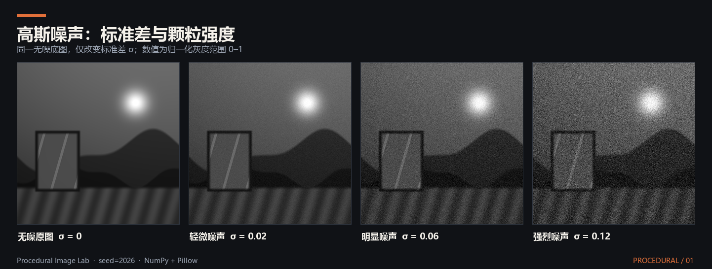

&emsp;&emsp;双边滤波是处理高斯噪声的理想选择。在图像平坦区域，像素值的差异主要由高斯噪声引起，此时双边滤波退化为高斯滤波，有效抹平高斯噪声；而在真实的图像边缘处（差异远大于 $\sigma_r$），滤波被阻断，从而完美保留了画面锐度。

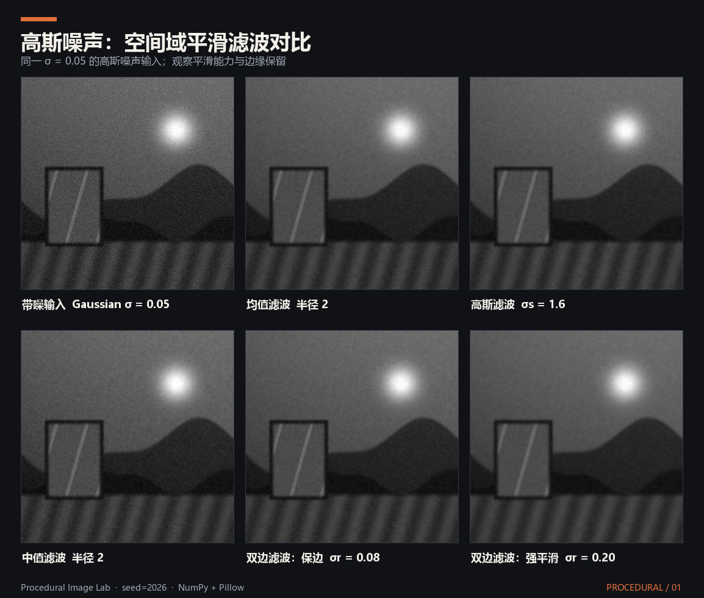

## 3、椒盐噪声（Salt-and-Pepper Noise）
&emsp;&emsp;与高斯噪声那种连续且无处不在的干扰不同，椒盐噪声，也常被称为脉冲噪声或尖峰噪声，是一种极端且离散的加性噪声。它的名字非常形象地描绘了其视觉特征：就像在图像上随机撒了一把黑色的胡椒粉和白色的盐粒。

&emsp;&emsp;在椒盐噪声的模型中，噪声并没有表现出平滑的概率分布曲线，而是表现为离散的概率跳变。最核心的特征是：它并不叠加或修改原有的像素值，而是以一定的概率直接覆盖并替换掉原有的像素值。

&emsp;&emsp;假设真实的图像信号为 $S(x,y)$，在 8-bit 的灰度图像（取值范围 0~255）中，带有椒盐噪声的图像 $I(x,y)$ 的概率分布可以表示为：
$$
I(x,y) = \begin{cases} 0 & \text{概率为 } p_1 \text{ （椒噪声，纯黑点）} \\ 255 & \text{概率为 } p_2 \text{ （盐噪声，纯白点）} \\ S(x,y) & \text{概率为 } 1 - (p_1 + p_2) \text{ （无噪声，保持原状）} \end{cases}
$$

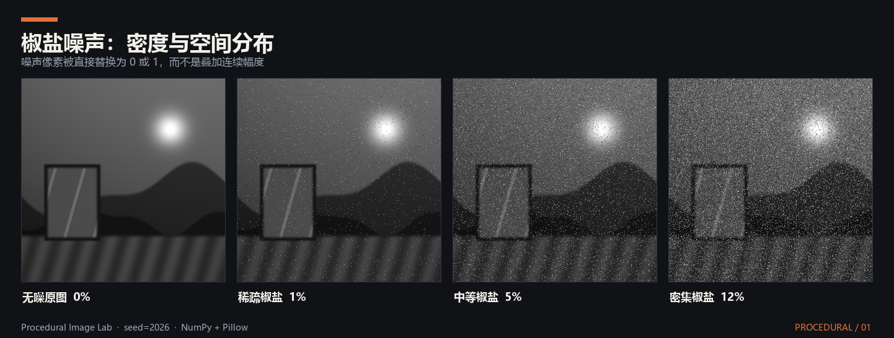

&emsp;&emsp;中值滤波是对抗椒盐噪声的最佳手段。因为中值滤波的核心思想是统计排序。在一个局部邻域内，无论椒盐噪声的值多么极端（0 或 255），在从小到大排序时，它们必定会被挤到队列的最左端或最右端。只要邻域内被污染的像素数量不超过一半，排在正中间（中位数）的必定是一个未被污染的正常像素。因此，中值滤波可以直接将椒盐噪点剔除，且极好地保留了图像边缘。

## 4、柏林噪声（Perlin Noise）
&emsp;&emsp;柏林噪声不同于高斯噪声和椒盐噪声。它是一种被有意生成的、具有特定数学规律的程序化噪声。它主要用于在计算机中模拟自然界中那种看似随机，但又连绵不断的有机纹理（如云朵、山脉、水波、大理石表面等）。

&emsp;&emsp;柏林噪声的本质是一种梯度噪声，它的核心思想是：空间中相近的点，其噪声值也应该相近，即具有空间连贯性。为了实现这一点，它不是直接生成随机的值，而是在一个空间网格的顶点上生成随机的梯度向量，然后通过平滑插值来计算网格内部任意点的值。

&emsp;&emsp;生成二维柏林噪声的经典算法可以拆解为以下四个步骤：

### 4.1、定义网格与随机梯度
&emsp;&emsp;将二维空间划分成一个个正方形网格。对于网格的每一个晶格顶点，预先分配一个随机的、长度为 1 的单位二维向量，称为梯度向量。

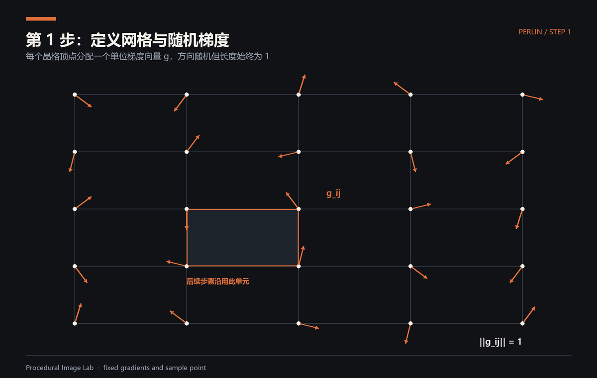

### 4.2、计算距离向量
&emsp;&emsp;对于空间中任意一个需要计算噪声值的目标点 $p(x, y)$，它必然落在一个正方形网格内。分别计算点 $p$ 到这 4 个顶点的空间向量，称为距离向量。

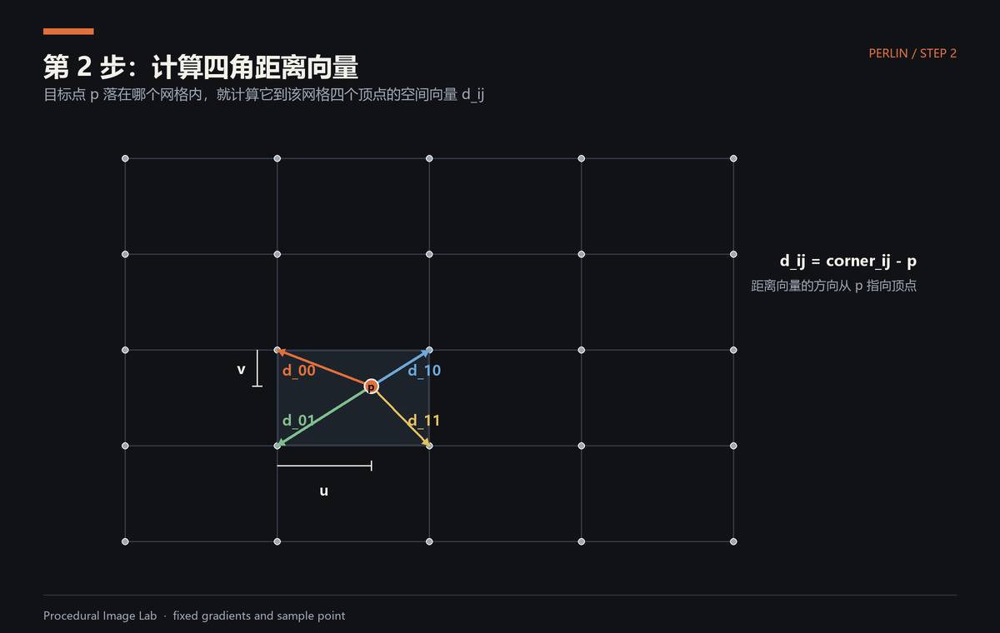

### 4.3、点乘计算影响力
&emsp;&emsp;将这 4 个顶点的梯度向量与对应的距离向量进行点乘。点乘的几何意义是求投影，结果是一个标量，代表了这 4 个顶点对点 $p$ 的影响程度。

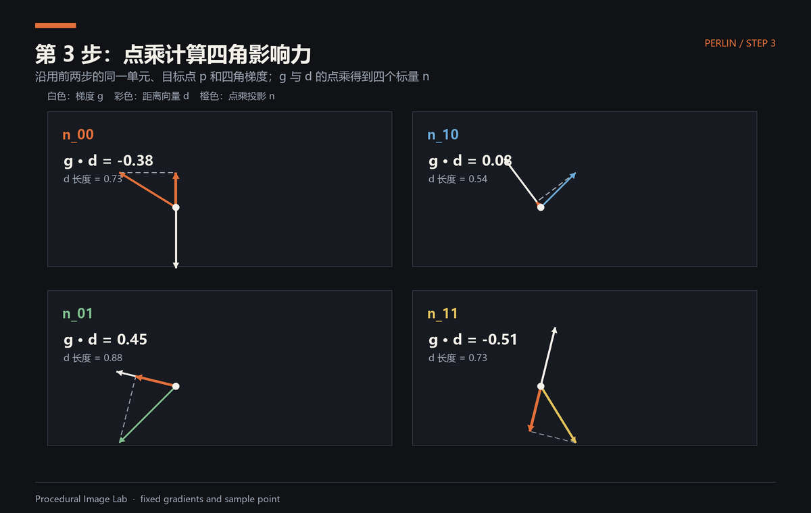

### 4.4、平滑插值
&emsp;&emsp;利用点 $p$ 在网格内的相对坐标 $(u, v)$，对这 4 个点乘结果进行双线性插值。为了保证相邻网格边界处的导数连续（没有生硬的折角），Ken Perlin 引入了一个非线性的缓入缓出函数。经典的缓入缓出函数是一个五次多项式：
$$
f(t) = 6t^5 - 15t^4 + 10t^3
$$
这个函数不仅保证了值连续，还保证了一阶导数和二阶导数在网格边界处为 0，从而实现了极其平滑的视觉过渡。

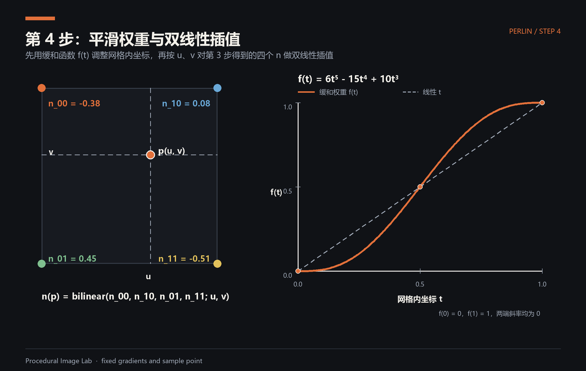

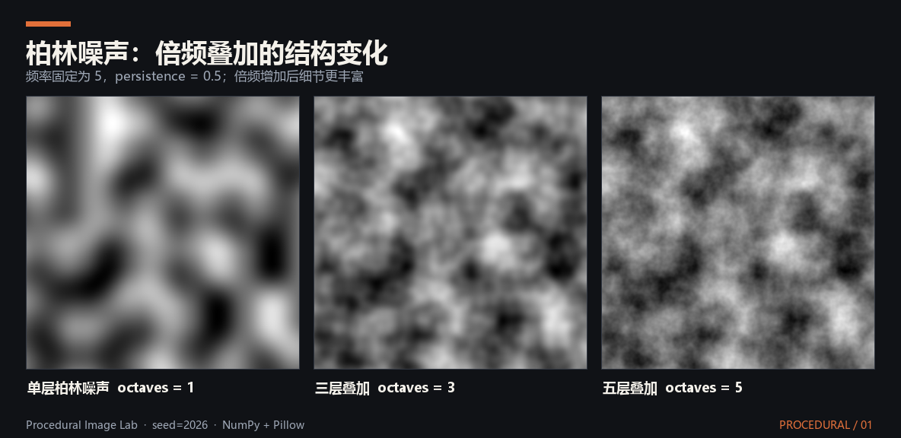

&emsp;&emsp;Perlin 噪声在实时风场中的应用见：[基于 Perlin 噪声的实时风场模拟](../../文章/计算机图形学/物理/空气动力学仿真/基于%20Perlin%20噪声的实时风场模拟.md#perlin-wind-field)。

## 5、细胞噪声（Worley Noise）
&emsp;&emsp;与柏林噪声一样，细胞噪声也属于程序化噪声。细胞噪声则擅长生成具有明显边界、呈现块状或细胞状结构的纹理，例如生物细胞、干裂的泥土、爬行动物的鳞片、鹅卵石或水底的光斑（焦散）。

&emsp;&emsp;它的核心思想是：在空间中随机撒布许多特征点。空间中任意一个像素的噪声值，取决于该像素到离它最近的特征点的距离。像素离特征点越近，往往颜色越暗（或越亮）；离特征点越远，颜色越亮（或越暗），从而在宏观上形成了一个个以特征点为中心的细胞状晶格。

&emsp;&emsp;为了极大地提高计算效率，Worley 提出了一种基于网格划分的优化算法，其基本步骤如下：

### 5.1、空间网格化与特征点生成
&emsp;&emsp;将二维空间划分为规则的方格网格。利用伪随机数生成器，在每个网格内部随机生成 1 个（或多个）特征点。

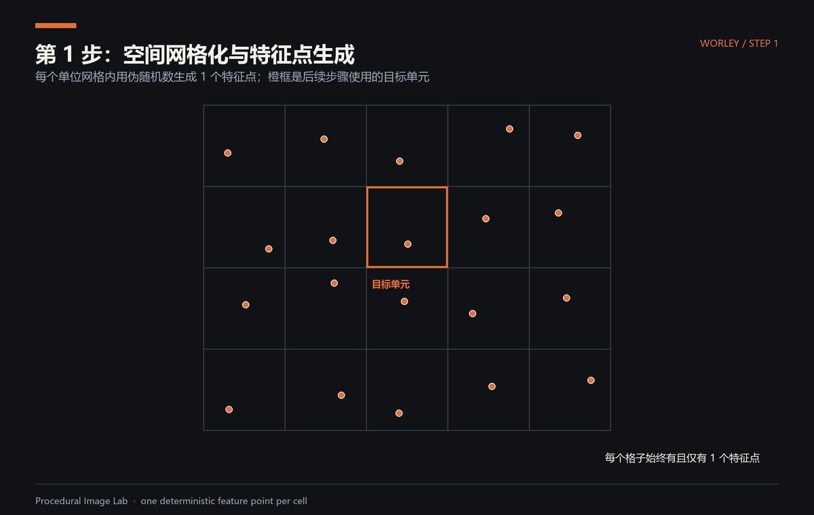

### 5.2、寻找最近的特征点
&emsp;&emsp;对于空间中任意需要计算像素值的目标点 $p(x, y)$，我们不需要遍历全局的所有特征点（计算量会爆炸）。由于网格的存在，我们只需要计算目标点 $p$ 所在的当前网格，以及其周围相邻的 8 个网格内的特征点。

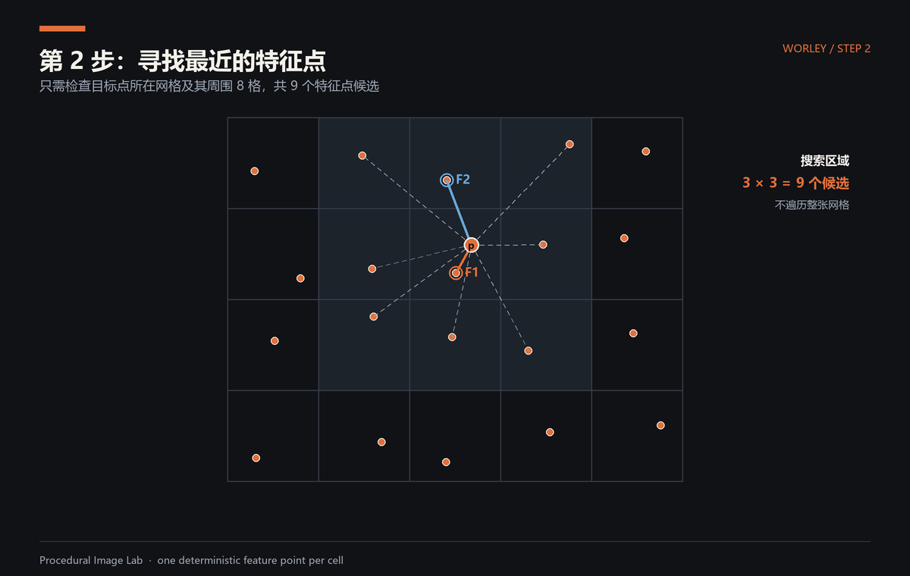

### 5.3、计算距离集合
&emsp;&emsp;计算目标点 $p$ 到这 9 个网格中所有特征点的距离，并将这些距离从小到大进行排序。我们定义：

&emsp;&emsp;$F_1$：目标点到最邻近特征点的距离。

&emsp;&emsp;$F_2$：目标点到次邻近特征点的距离。

&emsp;&emsp;$F_n$：目标点到第 $n$ 邻近特征点的距离。

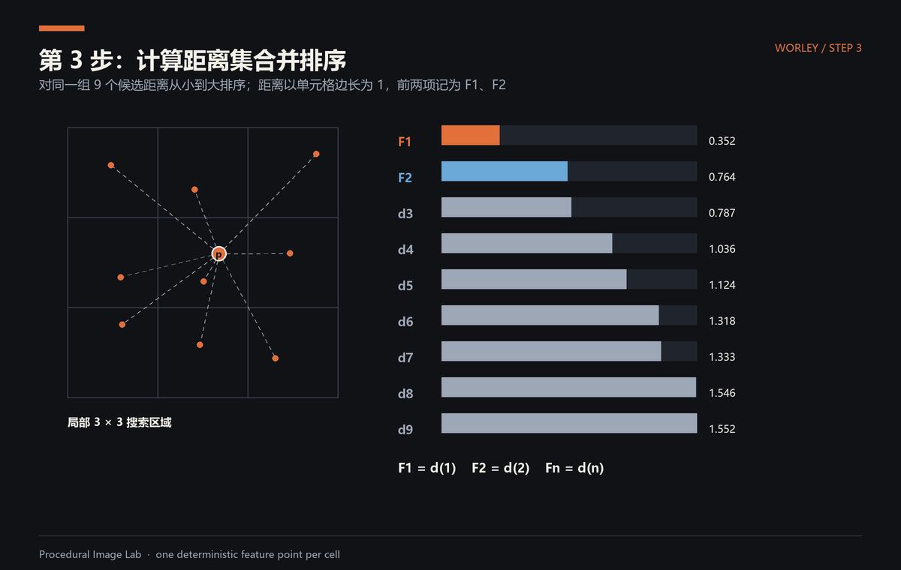

### 5.4、选择距离度量方式
&emsp;&emsp;在计算 $F_n$ 时，采用不同的距离公式，会直接改变细胞噪声的几何形状：

&emsp;&emsp;欧几里得距离： $\vert{}\vert{}p - q\vert{}\vert{} = \sqrt{(x_p - x_q)^2 + (y_p - y_q)^2}$，生成最自然的圆形/多边形细胞。

&emsp;&emsp;曼哈顿距离： $d = \vert{}x_p - x_q\vert{} + \vert{}y_p - y_q\vert{}$，生成带有正交感、类似城市街区或像素风的晶格。

&emsp;&emsp;切比雪夫距离： $d = \max(\vert{}x_p - x_q\vert{}, \vert{}y_p - y_q\vert{})$，生成正方形或长方形的晶格。

&emsp;&emsp;细胞噪声之所以强大，是因为通过对 $F_1$、$F_2$ 等参数进行简单的数学组合，就能映射出千变万化的视觉效果：

&emsp;&emsp;单独使用 $F_1$：
直接将 $F_1$ 的值映射为灰度。特征点处（距离为0）呈现黑色，向外逐渐泛白。这看起来像是一堆堆叠的黑色鹅卵石，或者是带有渐变阴影的凹坑。相反，如果使用 $1 - F_1$，则会生成类似星空或者发光细胞核的效果。

&emsp;&emsp;组合使用 $F_2 - F_1$（最经典的 Worley 边缘）：
这是一个极其巧妙的组合。当一个点处于两个特征点的正中间边界处时，$F_1$ 和 $F_2$ 几乎相等，此时 $F_2 - F_1 \approx 0$（呈现黑色）。而在靠近某个特征点内部时，$F_2$ 远大于 $F_1$，结果呈现白色。
这种数学操作直接提取出了 Voronoi 图的几何边界，在视觉上形成了锋利、干脆的黑色裂缝，也就是我们在游戏中常见的干裂的泥土、龟裂的冰面或者叶脉纹理。

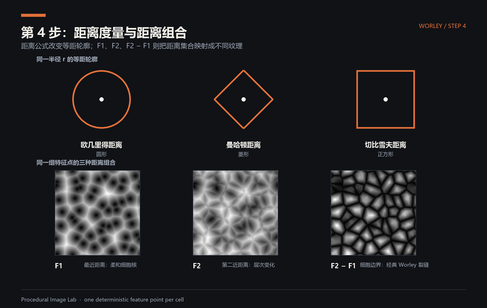

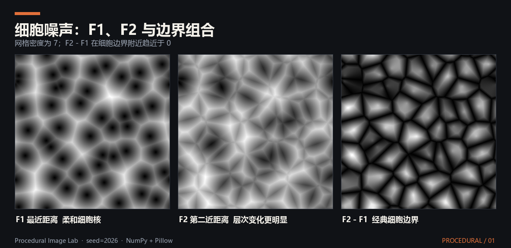

## 6、延伸阅读
- 项目：[ACN-Estimation：基于纹理—几何耦合的自然材质法线估计](../../项目/数字图像处理/ACN-Estimation：基于纹理—几何耦合的自然材质法线估计.md)
- 文章：[ACN-Estimation：基于纹理—几何耦合的自然材质法线估计](../../文章/数字图像处理/ACN-Estimation：基于纹理—几何耦合的自然材质法线估计.md)、[基于 Perlin 噪声的实时风场模拟](../../文章/计算机图形学/物理/空气动力学仿真/基于%20Perlin%20噪声的实时风场模拟.md#perlin-wind-field)
- 笔记：[滤波](滤波.md)、[滤波算子](滤波算子.md)
