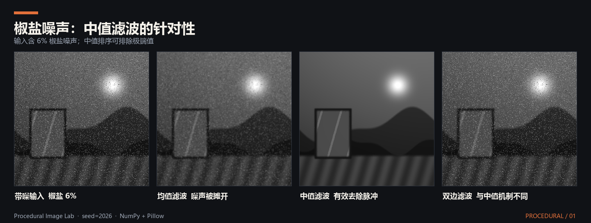
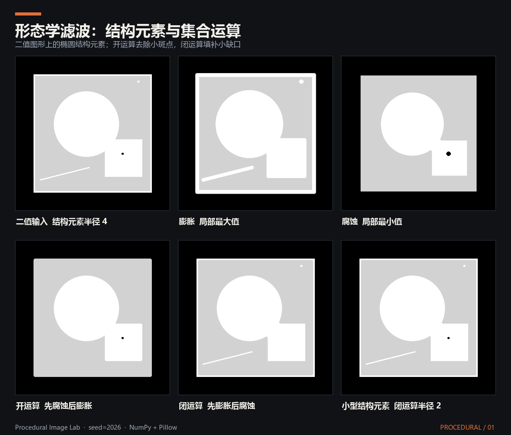

# 滤波
## 1、概念
&emsp;&emsp;滤波本质上是一种信号的特征选择与重构机制。系统按照特定的数学或逻辑规则，对输入信号的部分信息进行有选择性地保留、衰减、抑制或变换，从而输出符合预期的新信号。

## 2、均值滤波（Mean Filter）
&emsp;&emsp;均值滤波是最基础的线性空间域平滑滤波技术。它将中心像素及其局部邻域内所有像素的数值进行无差别的算术平均，以此作为该中心像素的最终输出。这种方法能有效降低图像中的高频随机噪声，但代价是会破坏图像的边缘特征，导致整体画面产生较为明显的均匀模糊现象。

&emsp;&emsp;对于图像中的任意一个目标像素 $p$ 及其对应的二维局部邻域 $S_p$（假设邻域内共有 $N$ 个像素），其经过均值滤波后的输出值 $\hat{I}_p$ 由以下离散求和公式计算得出：
$$
\hat{I}_p = \frac{1}{N} \sum_{q \in S_p} I_q
$$

&emsp;&emsp;为了与后续的高斯滤波等加权滤波器在数学形式上保持统一，我们也可以引入一个空间权重项 $f(p, q)$。在均值滤波中，对于邻域内的任意像素，该权重恒定为 1，即 $f(p, q) = 1$。因此其归一化权重 $W_p = \sum 1 = N$。此时公式可泛化为：
$$
\hat{I}_p = \frac{1}{W_p} \sum_{q \in S_p} I_q \cdot f(p, q)
$$

## 3、高斯衰减函数（Gaussian Function）
### 3.1、空间域权重函数 $f$
&emsp;&emsp;它评估的是二维屏幕空间上两点的几何距离：
$$f(\vert{}\vert{}p - q\vert{}\vert{}) = \exp \left( - \frac{\vert{}\vert{}p - q\vert{}\vert{}^2}{2\sigma_s^2} \right)$$

&emsp;&emsp;$\vert{}\vert{}p - q\vert{}\vert{}$ 表示像素 $p$ 和 $q$ 之间的欧几里得距离。

&emsp;&emsp;$\sigma_s$（空间方差）：控制模糊的物理范围。$\sigma_s$ 越大，高斯钟形曲线越平缓，远处的像素也能贡献较大的权重，整体模糊半径就越大。

### 3.2、值域权重函数 $g$
&emsp;&emsp;它评估的是两点在数据本身维度（一维深度、单通道灰度或三通道颜色）上的差异：
$$g(\vert{}\vert{}I_p - I_q\vert{}\vert{}) = \exp \left( - \frac{\vert{}\vert{}I_p - I_q\vert{}\vert{}^2}{2\sigma_r^2} \right)$$

&emsp;&emsp;$\vert{}\vert{}I_p - I_q\vert{}\vert{}$ 表示中心像素与邻居像素的差值的绝对值。

&emsp;&emsp;$\sigma_r$（值域方差）：控制对边缘的敏感度。$\sigma_r$ 决定了多大的差值会被判定为边缘。

## 4、高斯滤波（Gaussian Filter）
&emsp;&emsp;高斯滤波的数学本质是一个线性、各向同性的平滑加权平均滤波器。它的核心思想是：中心像素的最终值，仅仅取决于周围邻居像素在这个二维平面的物理距离。距离中心像素越近的邻居，其参与混合的权重就越高；距离越远，权重越低，权重的衰减严格服从二维高斯分布。

&emsp;&emsp;对于图像中的任意一个目标像素 $p$，其经过高斯滤波后的输出值 $\hat{I}_p$ 由以下离散卷积公式计算得出：
$$\hat{I}_p = \frac{1}{W_p} \sum_{q \in S} I_q \cdot f(\vert{}\vert{}p - q\vert{}\vert{})$$

&emsp;&emsp;归一化权重 $W_p$：
$$W_p = \sum_{q \in S} f(\vert{}\vert{}p - q\vert{}\vert{})$$

## 5、双边滤波（Bilateral Filter）
&emsp;&emsp;双边滤波的数学本质是一个非线性、保边的加权平均滤波器。它的核心思想是：中心像素的最终值，不仅取决于周围邻居像素在这个二维平面的物理距离，还取决于邻居像素与中心像素在数值大小上的差异。

&emsp;&emsp;对于图像中的任意一个目标像素 $p$，其经过双边滤波后的输出值 $\hat{I}_p$ 由以下离散卷积公式计算得出：
$$\hat{I}_p = \frac{1}{W_p} \sum_{q \in S} I_q \cdot f(\vert{}\vert{}p - q\vert{}\vert{}) \cdot g(\vert{}\vert{}I_p - I_q\vert{}\vert{})$$

&emsp;&emsp;归一化权重 $W_p$：
$$W_p = \sum_{q \in S} f(\vert{}\vert{}p - q\vert{}\vert{}) \cdot g(\vert{}\vert{}I_p - I_q\vert{}\vert{})$$

## 6、中值滤波（Median Filter）
&emsp;&emsp;中值滤波是一种经典的非线性空间域滤波技术。与高斯滤波或均值滤波依赖数学上的加权平均不同，中值滤波的核心思想是统计排序：它提取中心像素及其局部邻域内的所有像素值，将它们按数值大小进行排列，然后直接选取排序后的中位数作为中心像素的最终输出。

&emsp;&emsp;对于图像中的任意一个目标像素 $p$ 及其对应的二维邻域 $S_p$，经过中值滤波后的输出值 $\hat{I}_p$ 表示为：
$$
\hat{I}_p = \text{median} \{ I_q \mid q \in S_p \}
$$

## 7、形态学滤波（Morphological Filter）
&emsp;&emsp;形态学滤波是一种基于集合论和局部极值的非线性空间域滤波技术。与依赖加权平均的线性滤波不同，它通过让一个预先定义好形状的结构元素在图像上滑动，并进行逻辑极值运算，来提取图像的几何结构特征或消除特定形态的噪点。

&emsp;&emsp;结构元素：在形态学滤波中扮演着类似卷积核的角色。它不仅定义了邻域的大小，还规定了邻域的物理形状（如矩形、十字交叉形、圆形等）。

### 7.1、基础操作：膨胀与腐蚀
&emsp;&emsp;膨胀（Dilation）：本质是求局部最大值。它提取结构元素覆盖的邻域内的所有像素值，将最大值作为中心像素的输出。在二值图像中，只要邻域内存在白色像素，输出即为白色。它能使高亮目标区域向外扩张，常用于填补目标内部的细小孔洞或连接断裂的相邻目标：
$$
\hat{I}_p = \max \{ I_q \mid q \in S_p \}
$$

&emsp;&emsp;腐蚀（Erosion）：本质是求局部最小值。它提取结构元素覆盖的邻域内的所有像素值，将最小值作为中心像素的输出。在二值图像中，只有邻域内所有像素均为白色时，输出才保持白色。它能使高亮目标区域向内收缩，常用于消除孤立的亮噪点（如盐粒噪声）或剥离目标边缘的毛刺：
$$
\hat{I}_p = \min \{ I_q \mid q \in S_p \}
$$

### 7.2、复合操作：开运算与闭运算
&emsp;&emsp;由于单一的膨胀或腐蚀会改变目标物体的整体面积，工程上通常将两者组合使用，形成更高级的滤波算子：

&emsp;&emsp;开运算（Opening）：先对图像进行腐蚀操作，紧接着进行膨胀操作。它能在不显著改变主体面积的前提下，断开狭窄的连接处、消除微小的凸起或去除细小的孤立高亮噪点。

&emsp;&emsp;闭运算（Closing）：先对图像进行膨胀操作，紧接着进行腐蚀操作。它能在不显著改变主体面积的前提下，弥合狭窄的裂缝、填补细长的沟壑或消除目标内部的细小黑色孔洞。

### 7.3、进阶操作：基于连通分量的属性开运算
&emsp;&emsp;传统的形态学开运算依赖预先定义的、固定形状的结构元素，这在处理形状多变、弯曲或局部断裂的结构时难以适应。为了克服这一局限，工程上常使用基于目标自身几何特征的属性开运算。

&emsp;&emsp;属性开运算不再使用刚性的结构元素在图像上滑动，而是按连通分量的具体属性进行条件筛选。其核心步骤与数学表达如下：

&emsp;&emsp;连通分量提取：首先提取前景集合 $S$，随后利用邻域连通分量分析，将前景集合划分为若干个互不相交的连通子集 $C_i$：
$$
S=\bigcup_{i=1}^{n}C_i, \qquad C_i\cap C_j=\varnothing\quad(i\ne j)
$$

&emsp;&emsp;属性条件判定：计算每一个连通分量 $C_i$ 的几何属性参数，并定义一个属性判定函数 $\gamma(C_i)$。以提取横向条纹为例，要求连通分量的外接矩形宽度 $W(C_i)$ 大于最小宽度阈值 $T_{\mathrm{width}}$，且长宽比大于设定阈值 $T_{\mathrm{ar}}$：
$$
\gamma(C_i)= \begin{cases} 1, & W(C_i)>T_{\mathrm{width}} \ \land\ \dfrac{W(C_i)}{H(C_i)}>T_{\mathrm{ar}},\\ 0, & \text{else} \end{cases}
$$

&emsp;&emsp;特征筛选与重构：只有满足条件（$\gamma(C_i)=1$）的连通分量才会被保留并合并为有效特征集合（Feature Mask），其余不满足条件的连通分量则被抛弃：
$$\mathrm{Feature\_Mask}= \bigcup\left\{ C_i\mid\gamma(C_i)=1 \right\}$$

## 8、延伸阅读
- 项目：[ACN-Estimation：基于纹理—几何耦合的自然材质法线估计](../../项目/数字图像处理/ACN-Estimation：基于纹理—几何耦合的自然材质法线估计.md)
- 文章：[ACN-Estimation：基于纹理—几何耦合的自然材质法线估计](../../文章/数字图像处理/ACN-Estimation：基于纹理—几何耦合的自然材质法线估计.md)
- 笔记：[噪声](噪声.md)、[滤波算子](滤波算子.md)
