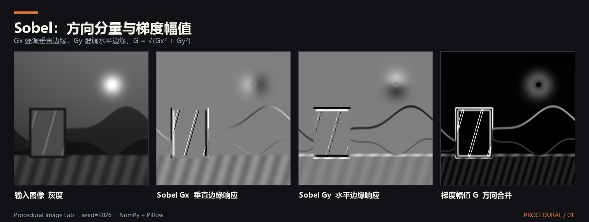
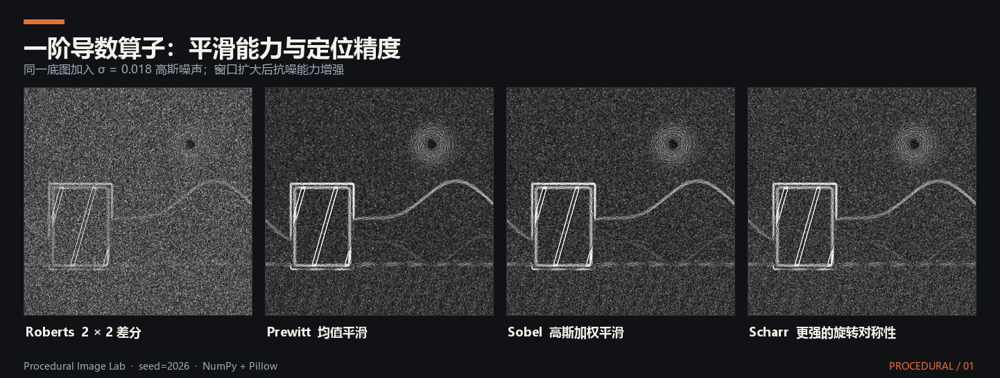
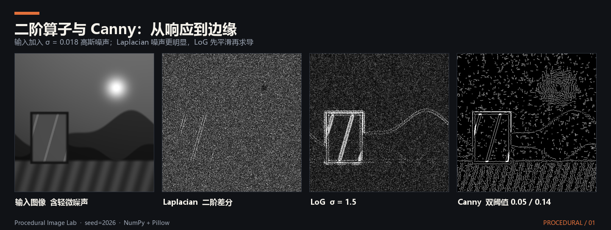

# 滤波算子
## 概念
&emsp;&emsp;滤波算子通常特指那些用于特征提取的小型离散卷积核。它们通过在图像的二维像素网格上滑动，执行局部加权求和，从而提取出图像的几何结构信息。

## 一阶导数算子
&emsp;&emsp;一阶导数算子通过计算图像像素在 $x$ 方向和 $y$ 方向的灰度变化率来定位边缘。

### Roberts 算子（罗伯茨算子）
&emsp;&emsp;这是最古老、最简单的一阶边缘检测算子，也称为交叉微分算法。它利用局部 $2 \times 2$ 邻域内对角线方向像素的差分来近似梯度。

&emsp;&emsp;水平与垂直卷积核：
$$G_x = \begin{bmatrix} 1 & 0 \\ 0 & -1 \end{bmatrix}, \quad G_y = \begin{bmatrix} 0 & 1 \\ -1 & 0 \end{bmatrix}$$

&emsp;&emsp;计算极其迅速。但由于其卷积核只有 $2 \times 2$ 大小，没有平滑作用，因此对噪声极度敏感。它只适用于处理那些本身没有噪声、且边缘极其陡峭清晰的理想图像。

### Prewitt 算子（普瑞特算子）
&emsp;&emsp;为了缓解 Roberts 算子对噪声敏感的问题，Prewitt 算子将卷积核扩大到了 $3 \times 3$。它的巧妙之处在于：在计算一个方向的差分时，会在另一个方向上进行均值平滑。

&emsp;&emsp;水平与垂直卷积核：
$$
G_x = \begin{bmatrix} -1 & 0 & 1 \\ -1 & 0 & 1 \\ -1 & 0 & 1 \end{bmatrix}, \quad G_y = \begin{bmatrix} -1 & -1 & -1 \\ 0 & 0 & 0 \\ 1 & 1 & 1 \end{bmatrix}
$$

&emsp;&emsp;$G_x$ 用于检测垂直边缘，$G_y$ 用于检测水平边缘。它对噪声有了一定的抑制能力，但由于使用的是无差别的均值平滑，提取出的边缘往往比较宽、不够精细。

### Sobel 算子（索贝尔算子）
&emsp;&emsp;Sobel 算子是工程界最经典、最常用的边缘检测算子。它在 Prewitt 算子的基础上进行了优化，将“均值平滑”替换为了“高斯加权平滑”。

&emsp;&emsp;水平与垂直卷积核：
$$
G_x = \begin{bmatrix} -1 & 0 & 1 \\ -2 & 0 & 2 \\ -1 & 0 & 1 \end{bmatrix}, \quad G_y = \begin{bmatrix} -1 & -2 & -1 \\ 0 & 0 & 0 \\ 1 & 2 & 1 \end{bmatrix}
$$
注意中间一行的权重从 1 变成了 2。这意味着它认为距离中心越近的像素，对梯度的贡献越大。这种类似高斯分布的权重赋予了 Sobel 算子极佳的抗噪性能，同时提取出的边缘也比 Prewitt 更锐利。

### Scharr 算子（沙尔算子）
&emsp;&emsp;Scharr 算子是 Sobel 算子的进阶版本。Sobel 算子虽然好用，但在计算对角线方向的梯度时，其旋转对称性不够完美，存在一定的误差。Scharr 算子通过调整权重解决了这个问题。

&emsp;&emsp;水平卷积核（垂直方向同理）：
$$
G_x = \begin{bmatrix} -3 & 0 & 3 \\ -10 & 0 & 10 \\ -3 & 0 & 3 \end{bmatrix}
$$
它对极其微小的灰度变化更加敏感，梯度角度的计算也更精确。通常在需要高精度计算图像深度或光流时替代 Sobel 算子使用。

## 二阶导数算子
&emsp;&emsp;一阶导数寻找的是梯度的极值，而二阶导数寻找的是梯度的零交叉点。二阶算子通常是各向同性的，即一个卷积核就能检测所有方向的边缘，不需要分 $X$ 和 $Y$ 两个方向。

### Laplacian 算子（拉普拉斯算子）
&emsp;&emsp;经典 $3 \times 3$ 卷积核：
$$
\begin{bmatrix} 0 & 1 & 0 \\ 1 & -4 & 1 \\ 0 & 1 & 0 \end{bmatrix} \quad \text{或包含对角线的} \quad \begin{bmatrix} 1 & 1 & 1 \\ 1 & -8 & 1 \\ 1 & 1 & 1 \end{bmatrix}
$$

&emsp;&emsp;对像素的突变极其敏感，能描绘出非常细致的轮廓。但它的致命弱点是会将所有的高斯噪声和高频干扰放大，导致提取出的边缘充满孤立的噪点。因此，它极少单独直接作用于原图。

### LoG 算子（高斯拉普拉斯算子）
&emsp;&emsp;为了解决 Laplacian 算子对噪声极度敏感的问题，Marr 和 Hildreth 提出了 LoG 算子，又被称为“墨西哥帽算子”（Mexican Hat Operator，因其三维函数图像形似一顶宽沿宽帽）。

&emsp;&emsp;它的核心思想是先平滑，后求导：先用高斯滤波器对图像进行平滑去噪，然后再对其结果应用拉普拉斯算子提取边缘。根据微积分的线性性质，这可以合并为一个单独的卷积核计算：
$$
\nabla^2 (G(x,y) * I(x,y)) = (\nabla^2 G(x,y)) * I(x,y)
$$
它完美结合了高斯滤波的抗噪特性和拉普拉斯滤波的精细边缘定位能力。由于其检测出的闭合边缘非常准确，常用于医学图像处理和斑点检测。

## 复合算法边缘算子
### Canny 算子（坎尼算子）
&emsp;&emsp;Canny 算子并不是单一的卷积矩阵，而是一套多阶段的边缘检测算法流水线，旨在实现低错误率、高定位精度和单一边缘响应。其核心流程分为四个标准步骤：

&emsp;&emsp;高斯滤波去噪：由于导数运算对噪声极度敏感，首先必须对原图像 $I(x,y)$ 应用高斯滤波器进行平滑处理，消除高斯噪声和高频干扰：
$$
S(x,y) = G(x,y) * I(x,y)
$$

&emsp;&emsp;计算梯度幅值与方向：使用一阶微分算子（通常为 Sobel 算子）计算平滑图像的水平和垂直梯度 $G_x$ 与 $G_y$，进而合成总梯度幅值 $G$ 与梯度方向 $\theta$：
$$
G = \sqrt{G_x^2 + G_y^2}, \quad \theta = \arctan \left( \frac{G_y}{G_x} \right)
$$

&emsp;&emsp;非极大值抑制（NMS）：为满足单一边缘响应，需对模糊粗大的边缘进行瘦身。算法会遍历每个像素，若其梯度幅值在沿梯度方向（近似量化为 0°、45°、90°、135°）的局部相邻像素中不是最大值，则说明它处于边缘过渡带，直接将其剔除（强制归零）。

&emsp;&emsp;双阈值检测与滞后边缘跟踪：引入高、低双阈值（$T_{high}$ 和 $T_{low}$）以精确筛选边缘：

&emsp;&emsp;强边缘（$G > T_{high}$）：确认为真实边缘，绝对保留。

&emsp;&emsp;非边缘（$G < T_{low}$）：确认为噪声伪影，彻底抛弃。

&emsp;&emsp;弱边缘（$T_{low} \le G \le T_{high}$）：进行滞后连通性跟踪。仅当该像素在 8 邻域内与强边缘连通时，才视作真实边缘延伸予以保留；否则作为孤立噪点剔除。

## 延伸阅读
- 项目：[ACN-Estimation：基于纹理—几何耦合的自然材质法线估计](../../项目/数字图像处理/ACN-Estimation：基于纹理—几何耦合的自然材质法线估计.md)
- 文章：[ACN-Estimation：基于纹理—几何耦合的自然材质法线估计](../../文章/数字图像处理/ACN-Estimation：基于纹理—几何耦合的自然材质法线估计.md)
- 笔记：[噪声](噪声.md)、[滤波](滤波.md)
