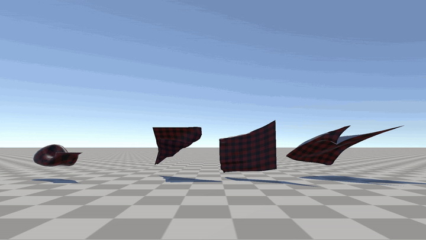
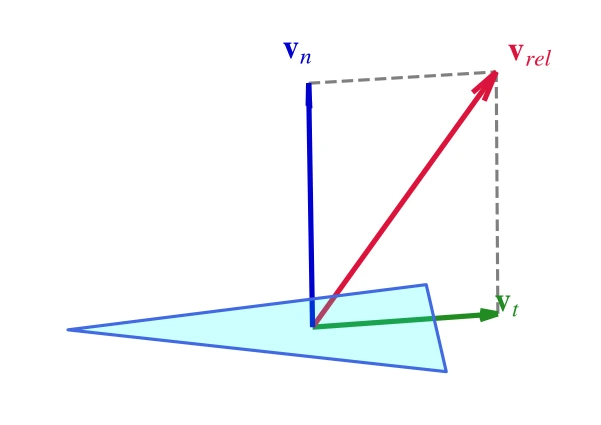
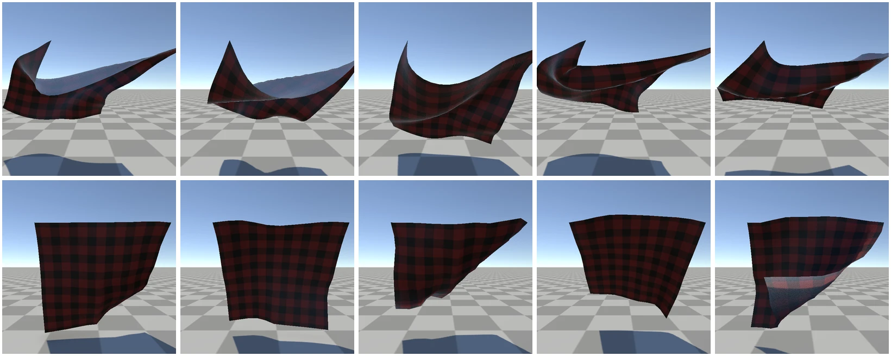

# 基于 Perlin 噪声的实时风场模拟
&emsp;&emsp;实时风场通常不需要在每一帧求解完整的 Navier-Stokes 方程，更实用的做法是先构造一个风速场，再把局部风速转换为不同几何体上的气动力。本文以 Perlin 噪声合成湍流方向，并用二次阻力模型为网格布料与骨骼代理计算气动力。

<p align="center">
  
</p>

## 1、风速场模型
### 1.1、定义
&emsp;&emsp;空间位置 $\mathbf{x}$ 在时间 $t$ 的瞬时风速定义为：
$$
\mathbf{u}(\mathbf{x},t)=s\,G(t)\,Z(\mathbf{x})\frac{\mathbf{d}+\mathbf{n}_{turb}(\mathbf{x},t)}{\left\|\mathbf{d}+\mathbf{n}_{turb}(\mathbf{x},t)\right\|}
$$
其中 $s$ 为基准风速，$\mathbf{d}$ 为归一化基准风向，$\mathbf{n}_{turb}$ 为 Perlin 噪声产生的方向扰动，$G(t)$ 为阵风倍率，$Z(\mathbf{x})$ 为风场包围盒的区域衰减系数。

```csharp
public Vector3 SampleWindVelocity(Vector3 worldPos, float time)
{
    float zoneFactor = 1f;
    if (useZone)
    {
        // 区域外直接返回零风
        zoneFactor = WindFieldMathUtility.ZoneFactor(
            worldPos - transform.position, zoneSize, zoneFalloff);
        if (zoneFactor <= 0f) return Vector3.zero;
    }

    // Perlin 扰动决定局部风向
    Vector3 dir = WindFieldMathUtility.TurbulentDirection(
        direction, worldPos, time, turbulence, turbulenceScale);

    // 阵风只改变风速幅值
    float gust = WindFieldMathUtility.GustFactor(
        time, gustFrequency, gustAmount, _gustPhase);

    // 合成最终风速
    return dir * (windSpeed * gust * zoneFactor);
}
```

### 1.2、Perlin 湍流方向
&emsp;&emsp;随机数采样会让风向在帧与帧之间跳变，Perlin 噪声则能在空间和时间上给出连续过渡。实现分别对 X、Y、Z 方向采样三组二维 Perlin 噪声，将结果映射到 $[-0.5,0.5]$，再把噪声向量叠加到基准风向上并重新归一化。

```csharp
public static Vector3 TurbulentDirection(
    Vector3 baseDirection, Vector3 worldPos, float time,
    float turbulence, float scale)
{
    Vector3 dir = baseDirection.sqrMagnitude > 1e-6f
        ? baseDirection.normalized
        : Vector3.right;
    if (turbulence <= 0f) return dir;

    // 时间项让扰动连续演化
    float t = time * 0.6f;

    // 三组噪声映射到 [-0.5, 0.5]
    float nx = Mathf.PerlinNoise(worldPos.x * scale + t, worldPos.y * scale) - 0.5f;
    float ny = Mathf.PerlinNoise(worldPos.y * scale - t, worldPos.z * scale) - 0.5f;
    float nz = Mathf.PerlinNoise(worldPos.z * scale + t, worldPos.x * scale) - 0.5f;

    // 叠加扰动并重新归一化
    dir += new Vector3(nx, ny, nz) * (turbulence * 2f);
    dir.Normalize();
    return dir;
}
```

<a id="perlin-wind-field"></a>

&emsp;&emsp;Perlin 噪声的网格梯度与插值过程见：[噪声](../../../../笔记/数字图像处理/噪声.md#柏林噪声-perlin-noise)。

### 1.3、阵风与区域衰减
&emsp;&emsp;阵风用一个带确定相位的正弦函数改变风速倍率：
$$
G(t)=1+A\sin(2\pi ft+\phi)
$$
其中 $A$ 为阵风幅度，$f$ 为频率，$\phi$ 为初相位。当 $A\in[0,1]$ 时，风速倍率会在 $1-A$ 到 $1+A$ 之间变化。

&emsp;&emsp;AABB 区域衰减由 `ZoneFactor` 计算。包围盒内部保留一段满强度区域，靠近边界时三个轴分别线性衰减，再将三个系数相乘。这样风场不会在边界处突然从满风切换为零。

```csharp
public static float ZoneFactor(Vector3 local, Vector3 zoneSize, float falloff)
{
    Vector3 half = zoneSize * 0.5f;
    float f = 1f;

    for (int i = 0; i < 3; i++)
    {
        float d = Mathf.Abs(local[i]);
        if (d > half[i]) return 0f;

        // 仅在接近边界时做线性衰减
        float inner = half[i] - falloff;
        if (inner > 0f && d > inner)
            f *= 1f - (d - inner) / falloff;
    }

    // 三轴系数相乘
    return f;
}
```

## 2、风阻模型
### 2.1、二次阻力
&emsp;&emsp;空气动力学中的二次阻力定律写作：
$$
\mathbf{F}_d=-\frac{1}{2}\rho C_d A\left\|\mathbf{v}_{rel}\right\|\mathbf{v}_{rel}
$$
其中 $\rho$ 为空气密度，$C_d$ 为阻力系数，$A$ 为迎风面积，$\mathbf{v}_{rel}$ 为物体与空气的相对速度。项目将 $\dfrac{1}{2}\rho C_d$ 合并进可调系数，并把相对速度拆成法向和切向分量，分别控制“兜风”和“掠风”两种表现。

<p align="center">
  
</p>

&emsp;&emsp;设面片法线为 $\mathbf{n}$，则：
$$
\mathbf{v}_n=(\mathbf{v}_{rel}\cdot\mathbf{n})\mathbf{n}
$$
$$
\mathbf{v}_t=\mathbf{v}_{rel}-\mathbf{v}_n
$$

### 2.2、网格布料
&emsp;&emsp;对于三角网格，程序在面片质心处采样风速，以三个顶点的平均速度作为面片速度，并按面积与法向计算气动力：
$$
\mathbf{F}_{mesh}=-A\left(C_n\|\mathbf{v}_n\|\mathbf{v}_n+C_t\|\mathbf{v}_t\|\mathbf{v}_t\right)
$$
其中 $C_n$ 和 $C_t$ 分别对应法向阻力与切向阻力。法向项决定布面被风吹起、鼓包和翻面的强度，切向项则模拟气流沿布面滑过时的拖拽。

&emsp;&emsp;两个方向共用同一段 `DragDelta` 数学。`TriangleAeroDelta` 在此基础上乘面积，并按三角形三个动态顶点的总质量换算成速度增量。

```csharp
public static Vector3 DragDelta(
    Vector3 vRel, Vector3 normal, float kN, float kT, float dt)
{
    // 法向分量负责兜风，切向分量负责沿面拖拽
    Vector3 vn = Vector3.Dot(vRel, normal) * normal;
    Vector3 vt = vRel - vn;

    // 两个方向均使用二次阻力
    return -(kN * vn.magnitude * vn + kT * vt.magnitude * vt) * dt;
}

public static Vector3 TriangleAeroDelta(
    Vector3 vRel, Vector3 normal, float area,
    float kN, float kT, float dt, float totalMass)
{
    if (totalMass < 1e-9f) return Vector3.zero;

    // 面积 × 单位面积阻力 / 总质量
    return area * XPBD_MathUtil.DragDelta(vRel, normal, kN, kT, 1f)
        * (dt / totalMass);
}
```

&emsp;&emsp;`ApplyAeroDrag` 会逐三角形计算法线、面积、平均速度与总质量，再把同一个速度增量写入三个仍在运动的顶点。固定点被视为无穷大质量，不接收速度增量。

```csharp
private void ApplyAeroDrag(XPBD_Body body, int[] tris, float dt)
{
    Vector3[] X = body.X, V = body.V;
    float[] invMass = body.invMass;
    ...

    // 逐三角形计算风力
    for (int t = 0; t < tris.Length / 3; t++)
    {
        int i0 = tris[t * 3], i1 = tris[t * 3 + 1], i2 = tris[t * 3 + 2];

        // 叉乘长度 = 2 × 面积
        Vector3 nVec = Vector3.Cross(X[i1] - X[i0], X[i2] - X[i0]);
        float area2 = nVec.magnitude;
        if (area2 < 1e-9f) continue;
        Vector3 n = nVec / area2;
        float area = area2 * 0.5f;

        // 质心风速与面片平均速度
        ...
        Vector3 u = SampleWindVelocity(centroid, time);
        Vector3 vRel = vTri - u;

        // 三个动态顶点的总质量
        ...
        float mTotal = m0 + m1 + m2;
        if (mTotal < 1e-9f) continue;

        // 面积与质量换算为速度增量
        Vector3 dv = WindFieldMathUtility.TriangleAeroDelta(
            vRel, n, area, dragCoefficient,
            tangentialDragCoefficient, dt, mTotal);

        // 固定点不接收速度增量
        if (invMass[i0] > 0f) V[i0] += dv;
        if (invMass[i1] > 0f) V[i1] += dv;
        if (invMass[i2] > 0f) V[i2] += dv;
    }
}
```

### 2.3、骨骼代理
&emsp;&emsp;规则网格形式的骨骼代理不逐个三角形处理，而是把每根骨骼视作一个带代理面积的面元。法线取相邻骨骼面片的平均方向，只保留相对速度的法向分量：
$$
\mathbf{F}_{bone}=-A_{bone}C_{bone}\left|v_n\right|v_n\mathbf{n}
$$
其中 $v_n=\mathbf{v}_{rel}\cdot\mathbf{n}$。

```csharp
public static Vector3 BoneNormalDragDelta(
    Vector3 vRel, Vector3 normal, float dragFactor)
{
    // 有符号法向速度决定阻力方向，abs(vDotN) * vDotN 提供二次阻力大小
    float vDotN = Vector3.Dot(vRel, normal);
    return -dragFactor * Mathf.Abs(vDotN) * vDotN * normal;
}
```

&emsp;&emsp;实际的骨骼施力函数如下。它遍历每根动态骨骼，采样其当前位置的风速，再用骨骼代理法线与相对速度计算法向阻力：

```csharp
private void ApplyBoneDrag(XPBD_Body body, float dt)
{
    Vector3[] X = body.X, V = body.V;
    float[] invMass = body.invMass;
    ...

    // 预计算代理面片的阻力因子
    float patchArea = ((XPBD_BoneBody)body).BonePatchArea;
    float dragFactor = patchArea * boneDragCoefficient;

    for (int i = 0; i < X.Length; i++)
    {
        if (invMass[i] <= 0f) continue;

        // 采样局部风速
        Vector3 u = SampleWindVelocity(X[i], time);
        if (u.sqrMagnitude < 1e-12f) continue;

        // 法向阻力速度增量
        Vector3 n = ((XPBD_BoneBody)body).GetBoneNormal(i);
        Vector3 vRel = V[i] - u;
        V[i] += WindFieldMathUtility.BoneNormalDragDelta(
            vRel, n, dragFactor) * (dt * invMass[i]);
    }
}
```

## 3、在 XPBD 求解器中的位置
&emsp;&emsp;风场作用发生在位置预测之前。求解器先刷新角色产生的近场气流与叶片气动，再对每个 Body 依次执行动画混合、全局风场、局部风阻和位置预测。这样风力先进入速度，随后才参与半隐式积分、约束投影与碰撞修正，不会绕过 XPBD 的约束系统。

```csharp
// 动画驱动先于物理外力
body.ApplyAnimationBlend();

// 同一 Body 可以依次叠加多个风场
for (int w = 0; w < windFields.Count; w++)
{
    var wind = windFields[w];
    if (wind == null || !wind.isActiveAndEnabled) continue;

    // 全局风场 → 当前 Body 的速度增量
    wind.ApplyTo(body, dt);
}

// 局部风阻之后才进入位置预测
body.ApplyAirDrag(dt);
PredictPositions(body, dt);

// 固定点在预测后恢复目标位置
body.FixEndpoints(dt);
```

&emsp;&emsp;全局风场与局部风阻的顺序也不能随意交换。全局风场回答“当前空间里空气如何流动”，局部风阻回答“物体相对于当前空气如何运动”，两者都应在预测位置之前折算为速度变化。

## 4、结果对照
<p align="center">
  
</p>

&emsp;&emsp;上排是 $21\times21$ 网格分辨率的各向同性布料，下排是由 $5\times5$ 骨骼代理驱动的蒙皮布料。两排每隔 30 帧取一帧，共展示 5 个时刻。

&emsp;&emsp;网格布料能够表现更细的局部褶皱与翻卷，骨骼代理则以更少的状态量给出低频、整体化的弯曲响应。两者共享同一条风速采样的采样口径，但根据几何形式选择不同的阻力计算路径。

## 5、延伸阅读
- 项目：Unity 实时柔性体与粒子流体系统（暂未上线）
- 笔记：[噪声](<../../../../笔记/数字图像处理/噪声.md>)
