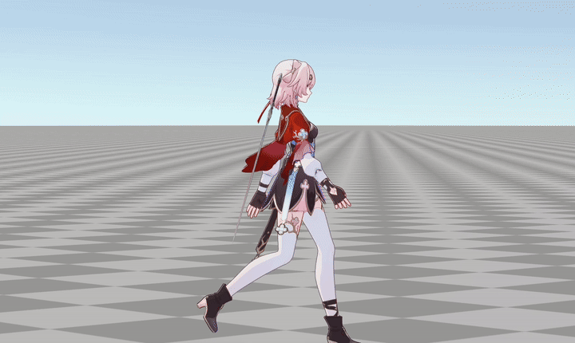
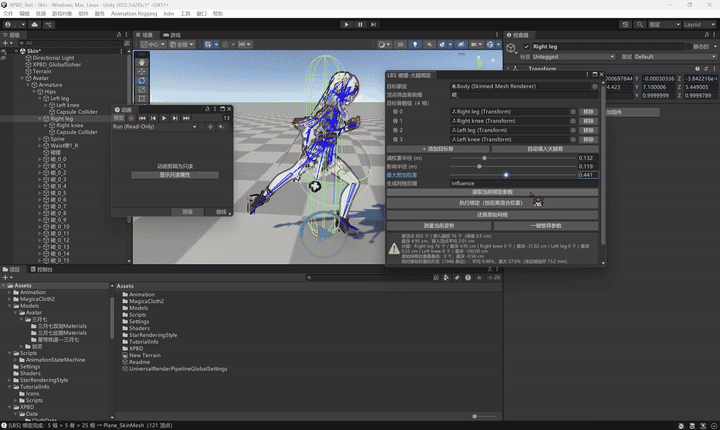
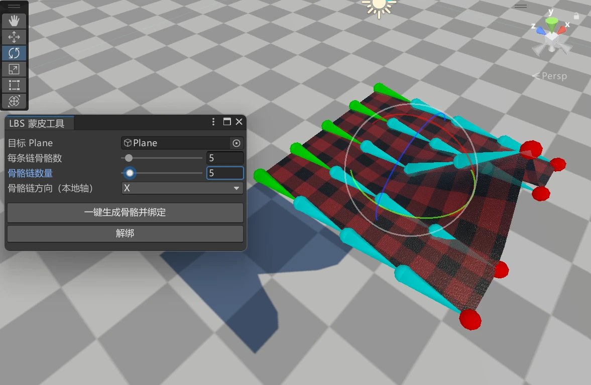
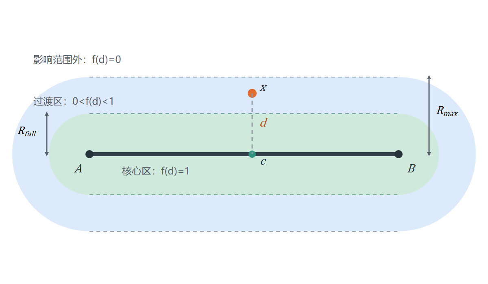
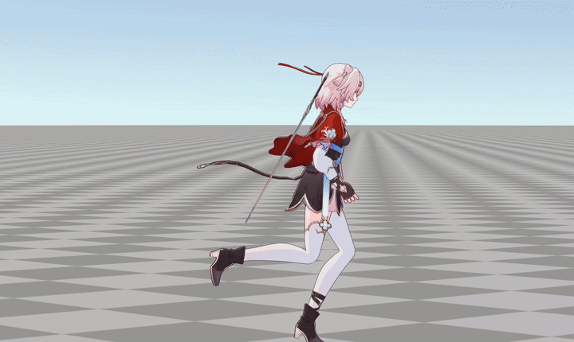

# 基于 LBS 的裙摆防穿模工具
&emsp;&emsp;本文基于线性混合蒙皮（LBS），实现两套面向裙摆的蒙皮工具：一套从结构化网格自动生成骨骼链、权重与蒙皮网格，另一套通过大腿骨骼影响修正裙摆权重，以较低成本抑制角色运动中的穿模 [1]。

<table>
  <tr>
    <td style="width: 50%; padding-right: 6px;">
      
    </td>
    <td style="width: 50%; padding-left: 6px;">
      
    </td>
  </tr>
</table>

## 参考文献
1. Jacobson, A., Deng, Z., Kavan, L., & Lewis, J. P. Skinning: Real-time Shape Deformation. *ACM SIGGRAPH 2014 Courses*, 2014: 1–22.

## 1、结构化网格蒙皮工具
### 1.1、包围盒参数化
&emsp;&emsp;自动工具以结构化网格为输入。为了减少权重的搜索维度，工具先取网格局部 AABB，以骨骼延伸方向为主轴 $a$，从剩余两轴中选择尺寸较大者为次轴 $s$，把三维顶点映射到二维参数空间。设顶点在两根轴上的坐标为 $x_a$ 与 $x_s$，则：
$$
u=\operatorname{clamp}\left(\frac{x_a-A_{min}}{A_{max}-A_{min}},0,1\right)
$$
$$
v=\operatorname{clamp}\left(\frac{x_s-S_{min}}{S_{max}-S_{min}},0,1\right)
$$
这样得到的 $u$ 与 $v$ 只描述顶点沿骨骼链和横向链的位置，与网格的具体三角剖分无关。

```csharp
private static bool TryCalculateAxes(Bounds bounds, int primaryAxis,
    out int spreadAxis, out BoundsData boundsData)
{
    // 主轴由调用方指定：骨骼链沿该轴展开
    boundsData = new BoundsData
    {
        minA = bounds.min[primaryAxis],
        maxA = bounds.max[primaryAxis],
    };
    ...

    // 次轴从剩余两轴中选择：让多条骨骼链沿更宽的方向并排
    spreadAxis = 0;
    float bestSize = -1f;
    for (int k = 0; k < 3; k++)
    {
        if (k == primaryAxis) continue;
        if (bounds.size[k] > bestSize)
        {
            bestSize = bounds.size[k];
            spreadAxis = k;
        }
    }
    ...

    // 保存次轴边界，供横向归一化使用
    boundsData.minS = bounds.min[spreadAxis];
    boundsData.maxS = bounds.max[spreadAxis];
    return true;
}
```

### 1.2、权重
&emsp;&emsp;设单链骨骼数为 $N_{bone}$、骨骼链数为 $N_{chain}$，把参数坐标映射到离散骨骼索引：
$$
f_a=u\left(N_{bone}-1\right),\qquad
f_s=v\left(N_{chain}-1\right)
$$
内部顶点最多受到控制网格四角上的 4 根骨骼影响。取整数部分定位单元，小数部分记为 $\tau_a=f_a-\lfloor f_a\rfloor$、$\tau_s=f_s-\lfloor f_s\rfloor$，四个权重为：
$$
\begin{aligned}
w_{00}&=(1-\tau_s)(1-\tau_a),&
w_{10}&=(1-\tau_s)\tau_a\\
w_{01}&=\tau_s(1-\tau_a),&
w_{11}&=\tau_s\tau_a
\end{aligned}
$$
四项之和恒为 1，因此权重不会缩放顶点。

```csharp
BoneWeight[] CalculateWeights(Vector3[] verts, int boneCount, int chainCount,
    int a, int s, BoundsData boundsData)
{
    var weights = new BoneWeight[verts.Length];

    for (int v = 0; v < verts.Length; v++)
    {
        // 把顶点位置映射到骨骼控制网格的浮点索引
        float fA = Mathf.Clamp01(
            (verts[v][a] - boundsData.minA) /
            (boundsData.maxA - boundsData.minA)) * (boneCount - 1);
        float fS = chainCount == 1 ? 0.5f : Mathf.Clamp01(
            (verts[v][s] - boundsData.minS) /
            (boundsData.maxS - boundsData.minS)) * (chainCount - 1);

        // b0/b1 是相邻骨骼，c0/c1 是相邻骨骼链
        int b0 = Mathf.Min(Mathf.FloorToInt(fA), boneCount - 1);
        int b1 = Mathf.Min(b0 + 1, boneCount - 1);
        int c0 = Mathf.Min(Mathf.FloorToInt(fS), chainCount - 1);
        int c1 = Mathf.Min(c0 + 1, chainCount - 1);

        // tb/tc 是顶点在控制网格单元内的局部比例
        float tb = fA - b0;
        float tc = fS - c0;

        // 双线性插值：控制网格四角权重之和为 1
        weights[v] = new BoneWeight
        {
            boneIndex0 = c0 * boneCount + b0, weight0 = (1f - tc) * (1f - tb),
            boneIndex1 = c0 * boneCount + b1, weight1 = (1f - tc) * tb,
            boneIndex2 = c1 * boneCount + b0, weight2 = tc * (1f - tb),
            boneIndex3 = c1 * boneCount + b1, weight3 = tc * tb,
        };
    }
    return weights;
}
```

### 1.3、逆绑定矩阵与网格烘焙
&emsp;&emsp;确定骨骼位置与权重后，工具还需要为 SkinnedMeshRenderer 写入 BindPose、BoneWeight 和完整骨骼数组。逆绑定矩阵的完整变换链为“网格局部空间 → 世界空间 → 骨骼绑定局部空间”，实现中直接预计算：
$$
\mathbf{B}_k=
\left(\mathbf{M}_b^{(k)}\right)^{-1}\mathbf{M}^{mesh}
$$
其中 $\mathbf{M}_b^{(k)}$ 为 BindPose 下骨骼 $k$ 的局部到世界矩阵，$\mathbf{M}^{mesh}$ 为网格的局部到世界矩阵。工具最后把原始网格、权重与逆绑定矩阵复制到独立蒙皮网格资产，并自动装配 SkinnedMeshRenderer。

```csharp
Matrix4x4[] CalculateInverseBindMatrices(Transform[] bones, Transform meshTransform)
{
    var bindPoses = new Matrix4x4[bones.Length];
    // 网格局部空间 → 世界空间
    var meshLocalToWorld = meshTransform.localToWorldMatrix;

    for (int i = 0; i < bones.Length; i++)
    {
        // 世界空间 → 骨骼绑定局部空间；
        // 矩阵乘法从右向左执行
        bindPoses[i] = bones[i].worldToLocalMatrix * meshLocalToWorld;
    }
    return bindPoses;
}

...

// 用带 BoneWeight 和 BindPose 的网格替换静态渲染组件
var smr = Undo.AddComponent<SkinnedMeshRenderer>(plane);
smr.sharedMesh = skinMesh;
smr.bones = bones;         // 顺序必须与权重和 BindPose 一致
smr.rootBone = bones[0];
...
```

<p align="center">
  
</p>

## 2、裙摆防穿模蒙皮工具

### 2.1、距离衰减
&emsp;&emsp;设目标骨骼线段端点为 $\mathbf{A}$、$\mathbf{B}$，裙摆顶点为 $\mathbf{x}$，记 $\mathbf{u}=\mathbf{B}-\mathbf{A}$。顶点在线段上的最近投影参数为：
$$
t=\operatorname{clamp}\left(
\frac{\left(\mathbf{x}-\mathbf{A}\right)\cdot\mathbf{u}}
{\left\|\mathbf{u}\right\|^2},0,1
\right)
$$
最近点与距离分别为：
$$
\mathbf{c}=\mathbf{A}+t\mathbf{u},\qquad
d=\left\|\mathbf{x}-\mathbf{c}\right\|
$$
与骨段等距的顶点构成一族同轴圆柱面，因此可用满权重半径 $R_{full}$ 与最大影响半径 $R_{max}$ 控制影响范围。过渡带参数为：
$$
\tau=\operatorname{clamp}\left(
\frac{d-R_{full}}{R_{max}-R_{full}},0,1
\right)
$$
为了在核心区、过渡带和无关区的拼接处保持连续，衰减函数使用 SmoothStep 的三次埃尔米特插值：
$$
f(d)=1-\tau^2\left(3-2\tau\right)
$$
当 $d\le R_{full}$ 时 $f=1$，当 $d\ge R_{max}$ 时 $f=0$。

<p align="center">
  
</p>

```csharp
public static float DistanceFalloff(float d, float fullRadius, float maxRadius)
{
    // 核心区：满权重
    if (d <= fullRadius) return 1f;
    // 影响范围外：不注入权重
    if (d >= maxRadius) return 0f;

    // 过渡带归一化到 [0,1]
    float tau = (d - fullRadius) / (maxRadius - fullRadius);
    // SmoothStep：两端值为 0/1，且两端斜率均为 0
    return 1f - tau * tau * (3f - 2f * tau);
}
```

### 2.2、权重
&emsp;&emsp;设允许注入的最大权重为 $W_{max}$，单个目标骨获得的最大附加权重为：
$$
w_{target}=W_{max}f(d)
$$
多根目标骨同时作用时，总附加权重取各目标骨最大衰减结果中的最大值，再按各衰减因子所占比例分配：
$$
w_{total}=W_{max}\max_i f_i,\qquad
w_i=w_{total}\frac{f_i}{\sum_j f_j}
$$
随后压缩原有蒙皮权重：
$$
w'_{orig,i}=w_{orig,i}\left(1-w_{total}\right)
$$

```csharp
...

for (int v = 0; v < vertices.Length; v++)
{
    BoneWeight w = weights[v];
    // 只有名称或骨链类型符合筛选前缀的顶点才参与修正
    if (!IsInfluencedBy(w, filterBones)) continue;

    // 使用绑定姿态位置计算距离，避免当前抬腿姿势造成左右权重不对称
    Vector3 p = meshTransform.localToWorldMatrix.MultiplyPoint3x4(vertices[v]);
    float maxFalloff = 0f;
    float sumFalloff = 0f;

    for (int i = 0; i < targetBones.Length; i++)
    {
        float f = LBSMathUtility.DistanceFalloff(
            LBSMathUtility.DistanceToSegment(p, segA[i], segB[i]),
            fullRadius, maxRadius);
        falloffs[i] = f;
        sumFalloff += f;
        maxFalloff = Mathf.Max(maxFalloff, f);
    }
    if (maxFalloff <= 1e-4f) continue;

    // 总附加权重由最大衰减和允许的最大权重共同决定
    float totalInjected = maxWeight * maxFalloff;
    float keep = 1f - totalInjected;

    // 原有四个 BoneWeight 等比例压缩，为目标骨权重留出空间
    Accumulate(w.boneIndex0, w.weight0 * keep, slotIndex, slotWeight, ref n);
    Accumulate(w.boneIndex1, w.weight1 * keep, slotIndex, slotWeight, ref n);
    Accumulate(w.boneIndex2, w.weight2 * keep, slotIndex, slotWeight, ref n);
    Accumulate(w.boneIndex3, w.weight3 * keep, slotIndex, slotWeight, ref n);

    // 多根目标骨按各自衰减系数分配附加权重
    for (int i = 0; i < targetBones.Length; i++)
    {
        if (falloffs[i] <= 0f) continue;
        Accumulate(boneIndex[i], totalInjected * falloffs[i] / sumFalloff,
            slotIndex, slotWeight, ref n);
    }

    // 合并重复骨骼索引，保留最大的 4 项并重新归一化
    ...
}
```

### 2.3、自动寻优
&emsp;&emsp;工具允许手工调整 $R_{full}$、$R_{max}$ 与 $W_{max}$，也能针对当前动画姿势自动搜索。优化目标同时考虑穿模顶点数与网格形状变化：
$$
C=N+1.5\Delta L
$$
其中 $N$ 为穿入腿部超过阈值的顶点数，$\Delta L$ 为相对原始权重产生的最大网格边长变化。候选半径由受影响顶点到最近骨段距离的分位数生成，并约束 $R_{max}\ge1.5R_{full}$ 以保证过渡带足够宽。

```csharp
...

// 受影响顶点到最近骨段距离的分位数，用于生成半径候选
float[] fullCandidates = {
    LBSMathUtility.Percentile(distances, 0.15f),
    LBSMathUtility.Percentile(distances, 0.25f),
    LBSMathUtility.Percentile(distances, 0.35f),
};
float[] maxCandidates = {
    LBSMathUtility.Percentile(distances, 0.60f),
    LBSMathUtility.Percentile(distances, 0.75f),
    LBSMathUtility.Percentile(distances, 0.90f),
};
float[] weightCandidates = { 0.4f, 0.6f, 0.8f };

// 当前参数先作为基线，推荐结果不会比现状更差
float bestCost = StretchPenalty(baseline);

for (int i = 0; i < fullCandidates.Length; i++)
for (int j = 0; j < maxCandidates.Length; j++)
{
    // 过渡带宽度至少为满权重半径的 0.5 倍
    if (maxCandidates[j] < fullCandidates[i] * 1.5f) continue;

    for (int k = 0; k < weightCandidates.Length; k++)
    {
        int affected = ComputeInfluenceWeights(
            smr, sourceMesh, targetBones, filterPrefix,
            fullCandidates[i], maxCandidates[j], weightCandidates[k],
            out BoneWeight[] candidate);
        if (affected <= 0 || candidate == null) continue;

        var report = AnalyzeSkirtThigh(
            smr, targetBones, filterPrefix, candidate);
        if (!report.valid) continue;

        // N：穿入顶点数；ΔL：最大边长变化
        float cost = report.penetrating + 1.5f * report.maxStretchDelta * 1000f;
        if (cost < bestCost)
        {
            bestCost = cost;
            ...
        }
    }
}
```

&emsp;&emsp;自动搜索结果只在代价低于当前参数时替换，避免推荐方案反而增加穿模或网格拉伸。

<p align="center">
  
</p>

&emsp;&emsp;执行绑定后，工具还会报告穿透顶点数、最大穿透深度、相对原始权重的顶点位移和网格边长变化。绑定结果可以随时还原，便于在多个动作片段中反复比较。

## 3、结果

<table>
  <tr>
    <td style="width: 50%; padding-right: 6px;">
      
    </td>
    <td style="width: 50%; padding-left: 6px;">
      
    </td>
  </tr>
</table>

&emsp;&emsp;走路和跑步动作中，裙摆保留原有服饰骨骼权重，并混合左右大腿与膝部骨骼影响。摆动腿抬高时，裙摆会随目标骨产生整体位移，腿部与布面之间仍保留自然间隙，没有出现仅依赖原服饰权重时的大面积穿透。

## 4、延伸阅读
- 作品：[Unity 实时柔性体与粒子流体系统](<../../../../作品/计算机图形学/物理/Unity 实时柔性体与粒子流体系统：基于 XPBD 与 PBF 的物理模拟.md>)
- 文章：[基于 XPBD 的柔性骨骼仿真](../物理/XPBD/基于%20XPBD%20的柔性骨骼仿真.md)
- 笔记：[线性混合蒙皮（LBS）](../../../../笔记/计算机图形学/动画/蒙皮/线性混合蒙皮（LBS）.md)、[基于位置的扩展动力学（XPBD）](../../../../笔记/计算机图形学/物理/XPBD/基于位置的扩展动力学（XPBD）.md)
