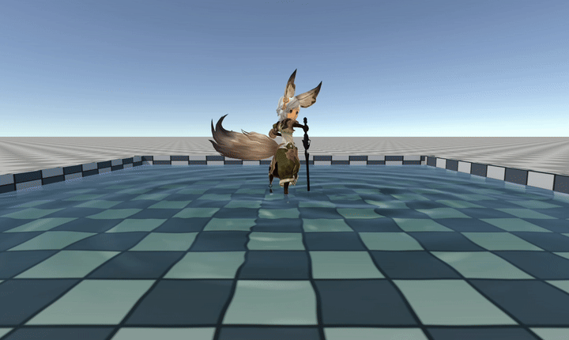

# 基于顶点高度位移贴图的浅水水面几何重建
&emsp;&emsp;浅水波场只提供每个网格位置上的高度与斜率，真正把这些数值变成具有轮廓和遮挡关系的水面，需要一层三维几何。项目在运行时生成一张覆盖水池内腔的规则四边形网格，并让顶点着色器根据波场 R 通道抬升顶点高度。该方法对应水体形状分类中的顶点高度位移贴图：位移由高度纹理驱动，波形仍然是真实几何。

<p align="center">
  
</p>

## 1、规则水面网格
&emsp;&emsp;设波场分辨率为 $n$，它表示水面网格每条边被划分成 $n$ 个区间。区间端点本身也是顶点，因此每条边实际使用 $n+1$ 个顶点。

&emsp;&emsp;令横向索引 $i=0,1,\ldots,n$，$x_{\min}$ 与 $x_{\max}$ 分别为水池内腔在 $x$ 方向的最小和最大世界坐标，则第 $i$ 列顶点的世界坐标 $x_i$ 与水平纹理坐标 $u_i$ 为：
$$
x_i=x_{\min}+\frac{i}{n}\left(x_{\max}-x_{\min}\right),
\qquad
u_i=\frac{i}{n}
$$
其中 $x_i$ 从 $x_{\min}$ 线性增加到 $x_{\max}$，$u_i\in[0,1]$ 把水池范围映射到波场纹理的横向采样范围。

&emsp;&emsp;纵向使用索引 $j=0,1,\ldots,n$，$z_{\min}$ 与 $z_{\max}$ 分别是水池在 $z$ 方向的边界：
$$
z_j=z_{\min}+\frac{j}{n}\left(z_{\max}-z_{\min}\right),
\qquad
v_j=\frac{j}{n}
$$
其中 $z_j$ 是对应顶点的世界坐标，$v_j$ 是纵向纹理坐标。二维索引 $(i,j)$ 对应的空间顶点为：
$$
\mathbf{p}_{i,j}
=\left(x_i,y_{\mathrm{level}},z_j\right)
$$
$y_{\mathrm{level}}$ 是静水面高度。此时网格尚未发生波场位移，相邻四个顶点构成一个网格单元，每个单元再拆成两个三角形。

```csharp
int n = Mathf.Clamp(_body.waveSettings.resolution, 32, 200);
int side = n + 1;

for (int z = 0; z < side; z++)
for (int x = 0; x < side; x++)
{
    float fx = (float)x / n;
    float fz = (float)z / n;
    verts[z * side + x] = new Vector3(
        Mathf.Lerp(mn.x, mx.x, fx),
        mn.y,
        Mathf.Lerp(mn.z, mx.z, fz));
}
```

## 2、波场驱动的顶点位移
&emsp;&emsp;顶点着色器先把世界坐标映射到水池范围内的波场 UV：
$$
u=\frac{x-x_{\min}}{x_{\max}-x_{\min}},
\qquad
v=\frac{z-z_{\min}}{z_{\max}-z_{\min}}
$$
R 通道保存相对静水面的高度 $h$，$k_{\mathrm{disp}}$ 控制高度到几何位移的倍率：
$$
y=y_{\mathrm{level}}+h(u,v)k_{\mathrm{disp}}
$$
其中 $k_{\mathrm{disp}}$ 是顶点位移增益，在着色器中对应 `_WaveDisplace`：

- $k_{\mathrm{disp}}=1$：R 通道高度按 1:1 转换为世界空间位移。
- $k_{\mathrm{disp}}=0$：关闭几何位移，只保留平坦水面。
- $k_{\mathrm{disp}}>1$：放大波峰高度，但过大时会与原生波场高度不一致。

```hlsl
// wave.r 是波场在同一 UV 处记录的相对高度 h
float4 wave = SAMPLE_TEXTURE2D(_WaveTex, sampler_WaveTex, waveUV);
float3 pWS = TransformObjectToWorld(IN.positionOS.xyz);
// _WaterLevel 对应静水面高度，_WaveDisplace 对应位移增益 k_disp
pWS.y = _WaterLevel + wave.r * _WaveDisplace;
```

&emsp;&emsp;顶点位移会改变水面的世界坐标，因此掠射角下能看到真实波峰轮廓、遮挡和透视变化。

## 3、逐像素法线重建
&emsp;&emsp;G/B 通道分别保存 $\partial h/\partial x$ 与 $\partial h/\partial z$。片元着色器再次采样同一张波场纹理，在屏幕像素上重建法线：
$$
\mathbf{g}
=\left(G,B\right),
\qquad
\mathbf{n}
=\operatorname{normalize}
\left(-g_xk_n,1,-g_zk_n\right)
$$
&emsp;&emsp;如果只在顶点上计算法线，较大三角形跨过屏幕后会暴露规则插值痕迹。逐像素采样可以减轻菱形波光和网格高光。材质还会从同一张波场中错位采样一层细节，但不会叠加由 `_Time` 驱动的假波纹，因此平静水面仍保持静止。

```hlsl
float2 slope = wave.gb + detail.gb * detailScale;
float3 nWS = normalize(float3(
    -slope.x * _WaveNormalGain,
     1.0,
    -slope.y * _WaveNormalGain));
```

## 4、延伸阅读
- 作品：[Unity 实时柔性体与粒子流体系统](<../../../../作品/计算机图形学/物理/Unity 实时柔性体与粒子流体系统：基于 XPBD 与 PBF 的物理模拟.md>)
- 文章：[基于二维波动方程的浅水波场](../../物理/水动力学仿真/基于二维波动方程的浅水波场.md)、[基础水体着色](基础水体着色.md)、[焦散](焦散.md)
