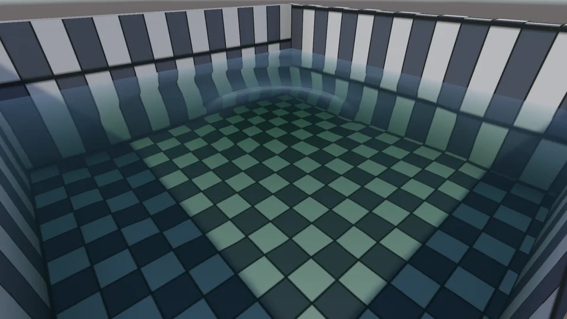
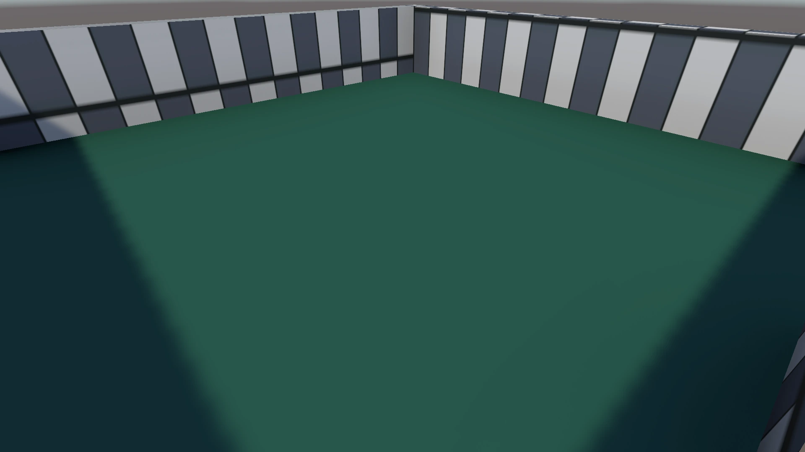
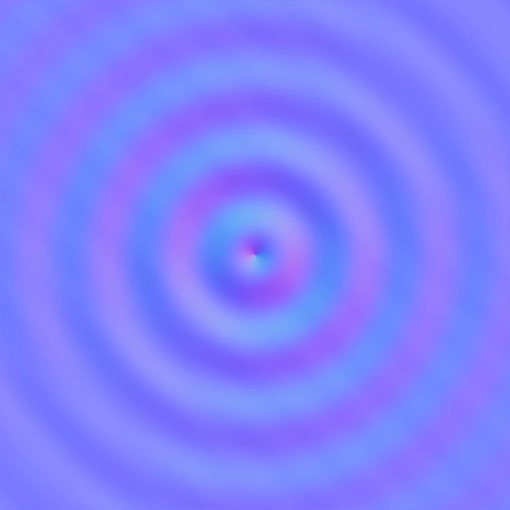
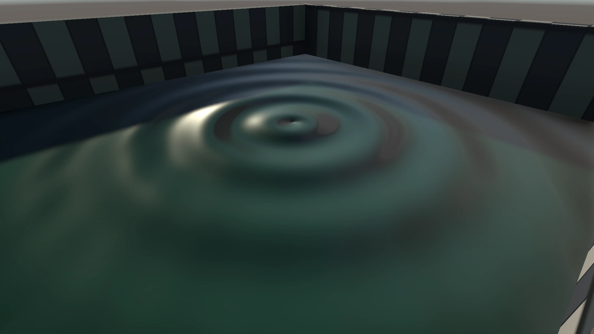
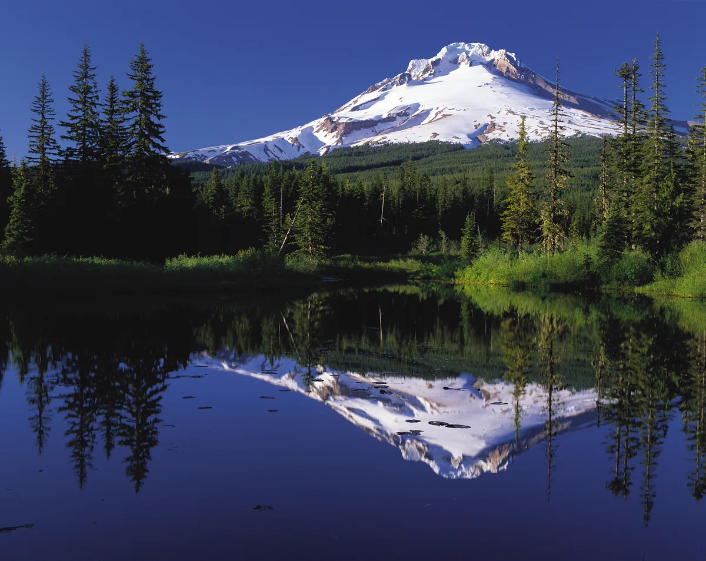
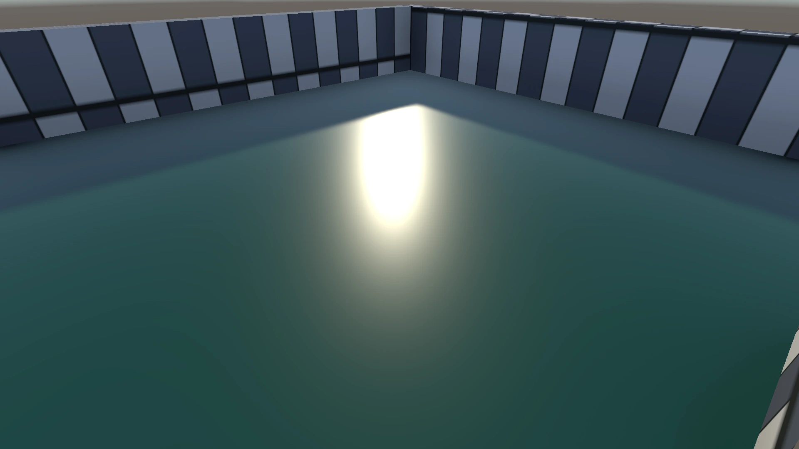
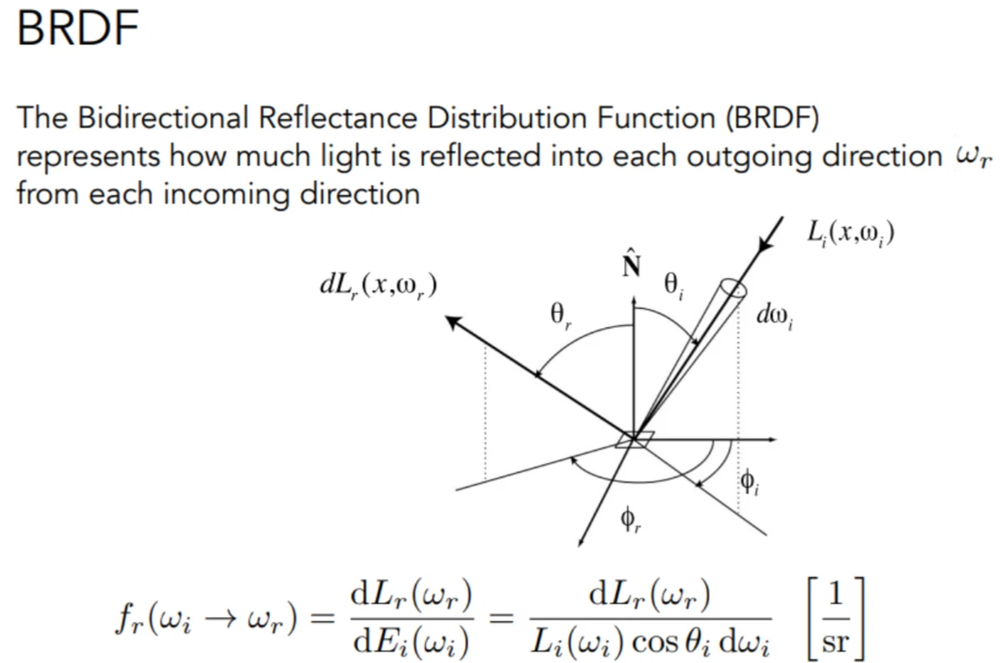
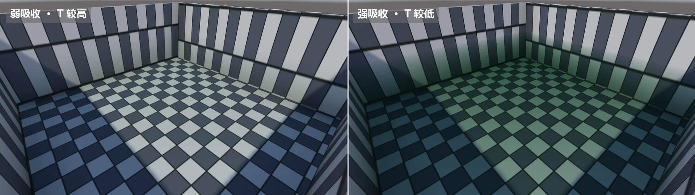

# 基础水体着色
&emsp;&emsp;主体水面的轮廓和逐像素法线由[基于顶点高度位移贴图的浅水水面几何重建](基于顶点高度位移贴图的浅水水面几何重建.md)提供。本文只讨论水面材质如何利用这些几何数据、场景颜色和场景深度，计算菲涅尔反射、环境反射、太阳高光、折射和 Beer-Lambert 吸收。

  

## 1、着色组成
&emsp;&emsp;基础水面颜色可以理解为水下颜色、环境反射和镜面高光的组合：
$$
\mathbf{C}_{\mathrm{water}}
=\left(1-F\right)\mathbf{C}_{\mathrm{trans}}\mathbf{T}
+F\mathbf{C}_{\mathrm{env}}
+\mathbf{C}_{\mathrm{spec}}
$$
其中 $F$ 为菲涅尔反射率，$\mathbf{C}_{\mathrm{trans}}$ 是经过折射后的背景颜色，$\mathbf{T}$ 是水体透射率，$\mathbf{C}_{\mathrm{env}}$ 是天空或环境反射，$\mathbf{C}_{\mathrm{spec}}$ 是太阳高光。

  

项目实拍：关闭镜面高光、法线扰动、折射和焦散，仅保留水体基础颜色。

## 2、波面法线
&emsp;&emsp;水面的反射和折射方向由法线决定。高度场保存坡度后，可以重建逐像素法线：
$$
\mathbf{n}
=\operatorname{normalize}
\left(
-\frac{\partial h}{\partial x}k_n,
1,
-\frac{\partial h}{\partial z}k_n
\right)
$$
法线本身不直接增加颜色，但它会改变环境反射、镜面高光和折射偏移，因此涟漪会表现为断续高光、扭曲倒影和晃动的池底。

  

项目实拍：由波场坡度重建出的切线空间法线贴图。

  

项目实拍：应用法线扰动后，平坦水面出现细密涟漪和断续反光。

## 3、菲涅尔与环境反射
&emsp;&emsp;水的垂直入射反射率接近 $F_0=0.02$，掠射角处反射迅速增强。Schlick 近似写为：
$$
F=F_0+\left(1-F_0\right)\left(1-\mathbf{n}\cdot\mathbf{v}\right)^5
$$
反射方向为：
$$
\mathbf{r}=2\left(\mathbf{n}\cdot\mathbf{v}\right)\mathbf{n}-\mathbf{v}
$$
项目先按反射方向的竖直分量混合地平线和天顶色，再在存在反射探针时叠加环境反射。菲涅尔项决定水面在垂直观察时主要显示水体和池底，在掠射观察时逐渐转成天空和环境倒影。

  

环境反射示例。图源：Oregon's Mt. Hood Territory，Public Domain，Wikimedia Commons。

## 4、GGX 高光
&emsp;&emsp;太阳和灯光会在水面形成沿反射方向集中的镜面高光。项目使用连续 GGX 分布，而不是固定阈值高光：
$$
D=\frac{a^2}
{\pi\left[
\left(\mathbf{n}\cdot\mathbf{h}\right)^2\left(a^2-1\right)+1
\right]^2}
$$
$a$ 与粗糙度有关，$\mathbf{h}$ 是视线和光照方向的半程向量。波面法线变化会让高光沿涟漪滑动；红、蓝通道再沿表面切向做极小偏移，形成轻微色散，零色散时退化为普通单色高光。

  

项目实拍：在基础水体颜色上加入 GGX 太阳高光。

  

BRDF 决定入射光如何分配到镜面高光、漫反射和其他出射方向。

## 5、屏幕空间折射
&emsp;&emsp;水面从 `_CameraOpaqueTexture` 采样池底和池壁的不透明颜色，并用波场坡度偏移屏幕 UV：
$$
\mathbf{uv}_{\mathrm{refract}}
=\mathbf{uv}
+\operatorname{offset}
\left(\nabla h\right)
$$
如果折射位置与当前像素的场景深度差过大，材质会降低折射偏移，避免把远处墙面或角色拖进当前水面。水下的池底、石头和角色会在波峰处发生连续轻微错位。

## 6、Beer-Lambert 吸收
&emsp;&emsp;不可见水体厚度由不透明场景深度和水面深度之差给出：
$$
d=\max\left(0,d_{\mathrm{scene}}-d_{\mathrm{water}}\right)
$$
逐通道透射率使用 Beer-Lambert 衰减：
$$
\mathbf{T}
=\exp\left(-d\rho\left(1-\mathbf{c}_{\mathrm{abs}}\right)\right)
$$
最终透射颜色为：
$$
\mathbf{c}_{\mathrm{transmitted}}
=\mathbf{c}_{\mathrm{refract}}\mathbf{T}
+\mathbf{c}_{\mathrm{scatter}}
\left(1-e^{-d\rho}\right)
$$
其中 $\rho$ 为吸收密度。浅水处池底清晰，厚度增加后颜色逐渐被吸收色和散射色取代。

  

项目实拍：同一机位下弱吸收与强吸收时的水底通透度和颜色对比。

## 7、管线与边界
&emsp;&emsp;`FluidWaterSurface` 在一个 pass 中完成折射、吸收、反射与高光合成，并使用 `Blend One Zero` 覆盖水面对应的像素。水面网格本身不写深度，因此角色、池底和其他不透明物体必须先通过场景深度参与遮挡判断。

&emsp;&emsp;基础水体着色只负责水面材质，不负责水下焦散。焦散改变的是池底收到的光，单独由 `FluidCausticsRenderer` 计算，见：[焦散](焦散.md)。

## 8、延伸阅读
- 作品：[Unity 实时柔性体与粒子流体系统](<../../../../作品/计算机图形学/物理/Unity 实时柔性体与粒子流体系统：基于 XPBD 与 PBF 的物理模拟.md>)
- 文章：[基于顶点高度位移贴图的浅水水面几何重建](基于顶点高度位移贴图的浅水水面几何重建.md)、[基于二维波动方程的浅水波场](../../物理/水动力学仿真/基于二维波动方程的浅水波场.md)、[PBF 粒子流体模拟](../../物理/水动力学仿真/PBF%20粒子流体模拟.md)
- 笔记：[水体着色概览](../../../../笔记/计算机图形学/渲染/水体渲染/水体着色概览.md)

