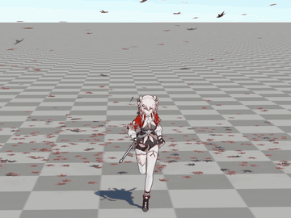
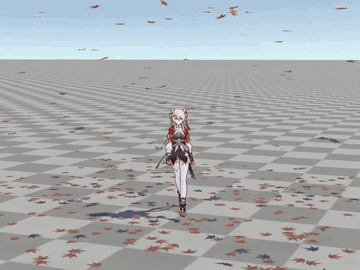
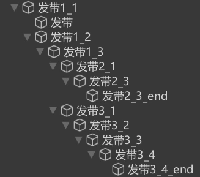
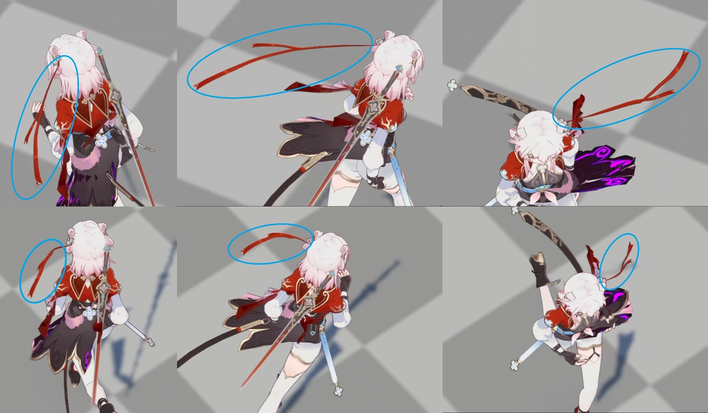
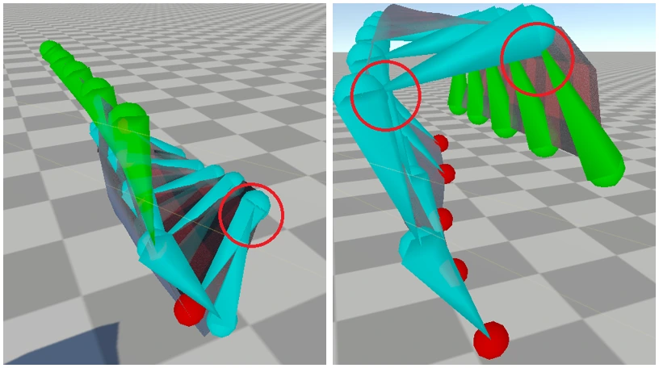
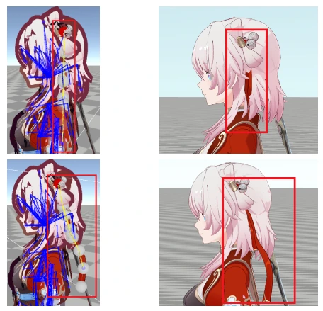
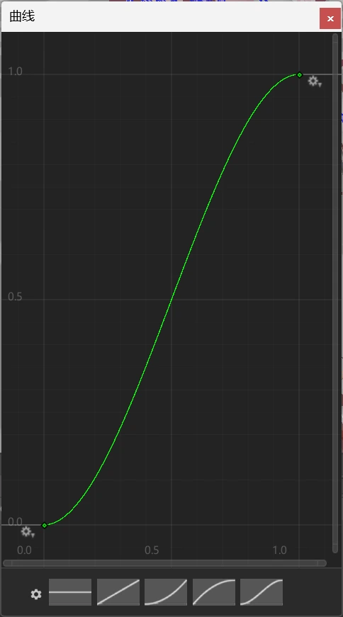

# 基于 XPBD 的柔性骨骼仿真
&emsp;&emsp;角色身上的发带、袖子、裙摆等柔性体飘带通常由多节骨骼组成。它们既需要跟随角色动画运动，又要表现出受重力、风力和角色加速度影响的柔性摆动。如果完全依赖高密度网格模拟，这类细长结构会产生大量额外约束与性能开销。

&emsp;&emsp;本系统采用低分辨率骨骼链作为柔性代理。链上的每个节点对应一根骨骼，节点间使用距离、系链和弯曲约束维持基本形状，再通过扭转约束避免局部翻转。约束投影建立在 PBD 与 XPBD 框架之上 [2][3]。为保留美术预设轮廓，额外引入按骨骼深度分配柔度的姿态维持约束。

&emsp;&emsp;这种由多个节点沿层级结构连接的柔性代理，可以看作经典质点-弹簧模型在低维骨骼链上的简化形式。它只保留纵向连接、横向连接和局部弯曲等必要关系 [1]，从而以远低于高分辨率网格的状态量完成飘带仿真。

<table>
  <tr>
    <td style="width: 50%; padding-right: 6px;">
      
    </td>
    <td style="width: 50%; padding-left: 6px;">
      
    </td>
  </tr>
</table>

## 参考文献
1. Provot, X. Deformation Constraints in a Mass-Spring Model to Describe Rigid Cloth Behavior. *Proceedings of Graphics Interface '95*, 1995: 147–154. [DOI](https://doi.org/10.20380/GI1995.17)
2. Müller, M., Heidelberger, B., Hennix, M., & Ratcliff, J. Position Based Dynamics. *Journal of Visual Communication and Image Representation*, 2007, 18(2): 109–118. [DOI](https://doi.org/10.1016/j.jvcir.2007.01.005)
3. Macklin, M., Müller, M., & Chentanez, N. XPBD: Position-Based Simulation of Compliant Constrained Dynamics. *Proceedings of the 9th International Conference on Motion in Games*, 2016: 49–54. [DOI](https://doi.org/10.1145/2994258.2994272)

## 1、基础约束
### 1.1、骨骼拓扑
<p align="center">
  
</p>

&emsp;&emsp;骨骼链以层级树组织，每个节点对应角色骨骼层级中的一根骨骼。除根节点外，每个物理节点只与自己的父节点和子节点相连，当某个父节点拥有多个子骨骼时，层级会形成分支。

&emsp;&emsp;物理初始化时，`XPBD_BoneBody` 从根骨骼开始递归收集子骨骼，并为每个骨骼分配独立的物理节点。根节点跟随角色动画与整体变换，其余节点沿各自的父子层级向下组织，因此不同分支可以独立摆动，又始终继承父级的位置与旋转。

```csharp
public bool autoDetectBones = true;
public Transform rootBone;
public List<Transform> bones = new List<Transform>();
private int[] _parentIndices;

// 以根骨骼为起点初始化整条层级树
bones.Clear();
if (rootBone == null) rootBone = transform;
bones.Add(rootBone);

// 从根骨骼开始递归收集整棵层级树
void FetchBonesRecursive(Transform current)
{
    bones.Add(current);
    foreach (Transform child in current)
        FetchBonesRecursive(child);
}

// 每根骨骼对应一个物理节点，并记录它在树中的父节点
int boneCount = bones.Count;
X = new Vector3[boneCount];
oldX = new Vector3[boneCount];
V = new Vector3[boneCount];
_parentIndices = new int[boneCount];
...
for (int i = 0; i < boneCount; i++)
{
    foreach (Transform child in bones[i])
    {
        if (boneToIndex.TryGetValue(child, out int childIndex))
            _parentIndices[childIndex] = i;
    }
}
```

### 1.2、系链约束
&emsp;&emsp;骨骼链是一维拓扑，相邻节点间的距离约束主要抵抗拉伸与压缩。但在离心运动或快速转向中，离散骨骼仍可能被持续拉长导致失真。为了解决此问题，需引入系链约束限制节点相对根锚点的最大外展距离：
$$
C_{tether}=\max\left(0,\ L-L_{max}\right)
$$
其中 $L$ 为当前距离，$L_{max}$ 为允许上限。约束只在超出上限时激活，不会影响正常范围内的运动。

<p align="center">
  
</p>

&emsp;&emsp;图中上排展示仅使用距离约束时的异常伸长，下排为加入系链约束后的结果。节点被限制在合法外展范围内，同时仍保留链条整体摆动。

### 1.3、骨骼弯曲约束
&emsp;&emsp;与网格不同，骨骼链是一维拓扑，弯曲约束不是建立在二面角上，而是直接建立在连续三个节点上。设相邻两段骨骼方向为 $\mathbf{v}_1$ 和 $\mathbf{v}_2$，约束使用点积形式：
$$
\cos\theta=\frac{\mathbf{v}_1\cdot\mathbf{v}_2}{\|\mathbf{v}_1\|\|\mathbf{v}_2\|}
$$
$$
C_{bend}=\cos\theta-\cos\theta_0
$$
相比四顶点二面角约束，三点拓扑直接表达单个关节的弯曲角度，更适合低分辨率骨骼链。

### 1.4、扭转约束
&emsp;&emsp;骨骼代理的节点数量很少，数值误差或极端外力容易把局部关节推向翻转。扭转约束将相邻骨骼夹角限制在安全范围内：
$$
C_{twist}=\max\left(0,\ \theta-\theta_{max}\right)
$$
当夹角未超过 $\theta_{max}$ 时约束不生效，超过后，投影会把节点拉回合法方向。

<p align="center">
  
</p>

&emsp;&emsp;左图未开启扭转约束，局部关节发生翻转；右图将最大内角限制在 $90^\circ$ 后，关节保持在合法范围。这种约束能够有效抑制局部自穿模。

## 2、姿态维持
&emsp;&emsp;弯曲约束只约束相邻骨骼的相对角度，具有旋转不变性。即使把弯曲刚度调到很高，重力仍可能带动整条骨骼链绕根节点整体下垂，使发带失去美术设计的流线轮廓。本节参考 MagicaCloth2 的 Motion Constraint，将物理节点限制在动画姿态附近，并改写为适用于 XPBD 的等式约束。

<p align="center">
  
</p>

&emsp;&emsp;上排未开启约束，发带受重力下垂失形；下排开启约束后，动态模拟成功维持了美术预设的流线造型。

### 2.1、MagicaCloth2 的 Motion Constraint
&emsp;&emsp;参考源码位于 `MagicaCloth2/Scripts/Core/Cloth/Constraints/MotionConstraint.cs`。MagicaCloth2 将动画姿态中的位置作为基准 $\mathbf{p}_{base}$，并围绕它定义可运动区域。开启 Max Distance 后，当前位置 $\mathbf{p}$ 会被限制在半径 $d_{max}$ 的球内：
$$
\mathbf{p}_{max}=\mathbf{p}_{base}
+\operatorname{Clamp}_{d_{max}}\left(\mathbf{p}-\mathbf{p}_{base}\right)
$$

&emsp;&emsp;Backstop 则在骨骼法线反方向构造一个半径为 $r_{b}$、距离为 $d_{b}$ 的球形禁区，限制骨骼绕到动画姿态的另一侧：
$$
\mathbf{c}=\mathbf{p}_{base}-\left(d_b+r_b\right)\mathbf{n}
$$
$$
\left\|\mathbf{p}-\mathbf{c}\right\|\ge r_b
$$

&emsp;&emsp;约束完成后，MagicaCloth2 再用 stiffness 在当前预测位置与约束位置之间插值，并把位置修正乘以 `0.95` 累加到速度：
$$
\mathbf{p}'=(1-s)\mathbf{p}+s\mathbf{p}_{constrained}
$$
$$
\mathbf{v}\leftarrow\mathbf{v}+0.95\left(\mathbf{p}'-\mathbf{p}\right)
$$

```csharp
// Max Distance：限制相对动画姿态的最大位移
float maxDistance = maxDistanceCurveData.EvaluateCurve(depth * depth);
Vector3 v = MathUtility.ClampVector(nextPos - basePos, maxDistance);
nextPos = basePos + v;

// Backstop：限制骨骼绕到动画姿态的另一侧
Vector3 c = basePos - dir * (backstopDistance + backstopRadius);
...

// Stiffness：把约束结果混合回当前位置
nextPos = math.lerp(opos, nextPos, stiffness);
velocityPosArray[pindex] += (nextPos - opos) * 0.95f;
```

&emsp;&emsp;这部分始终以动画姿态 `basePos` / `baseRot` 为基准，其本质是允许在动画姿态附近运动的区域约束，而不是把粒子强制吸附到唯一目标点。

### 2.2、姿态维持约束
&emsp;&emsp;MagicaCloth2 的 Motion Constraint 是它自身模拟管线中的一个独立阶段，其与 MagicaCloth2 的调度和数据布局绑定得很紧。

&emsp;&emsp;本项目的求解器则以统一的 `XPBD_Constraint` 接口组织距离、系链、弯曲、扭转和姿态约束。每个约束只需要提供柔度、阻尼、拉格朗日乘子和位置修正，由主循环统一安排组内并行、组间串行以及碰撞顺序。如果把 Motion Constraint 的球域钳制直接搬进来，它会绕过现有的约束投影流程，需要额外维护一套位置和速度补偿，不方便与其他 XPBD 约束共同参与迭代。

&emsp;&emsp;为此，姿态维持约束保留围绕绑定姿态限制柔性体的思想，把区域钳制改成三维等式约束。设当前质点为 $\mathbf{p}$，目标位置为 $\mathbf{p}_{target}$：
$$
\mathbf{C}_{rest}=\mathbf{p}-\mathbf{p}_{target}
$$
$$
\mathbf{p}_{target}=\mathbf{R}\mathbf{p}_{local}+\mathbf{t}
$$
其中 $\mathbf{R}$ 和 $\mathbf{t}$ 来自链根锚点在当前帧的旋转与平移，$\mathbf{p}_{local}$ 为绑定姿态下的局部位置。该约束的梯度是单位矩阵，因此三个坐标可以共用同一个三维拉格朗日乘子：
$$
\Delta\boldsymbol{\lambda}=
-\frac{\mathbf{C}_{rest}+\tilde{\alpha}\boldsymbol{\lambda}+\gamma\Delta\mathbf{p}}
{(1+\gamma)w+\tilde{\alpha}}
$$
$$
\Delta\mathbf{p}=w\Delta\boldsymbol{\lambda}
$$

### 2.3、柔度映射
&emsp;&emsp;为增强艺术可控性，系统为每个节点计算归一化深度。设节点到链根的层级距离为 $d$，到其最深叶节点的距离为 $d_{leaf}$，则：
$$
t=\frac{d}{d+d_{leaf}}
$$

&emsp;&emsp;编辑器通过一条曲线把该深度映射为柔度权重：
$$
w=f(t)
$$
曲线横轴为归一化深度，纵轴为权重。末端全局参数 `restPoseCompliance` 先被换算为末梢柔度：
$$
\alpha_{tip}=
\begin{cases}
0, & c_{rest}\le 0 \\
0.1c_{rest}^{2}, & c_{rest}>0
\end{cases}
$$
其中 $c_{rest}$ 为编辑器中的姿态维持柔度。根部取末梢柔度的 `1%`：
$$
\alpha_{root}=0.01\alpha_{tip}
$$
最终的节点柔度为：
$$
\alpha(t)=(1-w)\alpha_{root}+w\alpha_{tip}
$$

```csharp
float normalizedDepth = _boneDepth[index] /
    (float)(_boneDepth[index] + _boneDepthToLeaf[index]);
float weight = weightCurve.Evaluate(normalizedDepth);

float alphaTip = restPoseCompliance <= 0f
    ? 0f
    : 0.1f * restPoseCompliance * restPoseCompliance;
float alphaRoot = alphaTip * 0.01f;
return Mathf.Lerp(alphaRoot, alphaTip, weight);
```

<p align="center">
  
</p>

&emsp;&emsp;柔度传递函数 $f(t)$ 的编辑界面：横轴为归一化骨骼深度，纵轴为柔度权重系数。

## 3、动画混合
&emsp;&emsp;某些部位需要更贴近关键帧轨迹，而不是完全由物理系统接管。系统为此提供动画混合模式，物理节点在每个时间步向动画目标位置插值：
$$
\mathbf{x}_i\leftarrow\mathbf{x}_i+(1-\alpha)\left(\mathbf{x}_{target}-\mathbf{x}_i\right)
$$
其中 $\alpha$ 为动画混合柔度。取值越大，物理惯性越强；取值越小，骨骼越贴近动画。

```csharp
X[i] = Vector3.Lerp(X[i], cleanTarget, 1f - animCompliance);
```

&emsp;&emsp;动画混合会持续向物理系统注入外部速度，因此与姿态维持约束使用互斥状态。

## 4、延伸阅读
- 项目：[Unity 实时柔性体与粒子流体系统](<../../../../项目/计算机图形学/物理/Unity 实时柔性体与粒子流体系统：基于 XPBD 与 PBF 的物理模拟.md>)
- 文章：[基于 XPBD 的网格布料仿真](./基于%20XPBD%20的网格布料仿真.md)、[基于 Perlin 噪声的实时风场模拟](../空气动力学仿真/基于%20Perlin%20噪声的实时风场模拟.md)
- 笔记：[基于位置的扩展动力学（XPBD）](<../../../../笔记/计算机图形学/物理/XPBD/基于位置的扩展动力学（XPBD）.md>)
