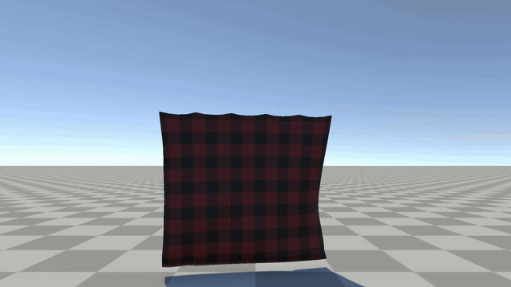
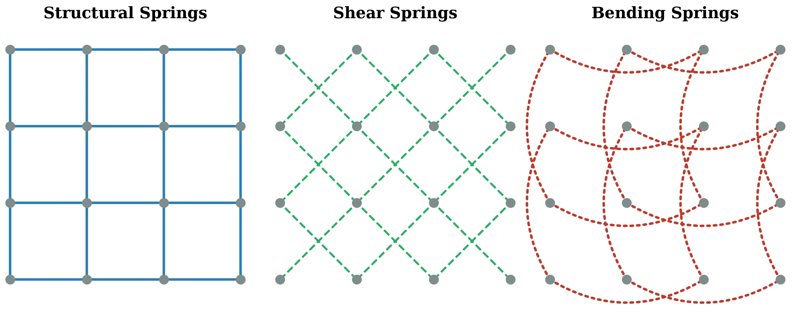
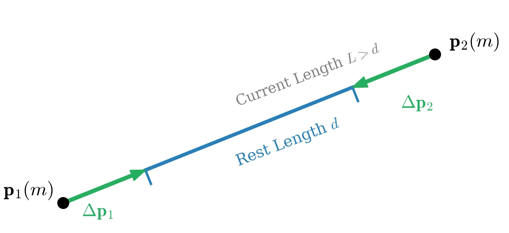
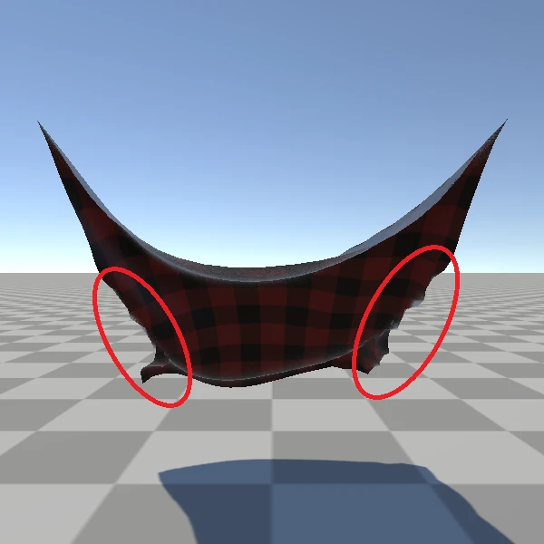
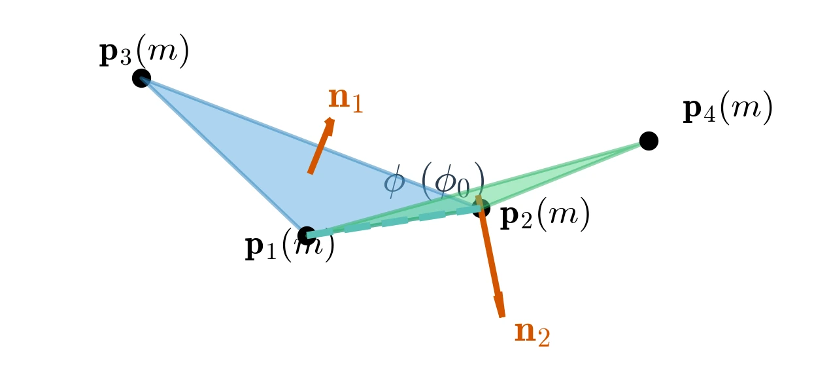
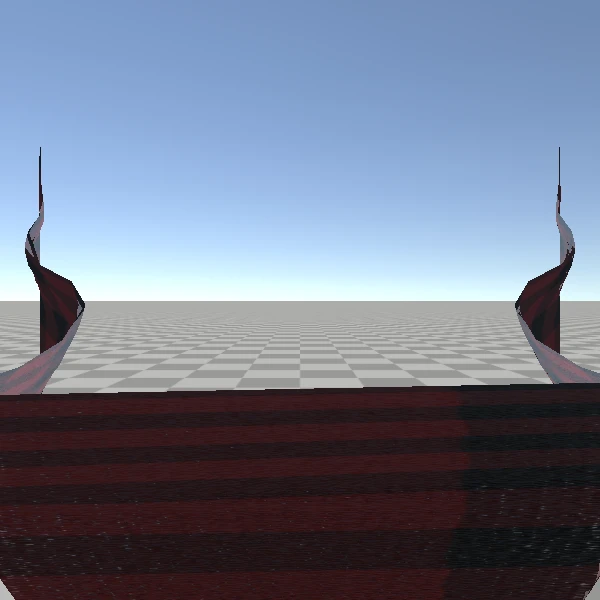
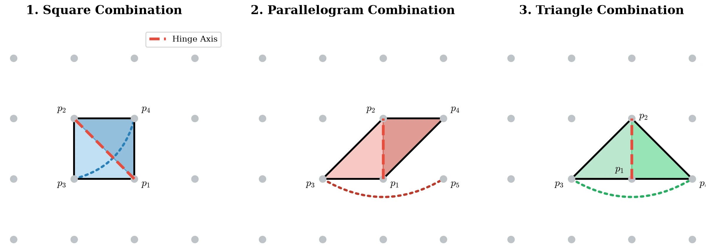
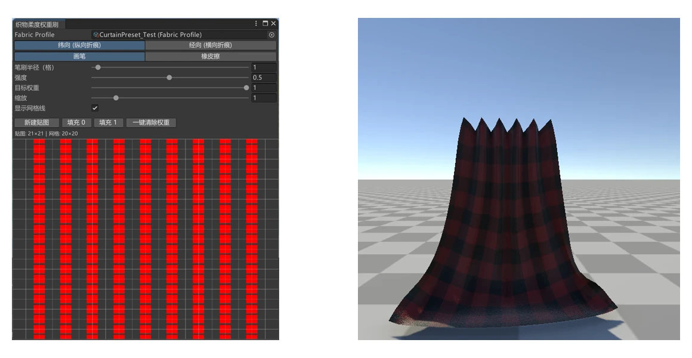
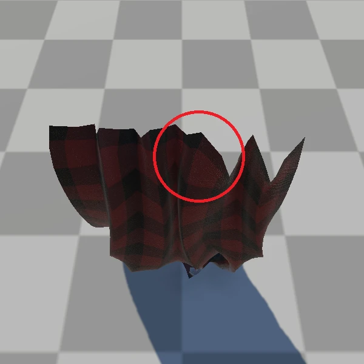
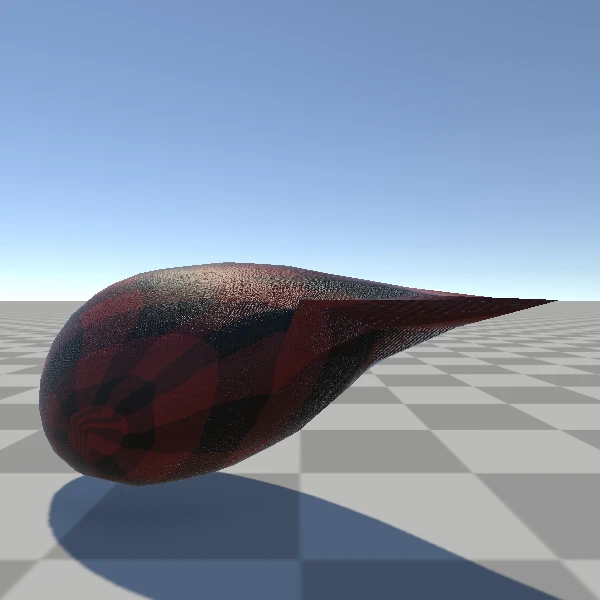

# 基于 XPBD 的网格布料仿真
&emsp;&emsp;实时布料仿真的难点在于同时兼顾稳定性、计算效率与美术可控性。布料既要抵抗面内拉伸与剪切，又需要表现面外弯曲、褶皱和材料方向差异，若直接求解高刚度弹簧或有限元方程，计算成本往往难以满足实时交互。

&emsp;&emsp;Provot 在 1995 年提出面向结构化网格的质点弹簧模型，将布料连接拆分为结构、剪切和弯曲弹簧，为后续网格布料拓扑奠定了基础 [1]。传统弹簧方法需要显式积分力与加速度，面对高刚度材料时容易受到时间步长限制。

&emsp;&emsp;Müller 等人随后提出基于位置的动力学（PBD），直接在位置空间迭代投影约束，避免了显式求解高刚度内力 [2]。XPBD 在此基础上引入柔度与拉格朗日乘子修正，使材料的宏观刚度不再与迭代次数和时间步长强耦合 [3]。本文的网格布料求解器便建立在 PBD 与 XPBD 的约束投影框架之上。

<p align="center">
  
</p>

## 参考文献
1. Provot, X. Deformation Constraints in a Mass-Spring Model to Describe Rigid Cloth Behavior. *Proceedings of Graphics Interface '95*, 1995: 147–154. [DOI](https://doi.org/10.20380/GI1995.17)
2. Müller, M., Heidelberger, B., Hennix, M., & Ratcliff, J. Position Based Dynamics. *Journal of Visual Communication and Image Representation*, 2007, 18(2): 109–118. [DOI](https://doi.org/10.1016/j.jvcir.2007.01.005)
3. Macklin, M., Müller, M., & Chentanez, N. XPBD: Position-Based Simulation of Compliant Constrained Dynamics. *Proceedings of the 9th International Conference on Motion in Games*, 2016: 49–54. [DOI](https://doi.org/10.1145/2994258.2994272)

## 1、弹簧分类
&emsp;&emsp;为了捕捉结构化网格的不同形变模式，Provot 将质点弹簧模型拆解为结构弹簧、剪切弹簧和弯曲弹簧三种作用 [1]。

<p align="center">
  
</p>

- **结构弹簧**：沿水平与垂直方向连接相邻质点，主要抵抗面内拉伸与压缩。
- **剪切弹簧**：连接对角线两端的质点，主要抵抗面内剪切形变。
- **弯曲弹簧**：连接水平与垂直方向上相隔一个网格的质点，提供面外抗弯刚度。

## 2、布料
&emsp;&emsp;距离约束缺乏面外抗弯能力，弯曲约束无法抵抗面内形变，且后者的力学表现依赖二面角拓扑。本节剖析二者的奇异性，并给出各向同性与各向异性布料控制方案。

### 2.1、距离约束的奇异性
<p align="center">
  
</p>

&emsp;&emsp;距离约束通过惩罚质点间的长度偏差来抵抗拉伸与压缩。设两端质点为 $\mathbf{p}_1$ 和 $\mathbf{p}_2$，原长为 $d$，约束函数为：
$$
C_{dist}=\left\|\mathbf{p}_1-\mathbf{p}_2\right\|-d
$$
其中 $d$ 为原长。距离约束的梯度始终沿两质点连线方向，因此平展状态下无法感知垂直布面的位移，也不会产生面外抗弯恢复力，只依赖距离约束会产生病态局部褶皱。

<p align="center">
  
</p>

### 2.2、弯曲约束的奇异性
<p align="center">
  
</p>

&emsp;&emsp;为补足面外响应，求解器引入以公共边 $\mathbf{p}_1\mathbf{p}_2$ 为铰链的二面角弯曲约束。将 $\mathbf{p}_1$ 平移到原点后，两侧单位法线为：
$$
\mathbf{n}_1=\frac{\mathbf{p}_2\times\mathbf{p}_3}{\|\mathbf{p}_2\times\mathbf{p}_3\|},
\qquad
\mathbf{n}_2=\frac{\mathbf{p}_2\times\mathbf{p}_4}{\|\mathbf{p}_2\times\mathbf{p}_4\|}
$$
弯曲约束的修正方向由两侧面法线决定，因此只能感知沿公共铰链的面外折叠。面内位移落在三角形切空间内，不会直接受到弯曲约束修正。

&emsp;&emsp;仅使用弯曲约束时，布料虽然受到面外角度限制，却缺乏面内距离保护，会沿重力方向发生严重拉伸。距离约束与弯曲约束必须共同构成基础布料。

<p align="center">
  
</p>

### 2.3、二面角拓扑分类
&emsp;&emsp;为消除单一约束的几何奇异性，布料需要结合距离与弯曲约束。宏观抗弯表现还取决于弯曲约束的局部连接方式。结构化网格可以划分为三种基本二面角构型：

<p align="center">
  
</p>

- **正方形组合**：由单元内部对角线切分形成，仅抵抗剪切方向的面外折叠。
- **平行四边形组合**：跨越相邻单元、侧翼顶点呈中心对称，对齐网格的真实切割方向，但继承单向剖分带来的方向偏置。
- **等腰直角三角形组合**：跨越相邻单元并呈镜像对称，通过脱离渲染层的几何绑定重构无方向偏置的抗弯拓扑。

### 2.4、各向同性控制策略
&emsp;&emsp;各向同性模拟采用正方形与平行四边形交织的组合。在单元对角线二面角的基础上，向外跨越构建水平与垂直方向的二面角，使布料沿经向、纬向或对角线弯曲时都能激活恢复力，呈现无死角的各向同性质感。

```csharp
if (strategy == Isotropic)
{
    // 单元内部的剪切方向二面角
    AddBendingConstraint(p1, p2, p3, p4);
    ...

    // 向相邻单元跨越，补齐水平与垂直方向的抗弯约束
    AddBendingConstraint(p1, p4, p2, i_right_down);
    AddBendingConstraint(p2, p4, p1, i_top_left);
}
```

### 2.5、各向异性控制策略
&emsp;&emsp;对于各方向抗弯差异明显的面料，项目基于等腰直角三角形组合提出解耦方案：摒弃对角线二面角，沿网格 U/V 轴独立构建正交转轴，从而得到参数化折痕与纹理柔度映射两个控制维度。

```csharp
else if (strategy == Anisotropism)
{
    // 沿 U 轴建立经向弯曲约束
    AddBendingConstraint(
        hinge_left, hinge_right, wing_down, wing_up,
        multWarp, foldSignWarp, SoftnessChannel.Warp);

    // 沿 V 轴建立纬向弯曲约束
    AddBendingConstraint(
        hinge_bottom, hinge_top, wing_left, wing_right,
        multWeft, foldSign, SoftnessChannel.Weft);
}
```

&emsp;&emsp;程序分别为经向和纬向维护柔度贴图，贴图与网格顶点一一对应。初始化二面角约束时，读取铰链两端点的权重并取平均：
$$
w=\frac{w_a+w_b}{2}
$$
权重通过指数映射转换为合规度倍率：
$$
m=10000^{\,w}
$$
权重为 $0$ 时保持默认刚度，权重为 $1$ 时弯曲合规度放大 `10000` 倍。最终约束柔度写作：
$$
\alpha_{bend}=\alpha_{base}\,m
$$

```csharp
// 取铰链两端点在对应经向/纬向贴图中的平均权重
float weight = weft
    ? (profile.SampleWeft(ua, va) + profile.SampleWeft(ub, vb)) * 0.5f
    : (profile.SampleWarp(ua, va) + profile.SampleWarp(ub, vb)) * 0.5f;

// 权重映射为合规度倍率，并写入弯曲约束
mult *= profile.WeightToMultiplier(weight);
...
_angleConstraints[i].alpha = alpha_ang * bendingData[i].complianceMultiplier;
```

<p align="center">
  
</p>

&emsp;&emsp;窗帘实验中，纬向贴图的 9 条纵向列被写入满柔度，经向保持默认刚度。布料因此在这些位置几乎没有抗弯能力，并在重力与单向折叠约束下形成稳定的大褶皱，而另一方向仍能维持基本形态。

### 2.6、单向折叠约束
&emsp;&emsp;弯曲约束只维持二面角，不限制折痕朝哪一侧翻转。受到高速拉扯时，原本交替排列的折痕可能翻向相反方向，破坏窗帘或裙摆的造型。

<p align="center">
  
</p>

&emsp;&emsp;设 $\mathbf{p}_1\mathbf{p}_2$ 为铰链边，$\mathbf{p}_3,\mathbf{p}_4$ 为两侧翼顶点。将 $\mathbf{p}_1$ 置于原点并记：
$$
\mathbf{a}=\mathbf{p}_2,\qquad
\mathbf{b}=\mathbf{p}_3,\qquad
\mathbf{c}=\mathbf{p}_4
$$
定义三角形 $\mathbf{p}_1\mathbf{p}_2\mathbf{p}_3$ 的单位法线及有符号折叠量：
$$
\mathbf{n}=\frac{\mathbf{a}\times\mathbf{b}}{\|\mathbf{a}\times\mathbf{b}\|},
\qquad
s=\mathbf{n}\cdot\mathbf{c}
$$
$s$ 等于 $\mathbf{p}_4$ 相对平面 $\mathbf{p}_1\mathbf{p}_2\mathbf{p}_3$ 的有符号高度。为每条折痕指定方向符号 $S_{fold}\in\{+1,-1\}$，单向折叠约束为：
$$
C_{fold}=S_{fold}\,s\ge 0
$$
该约束仅在 $C_{fold}<0$ 时激活，其拉格朗日乘子按不等式约束单边夹取：
$$
\lambda\leftarrow\max(0,\lambda+\Delta\lambda)
$$
约束投影会沿有符号高度的变化方向修正四个顶点，并乘上方向符号。该约束只阻止错误方向的折叠，不会把布料强制吸附到固定角度。

## 3、布气球
&emsp;&emsp;在网格布料的基础上，构建气球等封闭充气柔性体需要引入体积约束，以模拟内部气压产生的向外膨胀力。

<p align="center">
  
</p>

&emsp;&emsp;设网格包含 $N$ 个顶点和 $n$ 个三角面片，体积约束定义为：
$$
C_{volume}=\frac{1}{6}\sum_{i=1}^{n}
\left(\mathbf{p}_{t^i_1}\times\mathbf{p}_{t^i_2}\right)
\cdot\mathbf{p}_{t^i_3}
-K_{pressure}V_0
$$
其中 $V_0$ 为初始体积，$K_{pressure}$ 为无量纲超压因子。求和项利用三重积计算当前网格体积的 6 倍。

## 4、延伸阅读
- 项目：[Unity 实时柔性体与粒子流体系统](<../../../../项目/计算机图形学/物理/Unity 实时柔性体与粒子流体系统：基于 XPBD 与 PBF 的物理模拟.md>)
- 文章：[基于 XPBD 的柔性骨骼仿真](./基于%20XPBD%20的柔性骨骼仿真.md)、[基于 Perlin 噪声的实时风场模拟](../空气动力学仿真/基于%20Perlin%20噪声的实时风场模拟.md)
- 笔记：[基于位置的扩展动力学（XPBD）](<../../../../笔记/计算机图形学/物理/XPBD/基于位置的扩展动力学（XPBD）.md>)
