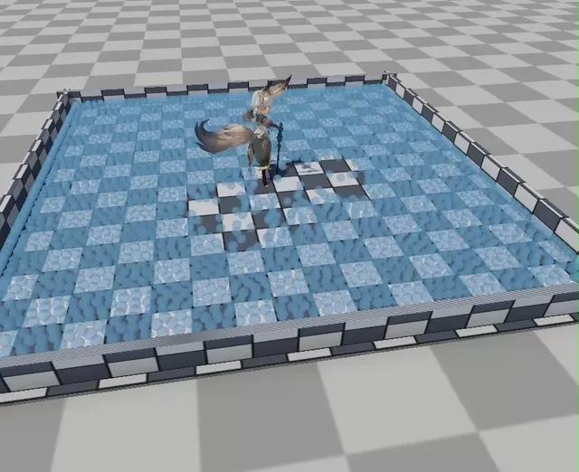

# PBF 粒子流体模拟
&emsp;&emsp;PBF（Position-Based Fluids）把不可压缩流体表示为离散粒子，不再通过状态方程计算压力，而是在每个子步中根据密度误差直接修正粒子位置 [1][2]。与 SPH 相比，PBF 更容易接受较大时间步，也能把流体约束和项目现有的位置更新框架统一起来。

<p align="center">
  
</p>

## 参考文献
1. Müller, M., Heidelberger, B., Hennix, M., & Ratcliff, J. Position Based Dynamics. *Journal of Visual Communication and Image Representation*, 2007, 18(2): 109–118. [DOI](https://doi.org/10.1016/j.jvcir.2007.01.005)
2. Macklin, M., & Müller, M. Position Based Fluids. *ACM Transactions on Graphics*, 2013, 32(4), Article 104. [DOI](https://doi.org/10.1145/2461912.2461984)

## 1、空间哈希
&emsp;&emsp;流体使用空间哈希加速粒子邻域查询：先把粒子映射到边长为平滑长度的规则网格，再把三维格坐标映射到哈希桶，仅检查当前格及相邻格，从而避免全场两两比较，哈希冲突通过重新比较格坐标排除。具体原理见：[空间数据结构](../../../../笔记/计算机基础/数据结构与算法/空间数据结构.md#spatial-hashing)。

## 2、密度约束
&emsp;&emsp;粒子 $i$ 的密度由 Poly6 核加权求和，邻域包含粒子自身：
$$
\rho_i=\sum_j mW\left(\left\|\mathbf{x}_{ij}\right\|,h\right)
$$
其中 $m$ 为粒子质量，$h$ 为平滑长度，$\mathbf{x}_{ij}=\mathbf{x}_i-\mathbf{x}_j$。密度约束定义为：
$$
C_i=\frac{\rho_i}{\rho_0}-1
$$
当 $C_i>0$ 时局部密度过高，约束投影会把粒子推开。通用 PBF 在 $C_i<0$ 时允许邻近粒子相互吸引，项目中的池水选择只抵抗压缩，因此把乘子限制为不大于零，自由表面附近不产生内聚力；史莱姆则保留双边乘子以获得内聚力。单个粒子的拉格朗日乘子分母为：
$$
D_i=
\frac{1}{\rho_0^2}
\left(
\left\|\sum_j\nabla_{\mathbf{x}_i}W_{ij}\right\|^2
+\sum_j\left\|\nabla_{\mathbf{x}_i}W_{ij}\right\|^2
\right)
+\epsilon
$$
池水采用的单边乘子为：
$$
\lambda_i=
\min\left(0,-\frac{C_i}{D_i}\right)
$$
其中 $\epsilon$ 用于避免除零。

```csharp
// 归一化密度误差：C > 0 表示过密，C < 0 表示偏稀
float C = densities[i] / restDensity - 1f;

// gradSum 累加邻居梯度，gradSqSum 累加梯度范数的平方
float3 gradSum = float3.zero;
float gradSqSum = 0f;

for (int k = 0; k < neighborCounts[i]; k++)
{
    int j = neighbors[i * maxNeighbors + k];
    float3 xij = positions[i] - positions[j];
    float r = math.length(xij);

    // 跳过重合粒子和支撑域外的邻居，避免除零与无效贡献
    if (r <= 1e-6f || r >= h) continue;

    // SpikyGrad 返回指向邻居的梯度，用于构造密度约束梯度
    float3 g = FluidMathUtility.SpikyGrad(xij, r, h);
    gradSum += g;
    gradSqSum += math.dot(g, g);
}

// 密度约束的一阶导数项：
// (|Σ∇W|² + Σ|∇W|²) / ρ0² + ε
float denom =
    (math.dot(gradSum, gradSum) + gradSqSum)
    / (restDensity * restDensity) + epsilon;

// 标准 PBF 乘子：过密时 dLambda < 0，偏稀时 dLambda > 0
float dLambda = -C / denom;

// 池水只保留排斥项：
// C > 0 时保留负乘子推开粒子；C < 0 时取 0，避免自由表面被向内吸引
lambdas[i] = repelOnly ? math.min(0f, dLambda) : dLambda;
```

## 3、位置修正
&emsp;&emsp;密度约束的梯度通过 Spiky 核计算。PBF 论文中的位置修正由当前粒子与邻居粒子的乘子共同决定：
$$
\Delta\mathbf{p}_i=
\frac{1}{\rho_0}
\sum_j
\left(\lambda_i+\lambda_j+s_{corr}\right)
\nabla W_{ij}
$$
$s_{corr}$ 是人工压力项，用于在粒子过近时提供额外排斥以抑制聚集，并由此产生类似表面张力的效果：
$$
s_{corr}
=-k
\left(
\frac{W\left(\mathbf{x}_{ij},h\right)}
{W\left(\Delta q,h\right)}
\right)^n
$$
采用 Spiky 梯度可以保证粒子接近重合时仍有明确方向，而 Poly6 更适合只负责密度标量和人工压力比值。项目默认设置 `scorrK = 0`，因此代码保留人工压力项的计算路径，但池水实际关闭该项，只依靠单边密度约束抵抗压缩。

```csharp
// dp 累加当前粒子受到的全部密度约束位置修正
float3 dp = float3.zero;

// 人工压力项 Poly6(W(r)/W(Δq))^n 的参考核值
float wDeltaQ = FluidMathUtility.Poly6(deltaQ, h);

for (int k = 0; k < neighborCounts[i]; k++)
{
    int j = neighbors[i * maxNeighbors + k];
    float3 xij = positions[i] - positions[j];
    float r = math.length(xij);

    // 跳过重合粒子和支撑域外邻居
    if (r <= 1e-6f || r >= h) continue;

    // s_corr 是人工压力项，用于抑制粒子过近时的聚集
    // scorrK = 0 时该行计算结果为 0，相当于完全关闭
    float scorr = -scorrK * math.pow(
        FluidMathUtility.Poly6(r, h) / math.max(1e-12f, wDeltaQ),
        scorrN);

    // SpikyGrad 返回指向邻居的梯度，供位置修正使用
    float3 g = FluidMathUtility.SpikyGrad(xij, r, h);

    // 当前粒子和邻居的约束乘子共同决定沿梯度方向的修正
    dp += (lambdas[i] + lambdas[j] + scorr) * g;
}

// 除以静止密度，将约束乘子归一化为位置修正量
deltaPositions[i] = dp / restDensity;

// 先乘欠松弛系数，避免本轮投影把粒子推过约束流形
float3 d = deltaPositions[i] * relaxation;

// 瞬时位移过大时只保留方向，并限制到允许的最大修正距离
if (math.dot(d, d) > maxCorrSq)
    d = math.normalize(d) * maxCorr;

positions[i] += d;
```

## 4、XSPH 粘度
&emsp;&emsp;PBF 的密度约束只处理不可压缩性，不会自动让速度场保持连贯。标准 XSPH 根据邻居质量、邻居密度和速度差修正粒子速度：
$$
\mathbf{v}_i\leftarrow
\mathbf{v}_i+
c_{xsph}\sum_j
\frac{m_j}{\rho_j}
\left(\mathbf{v}_j-\mathbf{v}_i\right)
W\left(\mathbf{x}_{ij},h\right)
$$
项目中的粒子质量统一为 $1$，并改用当前粒子密度 $\rho_i$ 做归一化，因此当前实现采用：
$$
\mathbf{v}_i\leftarrow
\mathbf{v}_i+
\frac{c_{xsph}}{\rho_i}\sum_j
\left(\mathbf{v}_j-\mathbf{v}_i\right)W\left(\mathbf{x}_{ij},h\right)
$$
粘度较小可以保留快速流动与细小液面变化，较大则会让液面更连续、更黏稠。

```csharp
float3 sum = float3.zero;
float3 vi = velocities[i];

for (int k = 0; k < neighborCounts[i]; k++)
{
    int j = neighbors[i * maxNeighbors + k];
    float r = math.length(positions[j] - positions[i]);
    if (r <= 1e-6f || r >= h) continue;

    // 只按邻居速度差修正，不改变整体匀速平移
    sum += (velocities[j] - vi) * FluidMathUtility.Poly6(r, h);
}

tempVelocities[i] =
    vi + xsphViscosity * (sum / math.max(densities[i], 1e-6f));
```

## 5、延伸阅读
- 作品：[Unity 实时柔性体与粒子流体系统](<../../../../作品/计算机图形学/物理/Unity 实时柔性体与粒子流体系统：基于 XPBD 与 PBF 的物理模拟.md>)
- 文章：[基于二维波动方程的浅水波场](基于二维波动方程的浅水波场.md)、[基于顶点高度位移贴图的浅水水面几何重建](../../渲染/水体渲染/基于顶点高度位移贴图的浅水水面几何重建.md)、[基础水体着色](../../渲染/水体渲染/基础水体着色.md)、[焦散](../../渲染/水体渲染/焦散.md)
