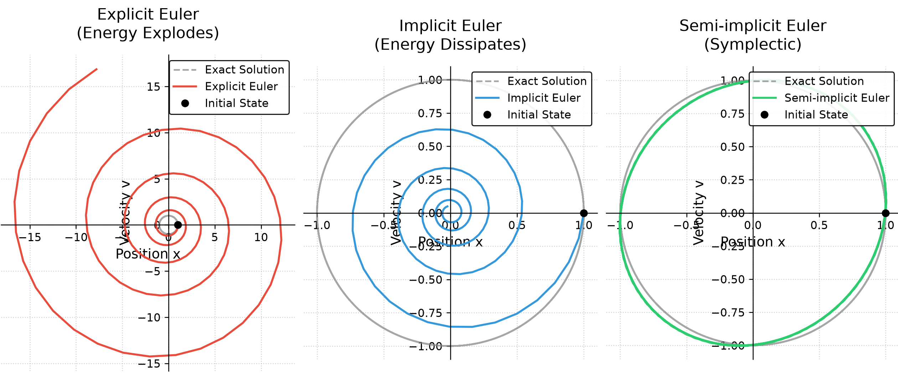
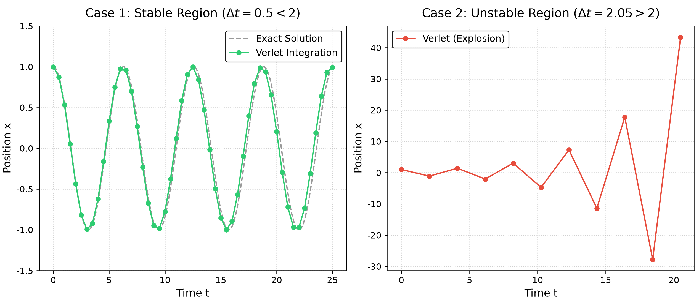
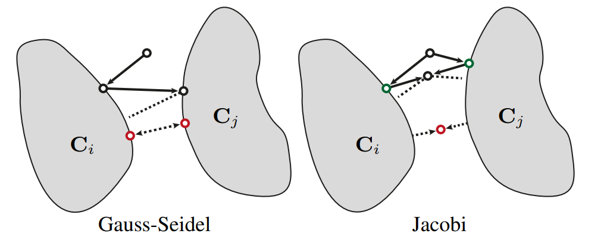

# 数值积分器与数值迭代法
## 数值积分器
&emsp;&emsp;数值积分器旨在对描述系统动力学的常微分方程组 $\dot{\mathbf{x}} = \mathbf{f}(\mathbf{x}, t)$ 进行离散求解。  
### 欧拉积分
&emsp;&emsp;以无阻尼简谐振子（$m=1, k=1$）为例，其初始机械能为 $E_t = \dfrac{1}{2}(v_t^2 + x_t^2)$。以下对比三种欧拉积分策略的演化特征。  
#### 显式欧拉（前向欧拉）
&emsp;&emsp;显式欧拉利用当前时刻来外推未来状态：
$$
x_{t+\Delta t} = x_t + v_t \Delta t, \quad v_{t+\Delta t} = v_t + a_t \Delta t
$$
&emsp;&emsp;系统在 $t$ 时刻的总能量为：
$$
E_t = \frac{1}{2}v_t^2 + \frac{1}{2}x_t^2
$$
&emsp;&emsp;系统在 $t+\Delta t$ 时刻的总能量为：
$$
E_{t+\Delta t} = \frac{1}{2}v_{t+\Delta t}^2 + \frac{1}{2}x_{t+\Delta t}^2 = E_t(1 + \Delta t^2)
$$
&emsp;&emsp;经过 $n$ 步迭代，系统总能量演变为：
$$
E_n = E_0 (1 + \Delta t^2)^n
$$
&emsp;&emsp;能量呈指数级发散。
#### 隐式欧拉（后向欧拉）
&emsp;&emsp;隐式欧拉利用未来时刻来推导当前状态：
$$
x_{t+\Delta t} = x_t + v_{t+\Delta t} \Delta t, \quad v_{t+\Delta t} = v_t + a_{t+\Delta t} \Delta t
$$
&emsp;&emsp;对于非线性系统，通常需要迭代求解。迭代 $n$ 步后能量变为： 
$$
E_{n} = E_0/(1+\Delta t^2)^n
$$
&emsp;&emsp;能量呈指数级衰减，产生显著的数值阻尼。
#### 半隐式欧拉（辛欧拉）
&emsp;&emsp;半隐式欧拉结合显式与隐式欧拉的特点，先显式更新速度，再用新速度更新位置：
$$
v_{t+\Delta t} = v_t + a_t \Delta t, \quad x_{t+\Delta t} = x_t + v_{t+\Delta t} \Delta t
$$
&emsp;&emsp;单步积分后的系统总能量展开为：
$$
E_{t+\Delta t} = E_t + \frac{1}{2}\Delta t^2(v_t^2 - x_t^2) - x_tv_t\Delta t^3 + \frac{1}{2}x_t^2\Delta t^4
$$
&emsp;&emsp;截断误差主项交替依赖于系统的动能（$v_t^2$）与势能（$x_t^2$），保持了严格的辛结构。
#### 相空间轨迹对比
&emsp;&emsp;将系统状态映射至由位置 $x$ 与动量 $mv$（$m=1$）构成的相空间。显式欧拉向外发散，隐式欧拉向内收缩，半隐式欧拉则表现为紧贴解析解的闭合环路。
 
### Verlet 积分
#### 公式推导
&emsp;&emsp;Verlet 积分是图形学中极具代表性的时间积分算法。我们将当前时刻 $t$ 的连续位置函数 $x(t)$ 分别向未来时刻 $(t + \Delta t)$ 与过去时刻 $(t - \Delta t)$ 进行带皮亚诺余项的 3 阶泰勒展开，设 $j(t)$ 为加加速度：
$$
\begin{align*}
x(t + \Delta t) &= x(t) + v(t)\Delta t + \frac{1}{2}a(t)\Delta t^2 + \frac{1}{6}j(t)\Delta t^3 + O(\Delta t^4) \\
x(t - \Delta t) &= x(t) - v(t)\Delta t + \frac{1}{2}a(t)\Delta t^2 - \frac{1}{6}j(t)\Delta t^3 + O(\Delta t^4)
\end{align*}
$$
&emsp;&emsp;将上述两式相加，包含速度与加加速度的奇数阶项相互抵消：
$$
x(t + \Delta t) + x(t - \Delta t) = 2x(t) + a(t)\Delta t^2 + O(\Delta t^4)
$$
&emsp;&emsp;移项并舍去高阶余项，将连续时间映射到离散序列（记 $x_n = x(t_n)$，$\Delta t$ 为常数步长），即可得到经典 Verlet 位置更新公式：
$$
x_{n+1} = 2x_n - x_{n-1} + a_n\Delta t^2
$$
#### 稳定性分析
&emsp;&emsp;沿用无阻尼简谐振子模型（$m=1, k=1$），将瞬时加速度 $a_n = -x_n$ 代入上式，可得常系数线性齐次差分方程 $x_{n+1} = (2 - \Delta t^2)x_n - x_{n-1}$。假设离散时间序列具有 $x_n = r^n$ 的形式，代入后得到系统特征方程：
$$
r^2 - (2 - \Delta t^2)r + 1 = 0
$$
&emsp;&emsp;由求根公式解得特征根，化简后形式为：
$$
r_{1,2} = 1 - \frac{\Delta t^2}{2} \pm \frac{\Delta t}{2}\sqrt{\Delta t^2 - 4}
$$
&emsp;&emsp;基于此进行区间讨论：  
&emsp;&emsp;稳定区间（$\Delta t < 2$）：根号下为负，特征根为共轭复数。经计算其谱半径严格满足 $\rho = |r| = 1$，数值解表现为等幅振荡。  
&emsp;&emsp;发散区间（$\Delta t > 2$）：方程有两个不等实根，其中一根必然满足 $r_1 < -1$。导致谱半径 $\rho = |r_1| > 1$，系统状态呈指数级震荡。
 
&emsp;&emsp;结合时间-位置曲线：在左图中（$\Delta t = 0.5 < 2$），积分轨迹完美呈现中性稳定的等幅振荡特性，且相位随时间推移出现了符合理论预期的微小偏移。而在右图中（$\Delta t = 2.05 > 2$），仅小幅越过临界值系统便迅速崩溃。对于该线性振荡系统，Verlet 积分本质上属于条件稳定方法，时间步长存在严格的上限约束。
## 约束求解的数值迭代算法
### 迭代法的概念
&emsp;&emsp;在物理仿真中，隐式积分或约束求解最终往往会转化为求解大型线性方程组的问题：
$$
A\mathbf{x} = \mathbf{b}
$$
&emsp;&emsp;其中，$A$ 是一个 $n \times n$ 的非奇异系数矩阵，$\mathbf{x}$ 是未知的列向量（如顶点的位移或速度），$\mathbf{b}$ 是已知的常数列向量。  
&emsp;&emsp;为了构建迭代求解器，我们首先将复杂的系数矩阵 $A$ 拆解为三个矩阵的加和：
$$
A = D + L + U
$$
&emsp;&emsp;其中，$D$ 是仅保留 $A$ 的对角线元素构成的对角矩阵，$L$ 是严格下三角矩阵，$U$ 是严格上三角矩阵。因此，原方程可等价重写为：
$$
(D + L + U)\mathbf{x} = \mathbf{b}
$$
&emsp;&emsp;雅可比迭代法（Jacobi Method）与高斯-塞德尔迭代法（Gauss-Seidel Method）的核心分歧，就在于对该矩阵方程的移项与变量更新策略。
### 雅可比迭代（Jacobi Method）
#### 矩阵推导
&emsp;&emsp;雅可比迭代的法则是，将对角矩阵 $D$ 保留在等号左侧，其余部分移至右侧：
$$
D\mathbf{x} = \mathbf{b} - (L + U)\mathbf{x}
$$
&emsp;&emsp;为了构建数值迭代，我们在等号右侧代入上一轮的旧值 $\mathbf{x}^{(k)}$，以此求解左侧的新一轮状态 $\mathbf{x}^{(k+1)}$：
$$
D\mathbf{x}^{(k+1)} = \mathbf{b} - (L + U)\mathbf{x}^{(k)}
$$
&emsp;&emsp;由于 $D$ 是对角矩阵，其求逆极其简单（仅需对主对角线元素取倒数）。等式两边同乘 $D^{-1}$，即可得到雅可比迭代的矩阵形式定义：
$$
\mathbf{x}^{(k+1)} = D^{-1}\left(\mathbf{b} - (L + U)\mathbf{x}^{(k)}\right)
$$
#### 分量公式
&emsp;&emsp;若将矩阵方程展开，第 $i$ 个未知数 $x_i$ 的更新公式为：
$$
x_i^{(k+1)} = \frac{1}{a_{ii}} \left( b_i - \sum_{\substack{j=1 \\ j \neq i}}^{n} a_{ij} x_j^{(k)} \right) \quad (i = 1, 2, \dots, n)
$$
&emsp;&emsp;雅可比迭代在计算第 $k+1$ 步的任何分量时，完全只依赖于第 $k$ 步的历史数据，这使得该算法具备极佳的并行计算能力。
### 高斯-塞德尔迭代（Gauss-Seidel Method）
#### 矩阵推导
&emsp;&emsp;高斯-塞德尔迭代的法则是，将对角矩阵 $D$ 与下三角矩阵 $L$ 共同留在等号左侧，仅将上三角矩阵 $U$ 移至右侧：
$$
(D + L)\mathbf{x}^{(k+1)} = \mathbf{b} - U\mathbf{x}^{(k)}
$$
&emsp;&emsp;两边同乘 $(D+L)^{-1}$，得到其矩阵形式定义：
$$
\mathbf{x}^{(k+1)} = (D + L)^{-1} \left( \mathbf{b} - U\mathbf{x}^{(k)} \right)
$$
#### 分量公式
&emsp;&emsp;将其展开至第 $i$ 个未知数 $x_i$：
$$
x_i^{(k+1)} = \frac{1}{a_{ii}} \left( b_i - \sum_{j=1}^{i-1} a_{ij} x_j^{(k+1)} - \sum_{j=i+1}^{n} a_{ij} x_j^{(k)} \right)
$$
&emsp;&emsp;高斯-塞德尔迭代在计算第 $i$ 个未知数时，排在其前方的分量（$j < i$）直接代入本轮 $(k+1)$ 的最新计算值，而其后方的分量（$j > i$）则沿用上一轮 $(k)$ 的旧值。这种有新值即刻使用的信息传播机制有效加速了系统的约束收敛。然而，这种严格的串行数据依赖也打破了计算的独立性，若不引入图着色等底层顶点分组策略，将难以直接在多核 GPU 架构上实现高效并行。
### 两种迭代法在 PBD 约束投影中的工程应用
&emsp;&emsp;在基于位置的动力学（Position-Based Dynamics, PBD）中，上述纯数学迭代被具象化为空间中顶点的几何投影过程。设 $K$ 与 $k$ 代表最大迭代上限与当前步数，$i, j \in V$ 为质点索引，$\mathbf{x}_i, \mathbf{x}_j \in \mathbb{R}^3$ 为其空间坐标；$e = \{i, j\} \in E$ 表示距离约束边，$L_e$ 为其原长。
#### 约束投影的雅可比迭代
&emsp;&emsp;雅可比方法在 PBD 中体现为“先独立累加，后统一平均”。设 $n_i \in \mathbb{N}$ 为关联顶点 $i$ 的约束总数，$\alpha$ 为松弛因子，用于控制迭代的收敛速度与稳定性。其算法流程如下：  
&emsp;&emsp;(1) For $k = 0 \dots K$  
&emsp;&emsp;(2) &emsp;&emsp;For every vertex $i \in V$  
&emsp;&emsp;(3) &emsp;&emsp;&emsp;&emsp;$\mathbf{x}_i^{\text{new}} \leftarrow \mathbf{0}, \quad n_i \leftarrow 0$  
&emsp;&emsp;(4) &emsp;&emsp;For every edge $e = \{i, j\} \in E$  
&emsp;&emsp;(5) &emsp;&emsp;&emsp;&emsp;$\Delta \mathbf{x} = \frac{1}{2}\left(\|\mathbf{x}_i - \mathbf{x}_j\| - L_e\right)\frac{\mathbf{x}_i - \mathbf{x}_j}{\|\mathbf{x}_i - \mathbf{x}_j\|}$  
&emsp;&emsp;(6) &emsp;&emsp;&emsp;&emsp;$\mathbf{x}_i^{\text{new}} \leftarrow \mathbf{x}_i^{\text{new}} + \mathbf{x}_i - \Delta \mathbf{x}$  
&emsp;&emsp;(7) &emsp;&emsp;&emsp;&emsp;$\mathbf{x}_j^{\text{new}} \leftarrow \mathbf{x}_j^{\text{new}} + \mathbf{x}_j + \Delta \mathbf{x}$  
&emsp;&emsp;(8) &emsp;&emsp;&emsp;&emsp;$n_i \leftarrow n_i + 1, \quad n_j \leftarrow n_j + 1$  
&emsp;&emsp;(9) &emsp;&emsp;For every vertex $i \in V$  
&emsp;&emsp;(10)&emsp;&emsp;&emsp;&emsp;$\mathbf{x}_i \leftarrow (\mathbf{x}_i^{\text{new}} + \alpha\mathbf{x}_i) / (n_i + \alpha)$  
&emsp;&emsp;该方法由于没有先后更新的偏向性，易用 GPU 进行大规模并行计算，但其收敛速度相对较慢。
#### 约束投影的高斯-塞德尔迭代
&emsp;&emsp;高斯-塞德尔方法在 PBD 中体现为“对每条约束边即刻投影覆盖”。其算法流程如下：  
&emsp;&emsp;(1) For $k = 0 \dots K$  
&emsp;&emsp;(2) &emsp;&emsp;For every edge $e = \{i, j\} \in E$  
&emsp;&emsp;(3) &emsp;&emsp;&emsp;&emsp;$\Delta \mathbf{x} = \frac{1}{2}\left(\Vert{}\mathbf{x}_i - \mathbf{x}_j\Vert{} - L_e\right)\frac{\mathbf{x}_i - \mathbf{x}_j}{\Vert{}\mathbf{x}_i - \mathbf{x}_j\Vert{}}$  
&emsp;&emsp;(4) &emsp;&emsp;&emsp;&emsp;$\mathbf{x}_i \leftarrow \mathbf{x}_i - \Delta \mathbf{x}$  
&emsp;&emsp;(5) &emsp;&emsp;&emsp;&emsp;$\mathbf{x}_j \leftarrow \mathbf{x}_j + \Delta \mathbf{x}$  
&emsp;&emsp;迭代次数越多，系统就能更好地逼近所有弹簧的约束流形。然而，该方法中边的处理顺序会对最终形态产生偏向性影响，且由于其数据依赖性，很难直接实现 GPU 并行化。
#### 约束集不存在可行解的情况
 
&emsp;&emsp;在某些极端形变或相互矛盾的刚性约束下，多个约束集之间可能不存在可行解。如图所示，若使用高斯-塞德尔算法，由于其就地更新特性，估计值会在不相交的不同约束流形之间（图示红点）产生剧烈的数值震荡。  
&emsp;&emsp;相反，雅可比算法通过并行地将当前估计值投影到各个约束集（图示绿点），并在最终步骤中利用加权平均（或质量分摊）进行欠松弛更新。这种全局策略使得雅可比迭代即使在无解的情况下，也能收敛到一个相对稳定的折中位置，从而有效避免了数值发散。
&emsp;&emsp;
&emsp;&emsp;
&emsp;&emsp;
&emsp;&emsp;