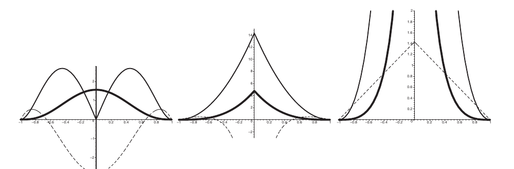

# 核函数
## 1、参考文献
1. Müller, M., Charypar, D., & Gross, M. Particle-Based Fluid Simulation for Interactive Applications. *Proceedings of the 2003 ACM SIGGRAPH/Eurographics Symposium on Computer Animation*, 2003: 154–159. [DOI](https://doi.org/10.2312/SCA03/154-159)
2. Monaghan, J. J. Smoothed Particle Hydrodynamics. *Annual Review of Astronomy and Astrophysics*, 1992, 30: 543–574.
3. Wang, H. GAMES103: Introduction to Physics-Based Animation, Lecture 12: Smoothed Particle Hydrodynamics. 2022. [Slides](https://slides.games-cn.org/course/GAMES103-12-SPH.pptx)

## 2、概念
&emsp;&emsp;平滑核函数（Smoothing Kernel）用于把离散粒子的物理量插值为连续场，并在不建立固定网格的情况下近似计算空间导数。SPH 与 PBF 使用核函数估计密度、压力梯度、速度平滑和表面相关量。

&emsp;&emsp;核函数不直接规定流体如何运动，而是提供一种空间采样规则。物理模型决定需要估计哪些场，核函数决定如何把邻域粒子的有限样本转换为该位置的近似值。

## 3、连续积分与离散近似
&emsp;&emsp;连续场 $A(\mathbf{x})$ 可以通过核函数与周围空间加权积分进行平滑：
$$
\left\langle A\right\rangle\left(\mathbf{x}\right)
=\int_\Omega
A\left(\mathbf{x}'\right)
W\left(\mathbf{x}-\mathbf{x}',h\right)
\mathrm{d}\mathbf{x}'
\tag{1}
$$
其中，$h$ 为平滑长度，$\Omega$ 为核函数的支撑域。核函数在支撑域外应为零，或衰减到可忽略的程度。

&emsp;&emsp;将连续积分替换为粒子求和，可以把粒子 $j$ 的体积写成 $V_j=m_j/\rho_j$，于是粒子 $i$ 处的场估计为：
$$
\left\langle A_i\right\rangle
=\sum_j
\frac{m_j}{\rho_j}
A_jW\left(\mathbf{x}_i-\mathbf{x}_j,h\right)
\tag{2}
$$
若系统总质量为 $M$、粒子数为 $N$，且每个粒子质量相等，则 $m_j=M/N$，式 (2) 可写成：
$$
\left\langle A_i\right\rangle
=\frac{M}{N}
\sum_j
\frac{A_j}{\rho_j}
W\left(\mathbf{x}_i-\mathbf{x}_j,h\right)
$$
物理量保存在粒子上，核函数负责决定每个邻域粒子对目标位置的贡献权重。

## 4、核函数条件
&emsp;&emsp;为了让式 (1) 成为合理的场近似，核函数通常需要满足归一化条件：
$$
\int_\Omega
W\left(\mathbf{x},h\right)
\mathrm{d}\mathbf{x}
=1
\tag{3}
$$
归一化保证常值场经过核平滑后仍近似保持原值。流体系统的质量守恒由粒子质量、质量和密度更新、边界条件以及时间积分共同保证，不能只归因于核函数归一化。

&emsp;&emsp;在三维空间中，缩放核通常写成：
$$
W\left(\mathbf{x},h\right)
=\frac{1}{h^3}
K\left(\frac{\mathbf{x}}{h}\right)
$$
当 $h\to0$ 且粒子采样足够密集时，核函数趋近于狄拉克 $\delta$ 函数：
$$
\lim_{h\to0}
W\left(\mathbf{x},h\right)
=\delta\left(\mathbf{x}\right)
$$
此时平滑场会趋近于原始局部值。

&emsp;&emsp;有限粒子数下，仅让 $h\to0$ 并不足以保证准确；还需要邻域内有足够多的粒子。否则支撑域内的采样过少，积分近似误差会重新增大。

&emsp;&emsp;核函数通常取偶函数：
$$
W\left(\mathbf{x},h\right)
=W\left(-\mathbf{x},h\right)
$$
这一性质使核函数只依赖粒子间距离，也有利于构造成对、对称的粒子相互作用。

## 5、空间导数
&emsp;&emsp;若把导数作用于目标位置处的核函数，而不对粒子携带的常量 $A_j$ 求导，可以得到离散梯度近似：
$$
\nabla_i\left\langle A_i\right\rangle
=\sum_j
\frac{m_j}{\rho_j}
A_j
\nabla_iW\left(\mathbf{x}_i-\mathbf{x}_j,h\right)
\tag{4}
$$
其中，$\nabla_i$ 表示对 $\mathbf{x}_i$ 求导。核函数的解析形式已知，因此代码可以直接计算它与位置差，而不需要为粒子系统建立空间网格。

&emsp;&emsp;式 (4) 是对核加权积分的离散近似，并不是对任意场都严格成立的恒等式。核宽度、邻域采样密度以及核函数的光滑性都会影响梯度误差。

## 6、高斯核
&emsp;&emsp;三维高斯核为：
$$
W_{gaussian}\left(r,h\right)
=\left(\frac{1}{\pi h^2}\right)^{3/2}
\exp\left(-\frac{r^2}{h^2}\right)
\tag{5}
$$
其中，$r=\left\|\mathbf{x}_i-\mathbf{x}_j\right\|$。高斯核具有无限支撑域，距离越近权重越大，但理论上空间中所有粒子都会产生贡献。

&emsp;&emsp;高斯核光滑、稳定且精度较高，但需要处理全空间粒子或人为截断支撑域。实时流体模拟通常更偏好紧支撑核，使每个粒子只查询有限邻域。

## 7、Poly6 核
&emsp;&emsp;Poly6 是一个紧支撑核，在三维空间中的定义为：
$$
W_{poly6}\left(r,h\right)
=
\begin{cases}
\dfrac{315}{64\pi h^9}
\left(h^2-r^2\right)^3,
&0\le r\le h\\
0,
&r>h
\end{cases}
\tag{6}
$$
$(h^2-r^2)^3$ 在 $r=h$ 处连同若干阶导数平滑衰减到零，适合估计密度、颜色场以及人工压力项中的核比值。

&emsp;&emsp;Poly6 对位置向量的梯度为：
$$
\nabla W_{poly6}\left(\mathbf{r},h\right)
=-\frac{945}{32\pi h^9}
\left(h^2-r^2\right)^2\mathbf{r}
\tag{7}
$$
其中，$\mathbf{r}=\mathbf{x}_i-\mathbf{x}_j$。当 $r\to0$ 时，式 (7) 含有因子 $\mathbf{r}$，因此梯度趋近于零。

&emsp;&emsp;在粒子几乎重合时，Poly6 无法提供足够强的排斥方向，容易让粒子聚集。因此可以稳定估计密度，并不代表它适合直接承担压力梯度计算。

## 8、Spiky 核
&emsp;&emsp;Spiky 核在三维空间中的定义为：
$$
W_{spiky}\left(r,h\right)
=
\begin{cases}
\dfrac{15}{\pi h^6}
\left(h-r\right)^3,
&0\le r\le h\\
0,
&r>h
\end{cases}
\tag{8}
$$
与 Poly6 的平滑顶部不同，Spiky 的梯度在中心附近不会因为额外的径向因子而立即消失，因此更适合压力梯度和密度约束投影。

&emsp;&emsp;Spiky 对位置向量的梯度为：
$$
\nabla W_{spiky}\left(\mathbf{r},h\right)
=-\frac{45}{\pi h^6}
\left(h-r\right)^2
\frac{\mathbf{r}}{r}
\tag{9}
$$
当 $r>0$ 时，梯度的模长为：
$$
\left\|\nabla W_{spiky}\right\|
=\frac{45}{\pi h^6}
\left(h-r\right)^2
$$
随 $r\to0$，梯度模长趋近于有限最大值 $45/(\pi h^4)$，但方向项 $\mathbf{r}/r$ 在完全重合时没有定义。

&emsp;&emsp;工程实现通常会在 $r$ 小于一个正阈值时跳过计算，或为重合粒子选择一个安全的默认方向，避免除以零。当前 PBF 求解器在邻居循环中过滤 $r\le10^{-6}$ 的粒子对，因此实际代码不会直接计算完全重合位置上的单位方向。

## 9、粘度核
&emsp;&emsp;经典 SPH 粘度核为：
$$
W_{viscosity}\left(r,h\right)
=
\frac{15}{2\pi h^3}
\left(
-\frac{r^3}{2h^3}
+\frac{r^2}{h^2}
+\frac{h}{2r}
-1
\right),
\quad 0<r\le h
$$
它的拉普拉斯算子在支撑域内保持非负：
$$
\nabla^2W_{viscosity}\left(r,h\right)
=\frac{45}{\pi h^6}\left(h-r\right)
$$
因此能平滑速度差，而不会在近距离产生反向加速。

&emsp;&emsp;当前 PBF 粒子的 XSPH 粘度使用 Poly6 作为速度差权重，并未实现上述独立的粘度核。密度计算使用 Poly6，密度约束的梯度使用 Spiky；人工压力项也通过 Poly6 核比值构造。三种经典核的职责在论文中相互区分，但具体项目可以按稳定性与性能需求选择更简单的组合。

## 10、函数曲线对比
&emsp;&emsp;Müller 等人的原始论文图 2 同时给出了三种核心函数的径向剖面。从左到右依次为 Poly6、Spiky 与粘度核；每个子图中粗线表示核函数本身，细线表示梯度，虚线表示拉普拉斯算子。原图各子图采用不同纵轴尺度，因此更适合比较曲线形态和中心附近行为，而不是直接比较三条曲线的绝对大小。

  

图源：Müller、Charypar、Gross，*Particle-Based Fluid Simulation for Interactive Applications*，SCA 2003，Figure 2。

&emsp;&emsp;Poly6 的梯度在 $r=0$ 处为零，两条细线随着距离增大才达到峰值；Spiky 的梯度在中心附近保持较大的排斥响应；粘度核的虚线拉普拉斯在整个支撑域内保持非负。这组对照直接说明了三种核在密度、压力梯度和黏性项中的分工。

## 11、延伸阅读
- 作品：[Unity 实时柔性体与粒子流体系统](<../../../../作品/计算机图形学/物理/Unity 实时柔性体与粒子流体系统：基于 XPBD 与 PBF 的物理模拟.md>)
- 文章：[PBF 粒子流体模拟](../../../../文章/计算机图形学/物理/水动力学仿真/PBF%20粒子流体模拟.md)
- 笔记：[纳维-斯托克斯方程](../纳维-斯托克斯方程.md)、[场论](../../../数学/分析学/场论.md)、[数值积分器](../../../计算机图形学/物理/数值计算基础/数值积分器.md)
