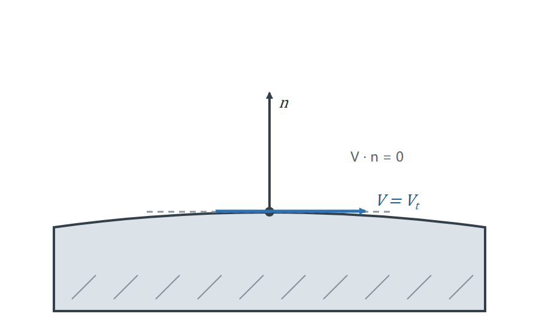
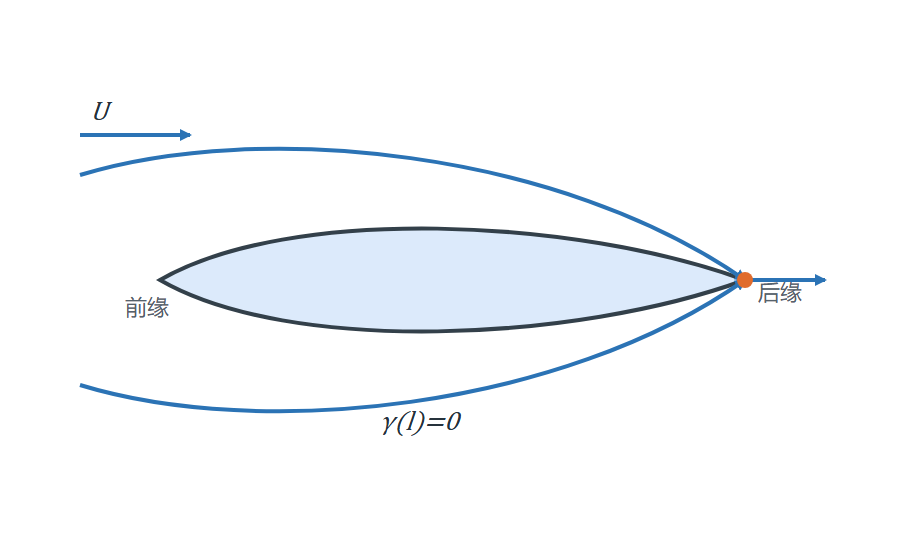
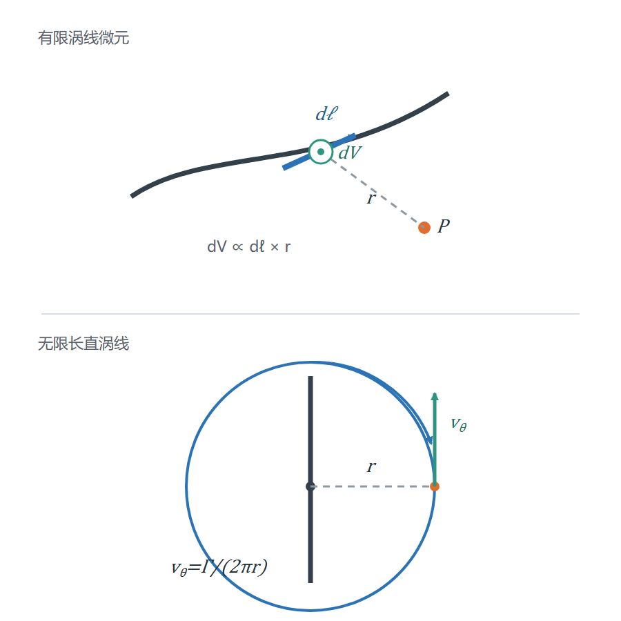
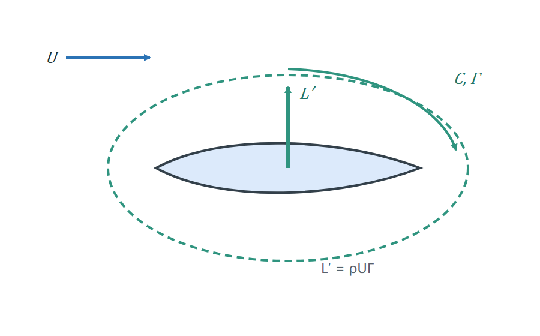

# 空气动力学的一些基础定理
## 1、无穿透条件
&emsp;&emsp;无穿透条件表示流体不能穿过固体表面，只能沿表面切向流动。设固体表面的单位法向量为 $\mathbf{n}$、流体速度为 $\mathbf{V}$，则边界上的法向速度必须为零：
$$
\mathbf{V}\cdot\mathbf{n}=0
$$

  

## 2、Kutta 条件
&emsp;&emsp;Kutta 条件描述尖锐后缘处的流动约束：气流必须从上下表面平滑汇合后离开后缘，后缘速度不能出现无限大的奇点。在二维薄翼的涡片模型中，这一条件写成后缘处的环量密度为零：
$$
\gamma(l)=0
$$

  

## 3、Biot-Savart 定律
&emsp;&emsp;设涡线上的有向线元为 $\mathrm{d}\boldsymbol\ell$，从该线元指向观测点的位置矢量为 $\mathbf{r}$，其长度为 $r$，线元对应的环量为 $\Gamma$。线元在观测点产生的速度增量为：
$$
\mathrm{d}\mathbf{V}
=\frac{\Gamma}{4\pi}
\frac{\mathrm{d}\boldsymbol\ell\times\mathbf{r}}{r^3}
$$

&emsp;&emsp;对于无限长直涡线，距离涡线 $r$ 处的诱导速度只有绕涡线的切向分量：
$$
v_\theta=\frac{\Gamma}{2\pi r}
$$

  

速度方向由环量正方向按右手定则确定。

## 4、Kutta-Joukowski 定理
&emsp;&emsp;速度环量定义为一个闭合回路上的速度切向分量沿回路的积分：
$$
\Gamma=\oint_C\mathbf{V}\cdot\mathrm{d}\mathbf{l}
$$
其中 $C$ 是围绕物体的闭合回路，$\mathbf{V}$ 是局部流体速度，$\mathrm{d}\mathbf{l}$ 是有向线元。

&emsp;&emsp;Kutta-Joukowski 定理给出二维物体单位展长上的升力：
$$
L'=\rho U\Gamma
$$

  

其中 $L'$ 的单位为 $\mathrm{N/m}$，$\rho$ 为流体密度，$U$ 为远场来流速度，$\Gamma$ 为净环量。升力方向垂直于来流，正负号由环量方向决定。

## 5、二次阻力定律
&emsp;&emsp;在常用高雷诺数近似下，物体受到的空气阻力可用二次阻力定律描述。令物体相对气流的速度为 $\mathbf{v}_{rel}=\mathbf{v}_{body}-\mathbf{v}_{air}$，阻力为：
$$
\mathbf{F}_d
=-\frac{1}{2}\rho C_d A\left\|\mathbf{v}_{rel}\right\|\mathbf{v}_{rel}
$$
其中 $\rho$ 为流体密度，$C_d$ 为无量纲阻力系数，$A$ 为垂直于相对来流的有效迎风面积。负号表示阻力始终与物体的相对运动方向相反。

## 6、延伸阅读
- 作品：[Unity 实时柔性体与粒子流体系统](<../../../../作品/计算机图形学/物理/Unity 实时柔性体与粒子流体系统：基于 XPBD 与 PBF 的物理模拟.md>)
- 文章：[基于 Perlin 噪声的实时风场模拟](../../../../文章/计算机图形学/物理/空气动力学仿真/基于%20Perlin%20噪声的实时风场模拟.md)、[基于 Tanabe-Kaneko 模型的落叶模拟](../../../../文章/计算机图形学/物理/空气动力学仿真/基于%20Tanabe-Kaneko%20模型的落叶模拟.md)
- 笔记：[Tanabe-Kaneko 模型](../../../计算机图形学/物理/空气动力学仿真/Tanabe-Kaneko%20模型.md)
