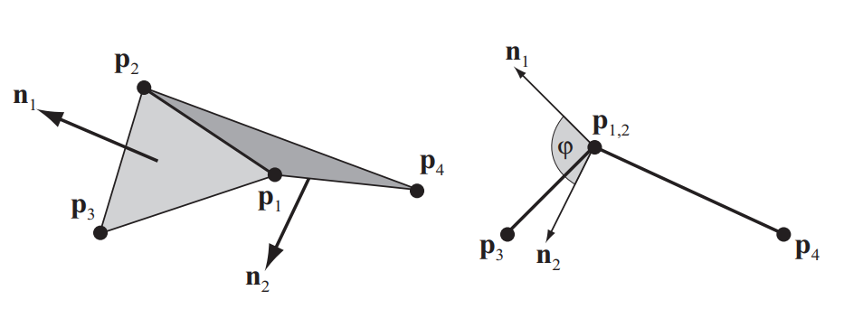

# 弯曲约束

## 二面角约束 (Dihedral Angle Constraint)
&emsp;&emsp;对于弯曲抵抗，使用了约束函数 $C(\mathbf{p}_1, \mathbf{p}_2, \mathbf{p}_3, \mathbf{p}_4) = \arccos(d) - \phi_0$，其中 $d = \mathbf{n}_1 \cdot \mathbf{n}_2 = \mathbf{n}_1^T \mathbf{n}_2$。在不失一般性的前提下，我们令顶点 $\mathbf{p}_1 = 0$（即设为原点），从而得到两个三角形的法向量，分别为 $\mathbf{n}_1 = \dfrac{\mathbf{p}_2 \times \mathbf{p}_3}{|\mathbf{p}_2 \times \mathbf{p}_3|}$ 和 $\mathbf{n}_2 = \dfrac{\mathbf{p}_2 \times \mathbf{p}_4}{|\mathbf{p}_2 \times \mathbf{p}_4|}$。已知反余弦函数的导数为 $\dfrac{d}{dx} \arccos(x) = -\dfrac{1}{\sqrt{1-x^2}}$，我们可以推导出以下梯度：
$$
\begin{align}
\nabla_{\mathbf{p}_3}C&=-\frac{1}{\sqrt{1-d^2}}[(\frac{\partial\mathbf{n}_1}{\partial\mathbf{p}_3})^\mathbf{T}\mathbf{n_2}]\\
\nabla_{\mathbf{p}_4}C&=-\frac{1}{\sqrt{1-d^2}}[(\frac{\partial\mathbf{n}_2}{\partial\mathbf{p}_4})^\mathbf{T}\mathbf{n_1}]\\    
\nabla_{\mathbf{p}_2}C&=-\frac{1}{\sqrt{1-d^2}}[(\frac{\partial\mathbf{n}_1}{\partial\mathbf{p}_2})^\mathbf{T}\mathbf{n_2}+(\frac{\partial\mathbf{n}_2}{\partial\mathbf{p}_2})^\mathbf{T}\mathbf{n_1}]\\ 
\end{align}
$$
&emsp;&emsp;对于弯曲约束，如果把整个二面角系统（四个点）一起平移，弯曲角度应该是不变的。这意味着：
$$
\Delta C = \sum_{i=1}^{n} \nabla_{\mathbf{p}_i} C \cdot \mathbf{\epsilon} = \left( \sum_{i=1}^{n} \nabla_{\mathbf{p}_i} C \right) \cdot \mathbf{\epsilon}=0
$$
&emsp;&emsp;其中，$\epsilon$ 是全局位移 $\Delta \mathbf{p}$。所以：
$$
\begin{align}
\nabla_{\mathbf{p}_1}C=-\nabla_{\mathbf{p}_2}C-\nabla_{\mathbf{p}_3}C-\nabla_{\mathbf{p}_4}C    
\end{align}
$$
&emsp;&emsp;给定归一化叉乘向量 $\mathbf{n} = \frac{\mathbf{p}_1 \times \mathbf{p}_2}{|\mathbf{p}_1 \times \mathbf{p}_2|}$，其对第一个向量 $\mathbf{p}_1$ 的偏导数（雅可比矩阵）为：
$$
\begin{align}
J=\frac{\partial \mathbf{n}}{\partial \mathbf{p}_1} = 
\begin{bmatrix}
\dfrac{\partial n_x}{\partial p_{1x}} & \dfrac{\partial n_x}{\partial p_{1y}} & \dfrac{\partial n_x}{\partial p_{1z}} \\
\dfrac{\partial n_y}{\partial p_{1x}} & \dfrac{\partial n_y}{\partial p_{1y}} & \dfrac{\partial n_y}{\partial p_{1z}} \\
\dfrac{\partial n_z}{\partial p_{1x}} & \dfrac{\partial n_z}{\partial p_{1y}} & \dfrac{\partial n_z}{\partial p_{1z}}
\end{bmatrix}
\end{align}
$$
&emsp;&emsp;根据链式法则，有：
$$
J=\frac{\partial \mathbf{n}}{\partial \mathbf{p}_1} = \frac{\partial \mathbf{n}}{\partial \mathbf{v}} \frac{\partial \mathbf{v}}{\partial \mathbf{p}_1}  
$$
&emsp;&emsp;其中 $\mathbf{v}=\mathbf{p}_1 \times \mathbf{p}_2$ 是未归一化的法向量。  
&emsp;&emsp;设 $L = \sqrt{\mathbf{v}^T \mathbf{v}}=|\mathbf{v}|$，那么$\mathbf{n}=\dfrac{\mathbf{v}}{L}$，考虑第一项，有：
$$
\frac{\partial \mathbf{n}}{\partial \mathbf{v}} = \frac{(\frac{\partial \mathbf{v}}{\partial \mathbf{v}})  L - \mathbf{v}  (\frac{\partial L}{\partial \mathbf{v}})}{L^2}
$$
&emsp;&emsp;其中
$$
\frac{\partial \mathbf{v}}{\partial \mathbf{v}}=\mathbf{I}\\
\frac{\partial L}{\partial \mathbf{v}}=\frac{1}{2\sqrt{\mathbf{v}^T \mathbf{v}}}2\mathbf{v}^T=\mathbf{n}^{\mathbf{T}}
$$
&emsp;&emsp;于是
$$
\frac{\partial \mathbf{n}}{\partial \mathbf{v}} = \frac{1}{L} \left( \mathbf{I} - \mathbf{n}\mathbf{n}^T \right)
$$
&emsp;&emsp;考虑第二项，叉乘可以写成矩阵乘法形式。利用反对称矩阵 $\tilde{\mathbf{p}}_2$：
$$
\mathbf{v} = \mathbf{p}_1 \times \mathbf{p}_2 = -(\mathbf{p}_2 \times \mathbf{p}_1) = -\tilde{\mathbf{p}}_2 \mathbf{p}_1
$$
&emsp;&emsp;其中 $\tilde{\mathbf{p}}_2 = \begin{bmatrix} 0 & -p_{2z} & p_{2y} \\ p_{2z} & 0 & -p_{2x} \\ -p_{2y} & p_{2x} & 0 \end{bmatrix}$， 于是  
$$
\frac{\partial \mathbf{v}}{\partial \mathbf{p}_1} = -\tilde{\mathbf{p}}_2 = \begin{bmatrix} 0 & p_{2z} & -p_{2y} \\ -p_{2z} & 0 & p_{2x} \\ p_{2y} & -p_{2x} & 0 \end{bmatrix}
$$
&emsp;&emsp;从而
$$
J=\frac{1}{|\mathbf{p}_1\times\mathbf{p}_2|}[-\tilde{\mathbf{p}}_2+\mathbf{n}(\mathbf{n}\times\mathbf{p}_2)^{\mathbf{T}}]
$$
&emsp;&emsp;令 $\mathbf{q}_i$ 满足 $\nabla_{\mathbf{p}_i}C=\dfrac{1}{\sqrt{1-d^2}}\mathbf{q}_i$ ，那么：
$$
\begin{align*}
\mathbf{q}_3&=-(\frac{\partial\mathbf{n}_1}{\partial\mathbf{p}_3})^\mathbf{T}\mathbf{n_2}\\
&=-\frac{1}{L_1} \left[\tilde{\mathbf{p}}_2 - \mathbf{n}_1 (\mathbf{n}_1 \times \mathbf{p}_2)^\mathbf{T} \right]^{\mathbf{T}}\mathbf{n}_2\\
&=-\frac{1}{L_1} \left[\tilde{\mathbf{p}}_2^{\mathbf{T}} - (\mathbf{n}_1 \times \mathbf{p}_2)\mathbf{n}_1^\mathbf{T}\right]\mathbf{n}_2\\ 
&=-\frac{1}{L_1} \left[-\tilde{\mathbf{p}}_2 - (\mathbf{n}_1 \times \mathbf{p}_2)\mathbf{n}_1^\mathbf{T}\right]\mathbf{n}_2\\
&=-\frac{1}{L_1} \left[-\tilde{\mathbf{p}}_2\mathbf{n}_2 - (\mathbf{n}_1 \times \mathbf{p}_2)\mathbf{n}_1^\mathbf{T}\mathbf{n}_2\right]\\ 
&=-\frac{1}{L_1} \left[\mathbf{n}_2\times\mathbf{p}_2 - (\mathbf{n}_1 \times \mathbf{p}_2)d\right]\\   
&=\frac{\mathbf{p}_2\times\mathbf{n}_2 + (\mathbf{n}_1 \times \mathbf{p}_2)d}{|\mathbf{p}_2\times\mathbf{p}_3|}\\    
\end{align*}
$$
&emsp;&emsp;于是
$$
\begin{align}
\mathbf{q}_3 &= \frac{\mathbf{p}_2 \times \mathbf{n}_2 + (\mathbf{n}_1 \times \mathbf{p}_2)d}{|\mathbf{p}_2 \times \mathbf{p}_3|}\\
\mathbf{q}_4 &= \frac{\mathbf{p}_2 \times \mathbf{n}_1 + (\mathbf{n}_2 \times \mathbf{p}_2)d}{|\mathbf{p}_2 \times \mathbf{p}_4|}\\
\mathbf{q}_2 &= -\frac{\mathbf{p}_3 \times \mathbf{n}_2 + (\mathbf{n}_1 \times \mathbf{p}_3)d}{|\mathbf{p}_2 \times \mathbf{p}_3|} - \frac{\mathbf{p}_4 \times \mathbf{n}_1 + (\mathbf{n}_2 \times \mathbf{p}_4)d}{|\mathbf{p}_2 \times \mathbf{p}_4|}\\
\mathbf{q}_1 &= -\mathbf{q}_2 - \mathbf{q}_3 - \mathbf{q}_4
\end{align}
$$
&emsp;&emsp;最终公式为：
$$
\begin{align}
\Delta \mathbf{p}_i = - \frac{w_i \sqrt{1-d^2} (\arccos(d) - \phi_0)}{\sum_j w_j |\mathbf{q}_j|^2} \mathbf{q}_i    
\end{align}
$$
&emsp;&emsp;
&emsp;&emsp;
&emsp;&emsp;
&emsp;&emsp;
&emsp;&emsp;
&emsp;&emsp;
&emsp;&emsp;
&emsp;&emsp;  
&emsp;&emsp;
&emsp;&emsp;
&emsp;&emsp;
&emsp;&emsp;
&emsp;&emsp;
&emsp;&emsp;
&emsp;&emsp;
&emsp;&emsp;
&emsp;&emsp;
&emsp;&emsp;
&emsp;&emsp;
&emsp;&emsp;
&emsp;&emsp;
&emsp;&emsp;
&emsp;&emsp;
&emsp;&emsp;
&emsp;&emsp;
&emsp;&emsp;
