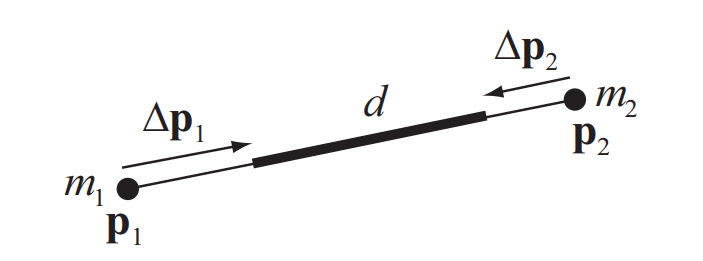

# 距离约束
 
&emsp;&emsp;假设系统包含两个质量均为 $m$ 的质点，其逆质量为 $\omega=\frac{1}{m}$。定义二者之间的距离约束，并设其合规度为 $\alpha$。    
&emsp;&emsp;为了抵抗拉伸形变，考虑距离约束函数 $C(\mathbf{p}_1, \mathbf{p}_2) = |\mathbf{p}_1 - \mathbf{p}_2| - d$。令相对位置向量 $\mathbf{r} = \mathbf{p}_1 - \mathbf{p}_2$，其模长 $L = |\mathbf{r}| = \sqrt{\mathbf{r} \cdot \mathbf{r}}$。计算约束梯度的过程如下：  
$$
\begin{align*}
\nabla_{\mathbf{p}_1} C &= \frac{\partial \sqrt{\mathbf{r} \cdot \mathbf{r}}}{\partial \mathbf{p}_1}\\
&= \frac{1}{2L}  (2\mathbf{r})\\
&= \frac{\mathbf{p}_1 - \mathbf{p}_2}{|\mathbf{p}_1 - \mathbf{p}_2|}\\
\nabla_{\mathbf{p_2}}C&=-\frac{\mathbf{p_1}-\mathbf{p_2}}{|\mathbf{p_1}-\mathbf{p_2}|}\\    
\end{align*}
$$
&emsp;&emsp;此时，广义逆质量项为 $\mathbf{M}^{-1} = 2\omega$。  
&emsp;&emsp;根据 XPBD 框架，拉格朗日乘子的单步更新量计算公式为：
$$
\begin{align}
\Delta \lambda_j = \frac{-C_j(\mathbf{x}_i) - \tilde{\alpha}_j \lambda_j}{\nabla C_j \mathbf{M}^{-1} \nabla C_j^T + \tilde{\alpha}_j}
\end{align}
$$
&emsp;&emsp;为了简化稳定性分析，我们考察最严苛的边界条件：假设在单次投影步中，忽略前序迭代累积的拉格朗日乘子（即设定 $\lambda=0$）    
&emsp;&emsp;基于此假设，乘子更新量 $\Delta\lambda$ 简化为：  
$$
\Delta\lambda=\frac{-C}{2\omega+\dfrac{\alpha}{\Delta t^2}}=\frac{-\Delta t^2}{2\omega\Delta t^2+\alpha}C
$$
&emsp;&emsp;进一步，对应的单次位置修正量模长为：
$$
\begin{align}
|\Delta \mathbf{p}| = \frac{-\omega\Delta t^2}{2\omega\Delta t^2+\alpha}C\\
\end{align}
$$
&emsp;&emsp;为便于后续的线性动力学分析，我们提取上述公式中的系数，将其定义为等效数值刚度系数 $k$：  
$$
\begin{align}
k = \frac{-\omega\Delta t^2}{2\omega\Delta t^2+\alpha}\\
\end{align}
$$
&emsp;&emsp;从而将位置修正过程抽象为：
$$
|\Delta \mathbf{p}| = kC\\
$$
&emsp;&emsp;假设系统当前处于第 $i$ 次离散时间步，该步的残差为 $C_i$，相对速度为 $v_i$。系统在经过约束修正后的半隐式积分更新方程可近似表示为：      
&emsp;&emsp;速度更新： $v_{i+1} = v_i + \dfrac{k}{\Delta t} C_i$   
&emsp;&emsp;位置更新：$C_{i+1} = C_i + \Delta t \cdot v_{i+1}$  
&emsp;&emsp;定义系统状态向量 $\mathbf{S} = \begin{bmatrix} v \\ C \end{bmatrix}$，将上述迭代过程重写为 $2 \times 2$ 的矩阵形式：  
$$
\begin{bmatrix} v_{i+1} \\ C_{i+1} \end{bmatrix} = \begin{bmatrix} 1 & \dfrac{k}{\Delta t} \\ \Delta t & 1 + k \end{bmatrix} \begin{bmatrix} v_i \\ C_i \end{bmatrix}
$$
&emsp;&emsp;提取出全局状态转移矩阵 $\mathbf{A}$：
$$
\mathbf{A} = \begin{bmatrix} 1 & \dfrac{k}{\Delta t} \\ \Delta t & 1 + k \end{bmatrix}
$$
&emsp;&emsp;根据离散动力系统理论，系统的渐近稳定性取决于状态转移矩阵 $\mathbf{A}$ 的谱特征。求解其特征方程 $\det(\mathbf{A} - \lambda \mathbf{I}) = 0$：  
$$
\det \begin{bmatrix} 1-\lambda & \dfrac{k}{\Delta t} \\ \Delta t & 1 + k - \lambda \end{bmatrix} = 0
$$
&emsp;&emsp;展开行列式，整理得特征多项式：  
$$
(1-\lambda)(1 + k - \lambda) - \left(\dfrac{k}{\Delta t} \cdot \Delta t\right) = 0
$$
$$
\lambda^2 - (2 + k)\lambda + 1 = 0
$$
&emsp;&emsp;根据线性系统稳定准则，为避免系统出现指数级发散，状态转移矩阵的谱半径必须满足 $\rho(\mathbf{A}) \le 1$。    
&emsp;&emsp;观察我们的特征方程 $\lambda^2 - (2 - \kappa)\lambda + 1 = 0$：  
&emsp;&emsp;观察上述特征方程，由韦达定理可知，两特征根之积 $\lambda_1 \cdot \lambda_2 = 1$。这意味着，只要方程的根 $\lambda_1, \lambda_2$ 是一对共轭复数，就必然满足 $|\lambda_1| = |\lambda_2| = 1$。此时系统处于临界稳定（边界简谐振荡）状态。    
&emsp;&emsp;一元二次方程具备共轭复根的充要条件是判别式 $\Delta \le 0$：  
  
$$
\Delta = B^2 - 4AC \le 0
$$
&emsp;&emsp;代入方程参数 $B = -(2 + k)$，$A = 1$，$C = 1$：
$$
(2 + k)^2 - 4 \le 0
$$
$$
-4 \le k \le 0
$$
&emsp;&emsp;考虑到在常规物理修正方向下 $k$ 必为负值，因此右侧的不等式 $k \le 0$ 恒成立。我们仅提取左侧的有效约束：  
$$
k \ge -4
$$
&emsp;&emsp;这是系统的绝对稳定边界：即等效数值刚度系数不可低于 $-4$。  
&emsp;&emsp;最终，将等效数值刚度系数 $k$ 的初始物理定义代回稳定边界不等式中：  
$$
\frac{-\omega\Delta t^2}{2\omega\Delta t^2+\alpha} \ge -4
$$
&emsp;&emsp;解该不等式，即可得出 XPBD 距离约束体系下，合规度参数确保理论收敛的绝对下界公式：
$$
\alpha \ge -\frac{7}{4}·\omega\Delta t^2
$$  
&emsp;&emsp;
&emsp;&emsp;
&emsp;&emsp;
&emsp;&emsp;
&emsp;&emsp;
&emsp;&emsp;
&emsp;&emsp;
&emsp;&emsp;  
&emsp;&emsp;
&emsp;&emsp;
&emsp;&emsp;
&emsp;&emsp;
&emsp;&emsp;
&emsp;&emsp;
&emsp;&emsp;
&emsp;&emsp;
&emsp;&emsp;
&emsp;&emsp;
&emsp;&emsp;
&emsp;&emsp;
&emsp;&emsp;
&emsp;&emsp;
&emsp;&emsp;
&emsp;&emsp;
&emsp;&emsp;
&emsp;&emsp;
