# 水体着色概览
## 1、参考文献
1. Qian Mo：《真实感水体渲染技术总结》，知乎，https://zhuanlan.zhihu.com/p/95917609。
2. Yuri Kryachko：《Using Vertex Texture Displacement for Realistic Water Rendering》，GPU Gems 2，Addison-Wesley，2005。
3. Jerry Tessendorf：《Simulating Ocean Water》，SIGGRAPH Course Notes，2001。
4. Alex Vlachos：《Water Flow in Portal 2》，SIGGRAPH 2010。

## 2、概念
&emsp;&emsp;水体着色通常被视为一个水面材质，但它实际上混合了四类信息：水体自身颜色、表面对光的反射、透过水面看到的场景，以及泡沫等事件性效果。水体本身还会吸收和散射穿过它的光，因此不能只套用普通不透明物体的漫反射模型。

&emsp;&emsp;一种便于理解的颜色分解是：
$$
\mathbf{C}_{\mathrm{base}}
=\left(1-F\right)\mathbf{C}_{\mathrm{trans}}\mathbf{T}
+F\mathbf{C}_{\mathrm{env}}
+\mathbf{C}_{\mathrm{spec}}
$$
其中 $F$ 为菲涅尔反射率，$\mathbf{C}_{\mathrm{trans}}$ 为透过水面看到并经过折射的场景颜色，$\mathbf{T}$ 为水体透射率，$\mathbf{C}_{\mathrm{env}}$ 为环境反射，$\mathbf{C}_{\mathrm{spec}}$ 为太阳或灯光产生的镜面高光。泡沫会通过遮罩覆盖基础颜色：
$$
\mathbf{C}_{\mathrm{surface}}
=\operatorname{lerp}
\left(
\mathbf{C}_{\mathrm{base}},
\mathbf{C}_{\mathrm{foam}},
m_{\mathrm{foam}}
\right)
$$
焦散并不直接加在水面颜色上，而是改变水下池底和物体接收到的光照。最后，水面再与雾效混合：
$$
\mathbf{C}_{\mathrm{final}}
=\operatorname{lerp}
\left(
\mathbf{C}_{\mathrm{surface}},
\mathbf{C}_{\mathrm{fog}},
m_{\mathrm{fog}}
\right)
$$

  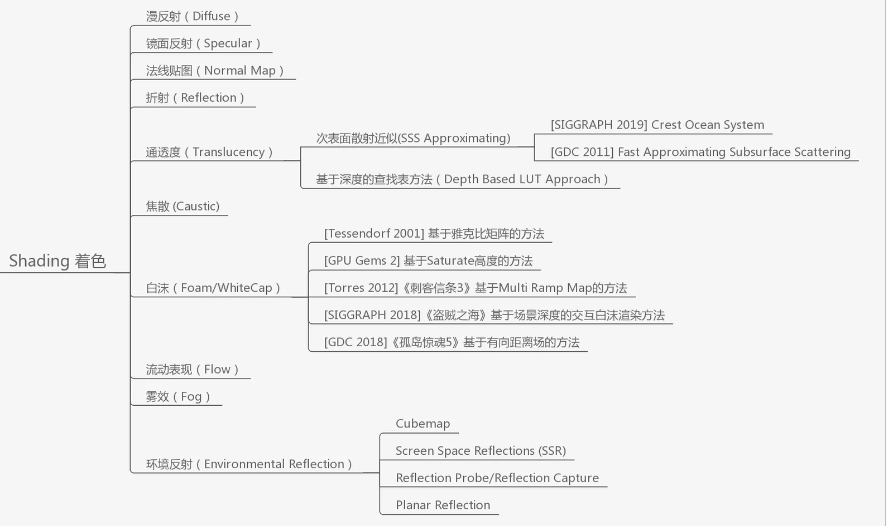

图源：Qian Mo，《真实感水体渲染技术总结》；这里只截取 Shading 着色分支。

&emsp;&emsp;下图是项目中高度场水面同时启用环境反射、镜面高光、折射、吸收和焦散后的综合结果。后文讨论的每个分支，都可以看作从这张结果里拆出的一种贡献：

  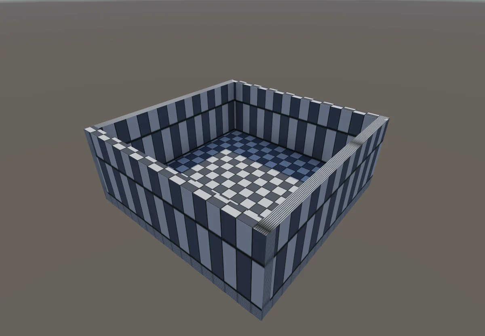

## 3、漫反射
&emsp;&emsp;漫反射描述粗糙表面向多个方向近似均匀散射光。水面不像布料或石头那样具有明显的朗伯表面，但水体的基色、浑浊度和环境光仍常被压成一个漫反射式项，用来表示没有被镜面反射、折射和泡沫覆盖的部分。
$$
\mathbf{C}_{\mathrm{diff}}
\approx\mathbf{C}_{\mathrm{body}}
\left(\mathbf{c}_{\mathrm{ambient}}
+\mathbf{c}_{\mathrm{light}}\max\left(0,\mathbf{n}\cdot\mathbf{l}\right)\right)
$$
$\mathbf{C}_{\mathrm{body}}$ 不是单纯的水色颜料，而是吸收、散射和观察深度共同形成的体色近似。漫反射项主要决定“水体本身是什么颜色”，不会产生太阳的锐利亮点。

  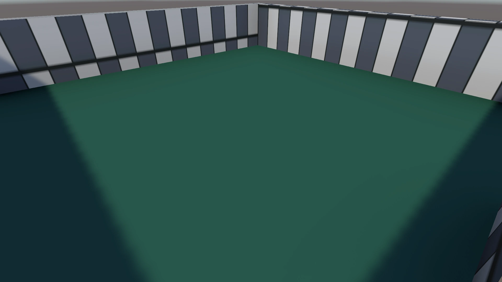

项目中的水体基色：镜面高光、环境反射和折射均已关闭，只保留吸收与散射形成的青绿色体色。

## 4、镜面反射
&emsp;&emsp;镜面反射描述光沿接近反射定律的方向集中离开水面。水的垂直入射反射率很低，菲涅尔项会随视线变斜迅速增大：
$$
F
=F_0+
\left(1-F_0\right)
\left(1-\mathbf{n}\cdot\mathbf{v}\right)^5
$$
水的 $F_0$ 约为 $0.02$。项目进一步使用 GGX 微表面分布计算太阳高光，因此波面法线变化会让亮点沿波峰滑动。镜面项负责太阳碎光、月光亮带和灯光倒影中的锐利核心。

  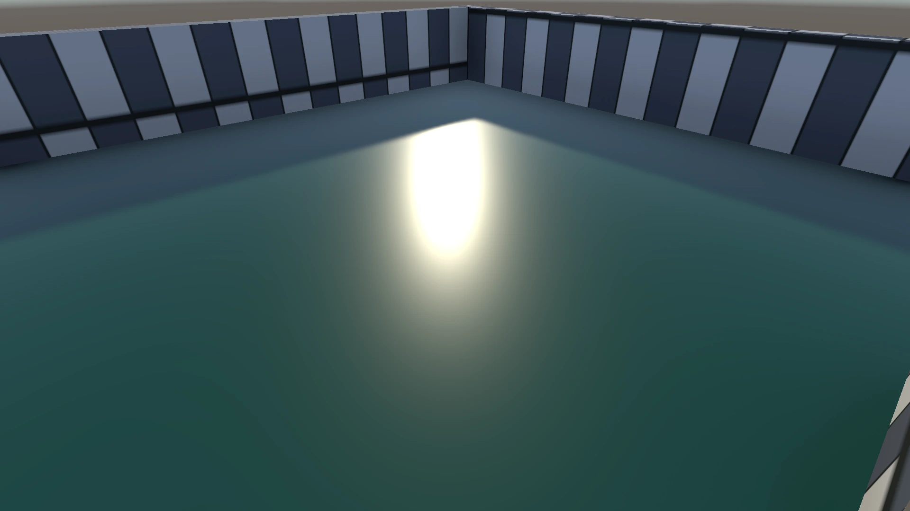

在同一机位和青绿色体色上加入方向光高光；亮斑由波面法线与 GGX 分布产生，环境反射和折射仍然关闭。

## 5、法线贴图
&emsp;&emsp;法线贴图不改变水面几何轮廓，只改变逐像素用于光照和反射计算的表面方向。高度场波场通常保存两个方向的坡度 $G=\partial h/\partial x$、$B=\partial h/\partial z$，再重建：
$$
\mathbf{n}
=\operatorname{normalize}
\left(
-\frac{\partial h}{\partial x}k_n,
1,
-\frac{\partial h}{\partial z}k_n
\right)
$$
法线扰动本身不直接增加颜色，但它会让环境反射、镜面高光和折射方向随涟漪变化，因此是“让水面看起来有细波”的关键。

  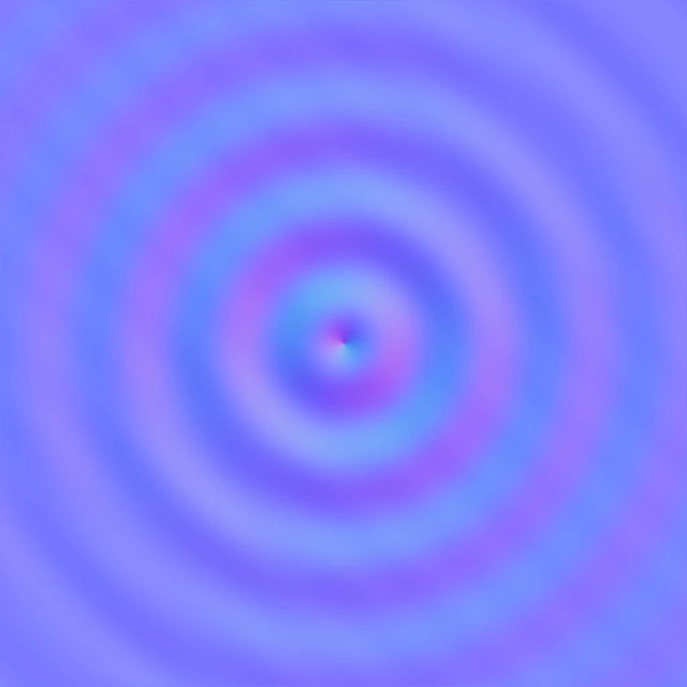

项目波场重建出的切线空间法线：蓝色基底表示未受扰动的竖直表面方向，环状颜色变化对应涟漪坡度。

  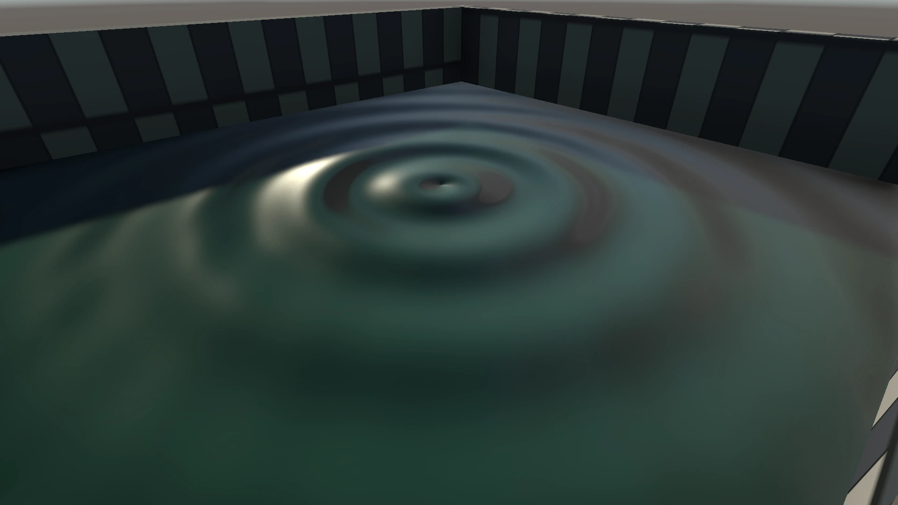

同一浅水池应用法线扰动后的结果：水面几何仍然平坦，但涟漪已经能打断镜面高光。

## 6、折射
&emsp;&emsp;折射描述光从空气进入水体后传播方向发生变化。实时渲染通常不追踪真实体素光线，而是在屏幕空间按法线扰动采样已经渲染好的不透明场景颜色：
$$
\mathbf{uv}_{\mathrm{refract}}
=\mathbf{uv}
+\operatorname{offset}
\left(\mathbf{n},\nabla h\right)
$$
再把采样结果与水体吸收颜色混合。折射负责让池底、河床、石头和角色水下部分发生位移和轻微扭曲。需要注意，屏幕空间折射不是反射；它只是在已有颜色缓冲上模拟视线穿过水面后的偏移。

  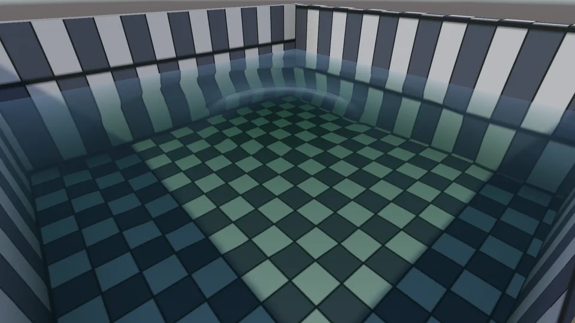

项目实际动画：兔子落下触发碰撞波后隐藏，焦散保持关闭；涟漪随时间向外扩散，并连续改变法线、水面位移和屏幕空间折射。

## 7、通透度
&emsp;&emsp;通透度描述光穿过水体时被吸收和散射的程度。Beer-Lambert 定律用距离 $d$ 和消光系数 $\boldsymbol{\sigma}_t$ 计算逐通道透射率：
$$
\mathbf{T}
=\exp\left(-d\boldsymbol{\sigma}_t\right)
$$
透射率高时能看清池底，透射率低时颜色逐渐被水体吸收色和散射色取代。水体厚度可以来自水面与场景深度差、粒子并集正反面深度差，或解析几何厚度。它主要决定浅水的透明感和深水的颜色层次。

  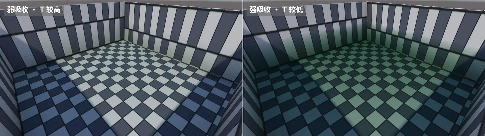

项目通透度 A/B 对照：两图使用同一机位和水面，关闭波面扰动、环境反射与焦散，只把吸收密度从 0.8 改为 4.5。弱吸收时 <em>T</em> 较高，仍能透过水体辨认高对比棋盘格；强吸收时 <em>T</em> 降低，红光衰减更快，池底逐渐被青绿色吸收色与散射色取代。

## 8、焦散
&emsp;&emsp;焦散是弯曲水面把入射光汇聚到池底后形成的亮纹。它不改变水面自身的颜色，而是改变水下表面收到的光。常用的实时近似是把水面点按法线折射到池底，再比较相邻水面采样点在池底投影后的面积：面积压缩表示光线汇聚，面积拉伸表示光线发散。

  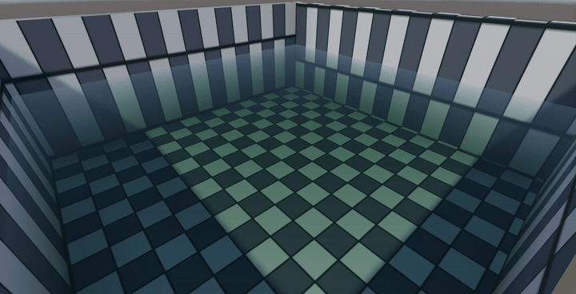

项目实际动画：使用场景当前水面参数，保留兔子的刚体与碰撞体、仅关闭 Renderer，让它继续落水并触发真实碰撞波，因此 GIF 全程只有水面。池底亮带由同一张波场按 Snell 折射和投影面积压缩实时计算，焦散与扩散涟漪同步移动。

## 9、白沫
&emsp;&emsp;白沫不是简单把浪尖涂白，而是先计算泡沫遮罩，再把它与基础水面颜色混合。遮罩可以来自波峰高度、水面斜率、曲率、流速、障碍物距离或粒子密度。较高遮罩值覆盖水体颜色，并减少镜面反射与折射的可见度。

  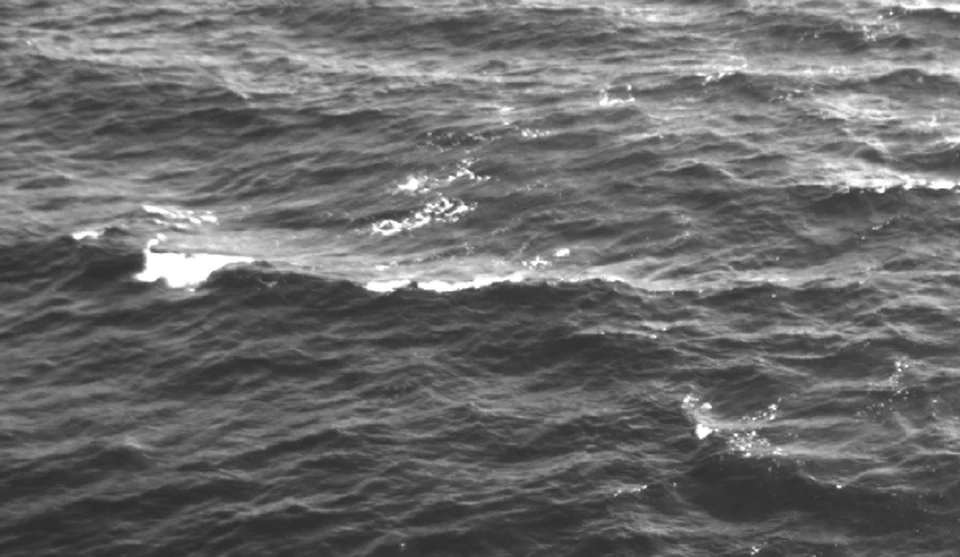

图源：Ardhuin，CC BY-SA 3.0，Wikimedia Commons。

## 10、流动表现
&emsp;&emsp;流动表现负责让波纹、泡沫和折射细节沿水面运动。常见做法是使用流速图、速度场或程序化流线推动法线 UV，而不是每帧重新生成几何：
$$
\mathbf{uv}\left(t+\Delta t\right)
=\mathbf{uv}\left(t\right)
+\mathbf{v}\left(\mathbf{uv}\right)\Delta t
$$
流动贴图本身可以完全不改变高度场，只改变纹理采样位置。真正决定湍流、回流和绕石流动速度的，仍然是底层流体或浅水求解结果。

  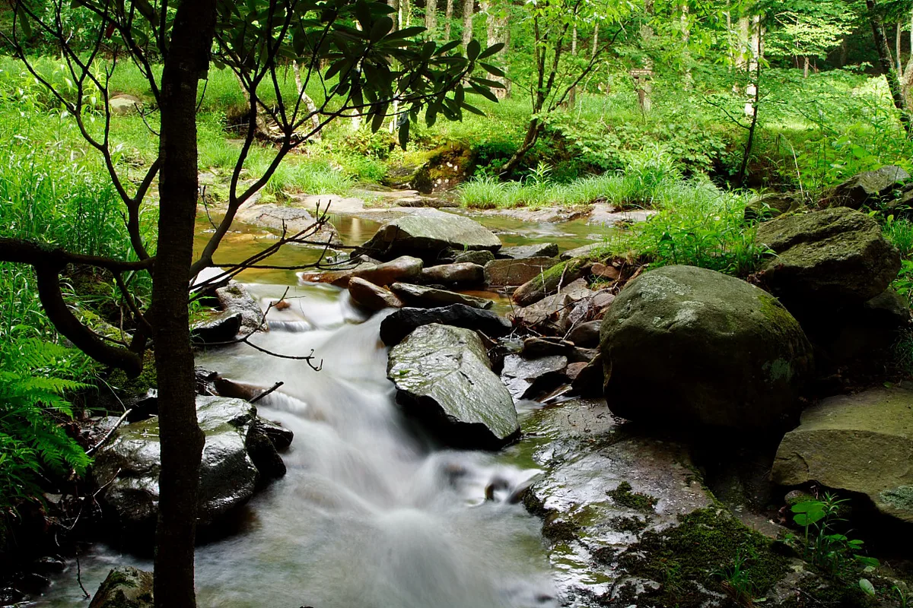

图源：ForestWander，CC BY-SA 3.0 US，Wikimedia Commons。

## 11、雾效
&emsp;&emsp;雾效把水面颜色按距离和水体与相机之间的介质混合到背景雾色：
$$
\mathbf{C}_{\mathrm{fogged}}
=\operatorname{lerp}
\left(
\mathbf{C}_{\mathrm{water}},
\mathbf{C}_{\mathrm{fog}},
1-e^{-\beta d}
\right)
$$
其中 $\beta$ 控制雾的浓度，$d$ 为相机到水面点的距离。雾效主要提供距离层次、空气透视和远处水天边界，不是水体本身的材质属性。

  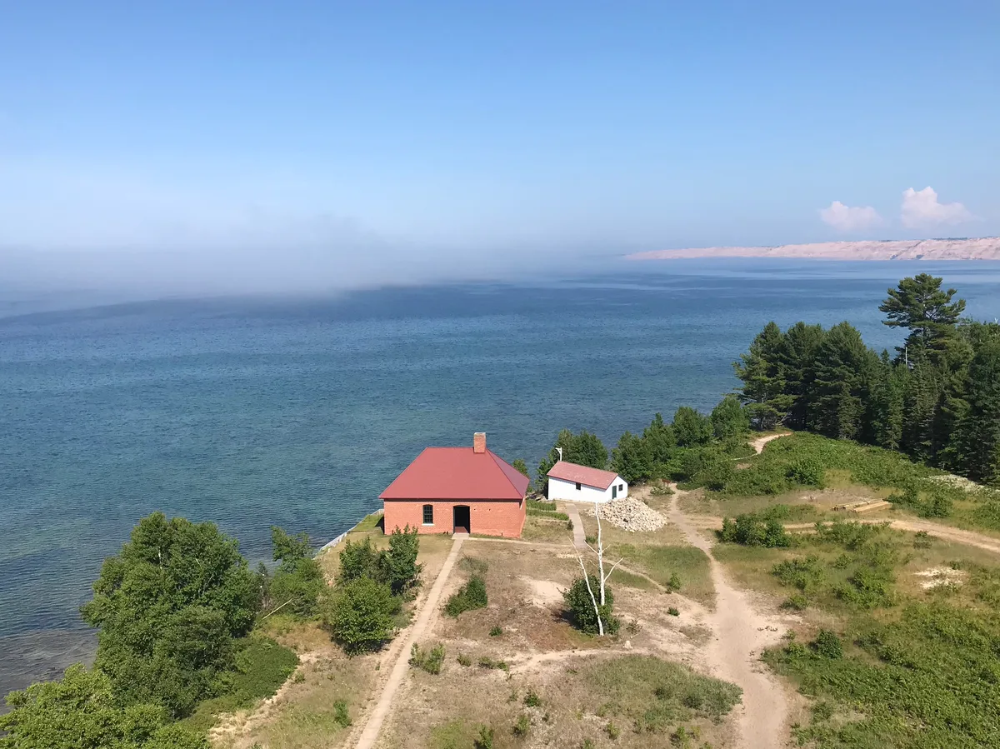

图源：NPS，Public Domain，Wikimedia Commons。

## 12、环境反射
&emsp;&emsp;环境反射使用反射方向采样周围世界：
$$
\mathbf{r}
=2\left(\mathbf{n}\cdot\mathbf{v}\right)\mathbf{n}-\mathbf{v}
$$
常见的实现包括 Cubemap、反射探针、平面反射和屏幕空间反射（SSR）。菲涅尔项决定环境反射与水下颜色的混合比例。环境反射负责天空、山脉、岸线、船只和角色在水中的倒影，是水体“像水”最明显的视觉线索之一。

  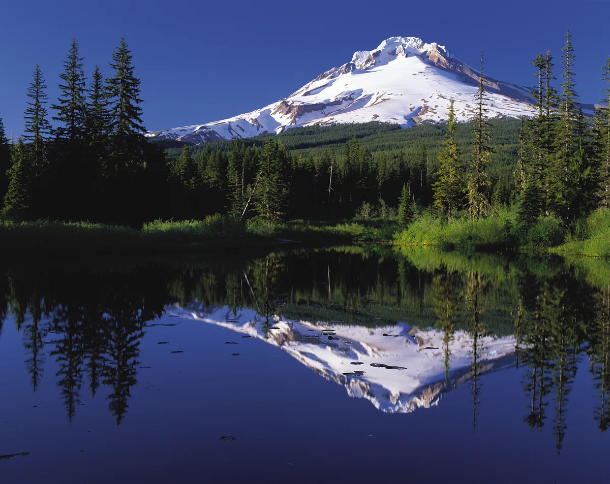

图源：Oregon's Mt. Hood Territory，Public Domain，Wikimedia Commons。

## 13、延伸阅读
- 作品：[Unity 实时柔性体与粒子流体系统](<../../../../作品/计算机图形学/物理/Unity 实时柔性体与粒子流体系统：基于 XPBD 与 PBF 的物理模拟.md>)
- 文章：[基础水体着色](../../../../文章/计算机图形学/渲染/水体渲染/基础水体着色.md)、[焦散](../../../../文章/计算机图形学/渲染/水体渲染/焦散.md)、[基于顶点高度位移贴图的浅水水面几何重建](../../../../文章/计算机图形学/渲染/水体渲染/基于顶点高度位移贴图的浅水水面几何重建.md)、[基于二维波动方程的浅水波场](../../../../文章/计算机图形学/物理/水动力学仿真/基于二维波动方程的浅水波场.md)、[PBF 粒子流体模拟](../../../../文章/计算机图形学/物理/水动力学仿真/PBF%20粒子流体模拟.md)
- 笔记：[辐射度量学](../辐射度量学.md)
