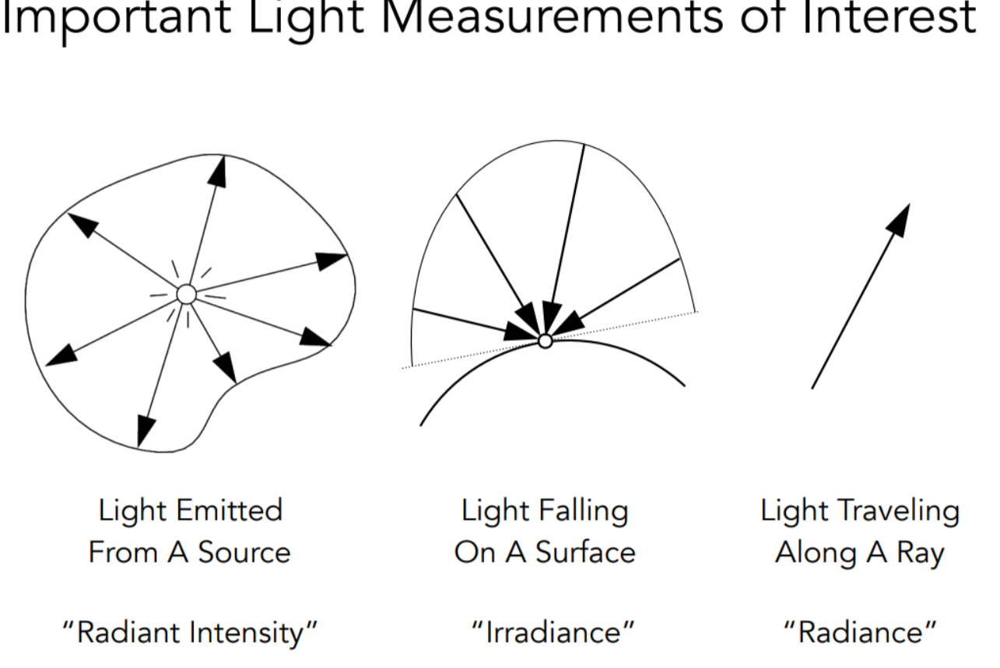
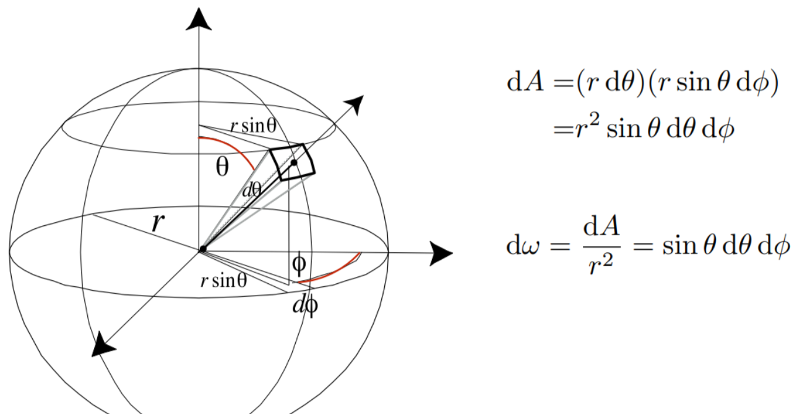
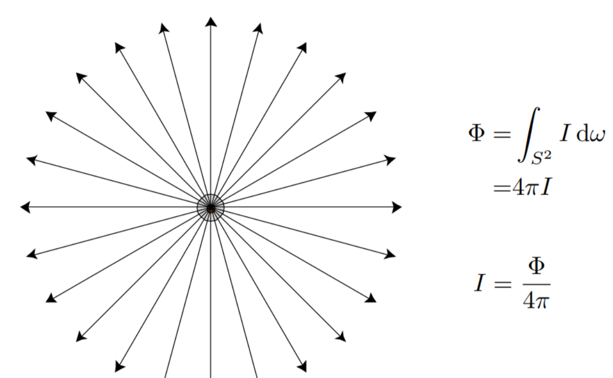
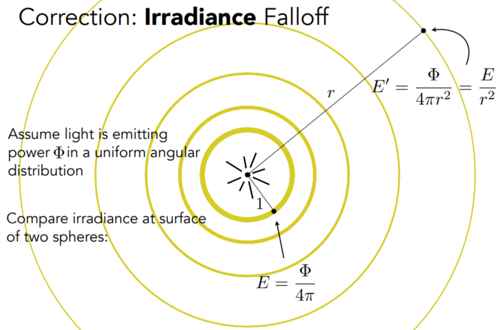
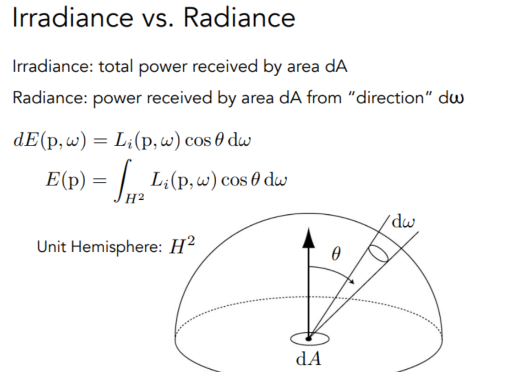
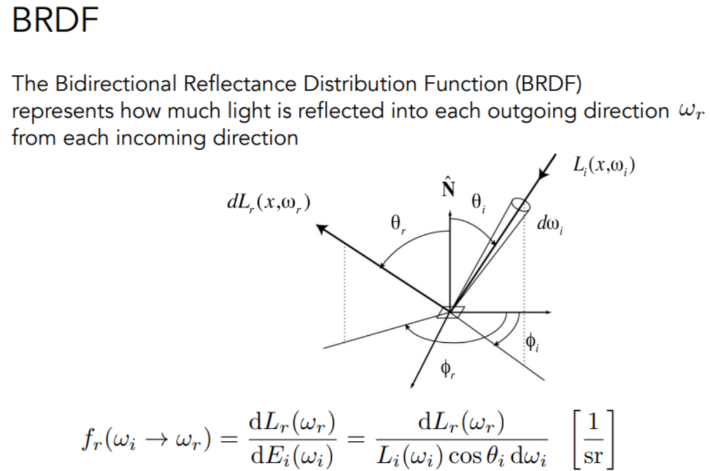
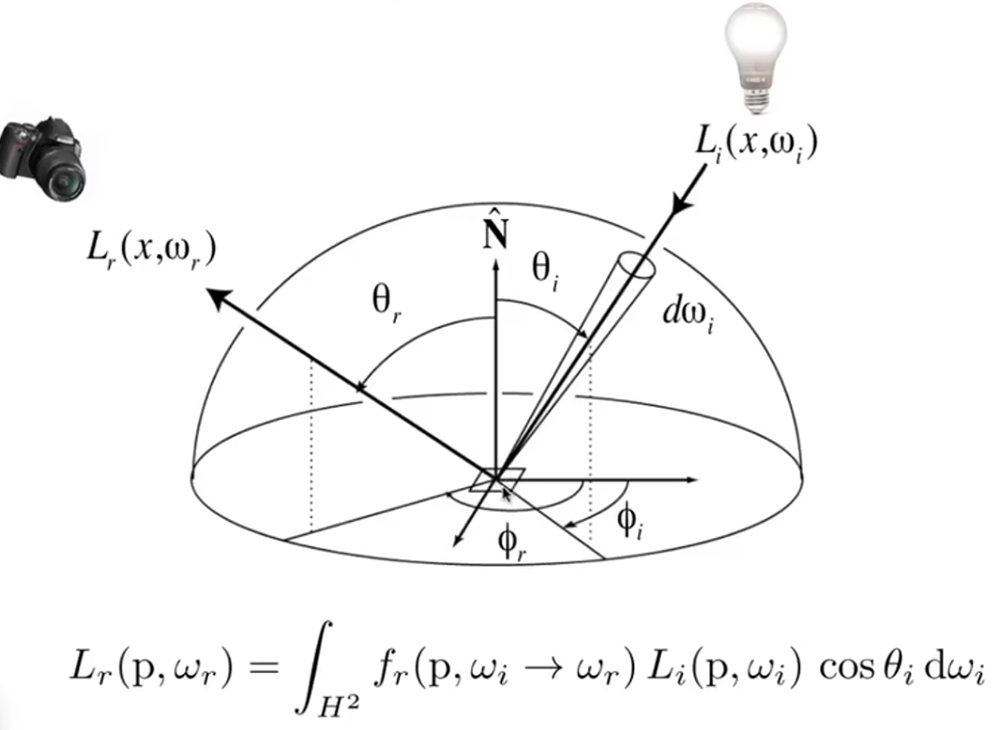

# 辐射度量学
&emsp;&emsp;辐射度量学用一组物理量描述电磁辐射的能量、时间分布、空间分布和方向分布。在计算机图形学中，光照计算需要追踪光从光源发出，经表面反射、折射和吸收后进入相机的过程，因此这些辐射度量量构成了 BRDF、反射方程与渲染方程的基础 [1]。

&emsp;&emsp;五个核心量可以按微分关系串联起来：辐射能量 $Q$ 对时间求导得到辐射通量 $\Phi$，辐射通量对立体角求导得到辐射强度 $I$，对面积求导得到辐照度 $E$，同时对投影面积和立体角求导得到辐亮度 $L$。其中辐亮度是渲染中最常用的量，因为它在理想真空传播过程中沿光线保持不变。

  

## 参考文献
1. Yan, Lingqi. GAMES101: Modern Computer Graphics. University of California, Santa Barbara, 2020. [Course](https://sites.cs.ucsb.edu/~lingqi/teaching/games101.html)

## 1、辐射能量与辐射通量
### 1.1、辐射能量
&emsp;&emsp;辐射能量（Radiant Energy）是以电磁波形式发射、传播或接收的总能量，记作 $Q$，单位为焦耳 $\mathrm{J}$。它描述一段时间内辐射传递的能量总量，本身不区分方向、面积或波长分布。

### 1.2、辐射通量
&emsp;&emsp;辐射通量（Radiant Flux）又称辐射功率，表示单位时间内发射、反射、透射或接收的辐射能量：
$$
\Phi=\frac{\mathrm{d}Q}{\mathrm{d}t}
$$
其单位为瓦特 $\mathrm{W}$。在光度学中，对应的量称为光通量，单位为流明 $\mathrm{lm}$。两者的数值不会仅因更换单位而相同，因为流明还需要按人眼对不同波长的敏感度进行加权。

## 2、立体角与辐射强度
### 2.1、立体角
&emsp;&emsp;平面角用弧长与半径之比定义，立体角则是它在三维球面上的推广。若球面上的一块表面积为 $A$、球半径为 $r$，则该表面对球心张成的立体角为：
$$
\Omega=\frac{A}{r^2}
$$
立体角的单位为球面度 $\mathrm{sr}$。整个球面对球心张成的立体角为 $4\pi\ \mathrm{sr}$，半球面为 $2\pi\ \mathrm{sr}$。

### 2.2、微分立体角
&emsp;&emsp;球坐标中，令 $\theta$ 为与极轴之间的极角，$\phi$ 为方位角。球面上一个无穷小面积元可以写成：
$$
\mathrm{d}A
=r^2\sin\theta\,\mathrm{d}\theta\,\mathrm{d}\phi
$$
因此对应的微分立体角为：
$$
\mathrm{d}\Omega
=\frac{\mathrm{d}A}{r^2}
=\sin\theta\,\mathrm{d}\theta\,\mathrm{d}\phi
$$
微分立体角只描述方向在单位球面上占据的角面积，与距离 $r$ 无关。

  

### 2.3、辐射强度
&emsp;&emsp;辐射强度（Radiant Intensity）描述点光源在某一方向上的能量发射密度，定义为单位立体角内的辐射通量：
$$
I(\omega)=\frac{\mathrm{d}\Phi}{\mathrm{d}\omega}
$$
其辐射度量单位为 $\mathrm{W}/\mathrm{sr}$，对应的光度学单位是坎德拉 $\mathrm{cd}=1\ \mathrm{lm}/\mathrm{sr}$。辐射强度只适用于点光源或可以近似为点光源的发射体，并且是方向 $\omega$ 的函数。

&emsp;&emsp;若点光源向整个空间均匀辐射，则总通量 $\Phi$ 被分配到 $4\pi$ 的立体角中，每个方向的辐射强度为：
$$
I=\frac{\Phi}{4\pi}
$$

  

## 3、辐照度与辐亮度
### 3.1、辐照度
&emsp;&emsp;辐照度（Irradiance）表示单位接收面积上到达的辐射通量：
$$
E(p)=\frac{\mathrm{d}\Phi(p)}{\mathrm{d}A}
$$
其辐射度量单位为 $\mathrm{W}/\mathrm{m}^2$，对应的光度学单位是勒克斯 $\mathrm{lx}=\mathrm{lm}/\mathrm{m}^2$。辐照度描述的是一个面元接收到的总入射功率，不区分这些功率来自哪些方向。

&emsp;&emsp;对于各方向辐射强度相同的点光源，半径为 $r$ 的球壳上的总面积为 $4\pi r^2$。由于能量在传播过程中守恒，球壳上的辐照度为：
$$
E(r)=\frac{\Phi}{4\pi r^2}
$$
这说明点光源产生的辐照度随距离平方衰减。

  

### 3.2、辐亮度
&emsp;&emsp;辐亮度（Radiance）同时描述单位投影面积和单位立体角内的辐射通量：
$$
L(p,\omega)
=\frac{\mathrm{d}^2\Phi(p,\omega)}
{\mathrm{d}A^\perp\,\mathrm{d}\omega}
=\frac{\mathrm{d}^2\Phi(p,\omega)}
{\mathrm{d}A\cos\theta\,\mathrm{d}\omega}
$$
其中 $\theta$ 是传播方向与表面法线之间的夹角，$\mathrm{d}A^\perp=\mathrm{d}A\cos\theta$ 是面积元在垂直于传播方向上的投影。$\mathrm{d}A\cos\theta$ 应取非负值；当方向位于表面背面时，该方向不属于当前表面的有效辐射范围。

&emsp;&emsp;辐亮度的辐射度量单位为 $\mathrm{W}/(\mathrm{sr}\cdot\mathrm{m}^2)$，对应的光度学单位是尼特 $\mathrm{nit}=\mathrm{cd}/\mathrm{m}^2$。它同时包含位置 $p$ 和方向 $\omega$，因此能够描述沿某条光线传播的局部能量密度。在无吸收、无散射的均匀介质中，辐亮度沿同一条理想光线保持不变，所以它最适合作为光线追踪的核心传输量。

### 3.3、入射辐亮度与出射辐亮度
&emsp;&emsp;入射辐亮度 $L_i(p,\omega_i)$ 描述从方向 $\omega_i$ 到达点 $p$ 的辐亮度。方向 $\omega_i$ 从点 $p$ 指向光源，而实际传播方向与 $\omega_i$ 相反。它与方向性辐照度之间的关系为：
$$
\mathrm{d}E_i(p,\omega_i)
=L_i(p,\omega_i)\cos\theta_i\,\mathrm{d}\omega_i
$$
其中 $\theta_i$ 是 $\omega_i$ 与表面法线之间的夹角。由此可得：
$$
L_i(p,\omega_i)
=\frac{\mathrm{d}E_i(p,\omega_i)}
{\cos\theta_i\,\mathrm{d}\omega_i}
$$
出射辐亮度 $L_o(p,\omega_o)$ 描述从点 $p$ 沿方向 $\omega_o$ 离开表面的辐亮度。若 $I_o(p,\omega_o)$ 是表面在该方向上的辐射强度，则：
$$
L_o(p,\omega_o)
=\frac{\mathrm{d}I_o(p,\omega_o)}
{\mathrm{d}A\cos\theta_o}
$$

&emsp;&emsp;总辐照度是入射辐亮度在整个上半球面上的投影积分：
$$
E(p)=\int_{H^2}
L_i(p,\omega_i)
\max\left(\mathbf{n}\cdot\omega_i,0\right)
\,\mathrm{d}\omega_i
$$
因此，辐亮度描述“沿某一方向有多少能量”，而辐照度描述“一个面元从所有方向总共收到多少能量”。

  

## 4、双向反射分布函数
&emsp;&emsp;双向反射分布函数（Bidirectional Reflectance Distribution Function，BRDF）描述表面把来自入射方向 $\omega_i$ 的辐亮度分配到出射方向 $\omega_o$ 的能力。设 $L_o$ 为出射辐亮度，$\mathrm{d}E_i$ 为来自单一入射方向的辐照度增量，则：
$$
f_r(p,\omega_i\to\omega_o)
=\frac{\mathrm{d}L_o(p,\omega_o)}
{\mathrm{d}E_i(p,\omega_i)}
$$
代入方向性辐照度的表达式：
$$
f_r(p,\omega_i\to\omega_o)
=\frac{\mathrm{d}L_o(p,\omega_o)}
{L_i(p,\omega_i)\cos\theta_i\,\mathrm{d}\omega_i}
$$
BRDF 的单位是 $\mathrm{sr}^{-1}$。它表示一个微分入射立体角中的光经过表面后，能够向一个微分出射立体角贡献多少辐亮度。

&emsp;&emsp;对于常见的各向同性反射材料，BRDF 满足 Helmholtz 互易性：
$$
f_r(p,\omega_i\to\omega_o)
=f_r(p,\omega_o\to\omega_i)
$$
同时，一个不产生能量的被动表面应满足能量守恒：
$$
\int_{H^2}
f_r(p,\omega_i\to\omega_o)
\cos\theta_o\,\mathrm{d}\omega_o
\le1
$$

  

## 5、反射方程
&emsp;&emsp;表面通常会同时接收来自整个上半球面的光。将所有入射方向对出射辐亮度的贡献累加，并乘上 BRDF 与投影余弦项，便得到反射方程：
$$
L_o(p,\omega_o)
=\int_{H^2}
f_r(p,\omega_i\to\omega_o)
L_i(p,\omega_i)
\max\left(\mathbf{n}\cdot\omega_i,0\right)
\,\mathrm{d}\omega_i
$$
其中 $H^2$ 是以表面法线为中心的上半球面。$L_i\cos\theta_i\,\mathrm{d}\omega_i$ 表示单一入射方向提供的辐照度，BRDF 把它转换为该方向对出射辐亮度的贡献。

  

## 6、渲染方程
&emsp;&emsp;若表面自身还会发光，则在反射方程上增加自发光辐亮度 $L_e$，得到渲染方程：
$$
L_o(p,\omega_o)
=L_e(p,\omega_o)
+\int_{H^2}
f_r(p,\omega_i\to\omega_o)
L_i(p,\omega_i)
\max\left(\mathbf{n}\cdot\omega_i,0\right)
\,\mathrm{d}\omega_i
$$
其中 $L_i$ 本身也可能是其他表面反射后沿该方向传来的辐亮度，因此渲染方程通过递归方式描述了多次反射与全局光照。

&emsp;&emsp;把积分项视为作用在辐亮度场上的光线传输算子 $K$，并用 $\mathbf{I}$ 表示恒等算子，则渲染方程可以简写为：
$$
L=L_e+KL
$$
整理后得到：
$$
\begin{aligned}
\left(\mathbf{I}-K\right)L&=L_e \\
L&=\left(\mathbf{I}-K\right)^{-1}L_e \\
&=\sum_{n=0}^{\infty}K^nL_e
\end{aligned}
$$
$K^0L_e=L_e$ 是表面自身发射的光，$K^1L_e$ 表示经过一次表面作用后到达观察位置的光，更高阶项则对应多次间接反射。路径追踪等方法就是在采样并估计这一无限级数。

## 7、物理量汇总
| 物理量 | 符号 | 定义 | 辐射度量单位 | 光度学对应量 |
| --- | --- | --- | --- | --- |
| 辐射能量 | $Q$ | 辐射的总能量 | $\mathrm{J}$ | — |
| 辐射通量 | $\Phi$ | $\mathrm{d}Q/\mathrm{d}t$ | $\mathrm{W}$ | 光通量，$\mathrm{lm}$ |
| 辐射强度 | $I$ | $\mathrm{d}\Phi/\mathrm{d}\omega$ | $\mathrm{W}/\mathrm{sr}$ | 发光强度，$\mathrm{cd}$ |
| 辐照度 | $E$ | $\mathrm{d}\Phi/\mathrm{d}A$ | $\mathrm{W}/\mathrm{m}^2$ | 光照度，$\mathrm{lx}$ |
| 辐亮度 | $L$ | $\mathrm{d}^2\Phi/(\mathrm{d}A^\perp\mathrm{d}\omega)$ | $\mathrm{W}/(\mathrm{sr}\cdot\mathrm{m}^2)$ | 亮度，$\mathrm{nit}$ |

## 延伸阅读
- 笔记：[图形渲染管线](图形渲染管线.md)
