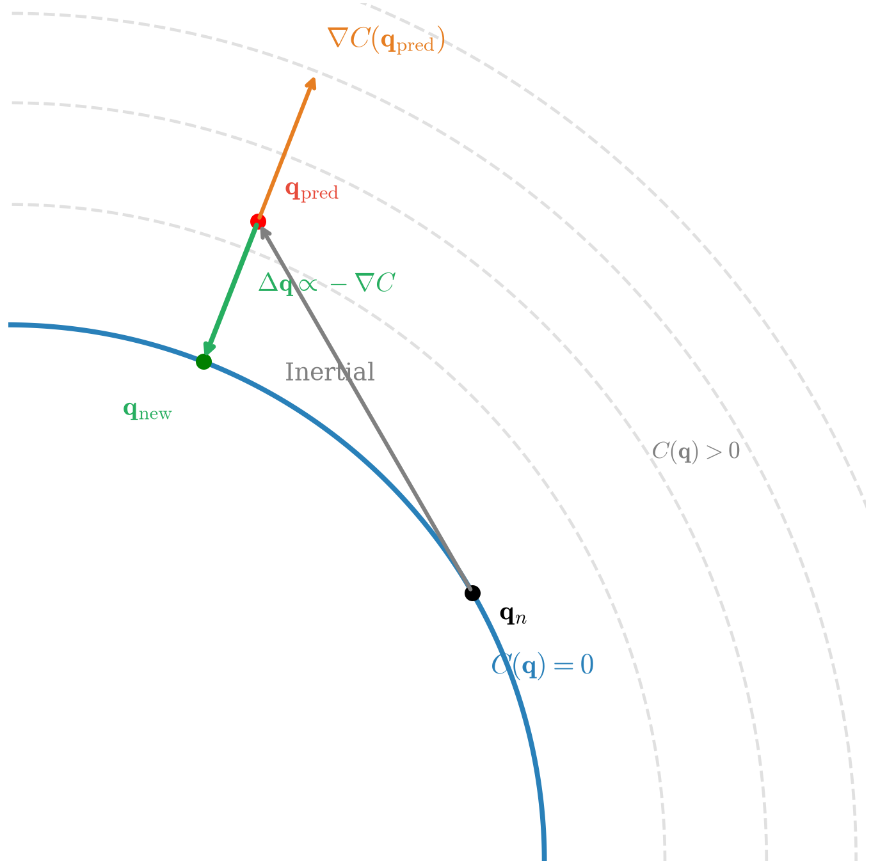

# 基于位置的扩展动力学（XPBD）
## 1、参考文献
1. Müller, M., Heidelberger, B., Hennix, M., & Ratcliff, J. Position Based Dynamics. *Journal of Visual Communication and Image Representation*, 2007, 18(2): 109–118. [DOI](https://doi.org/10.1016/j.jvcir.2007.01.005)
2. Macklin, M., Müller, M., & Chentanez, N. XPBD: Position-Based Simulation of Compliant Constrained Dynamics. *Proceedings of the 9th International Conference on Motion in Games*, 2016: 49–54. [DOI](https://doi.org/10.1145/2994258.2994272)

## 2、概念
&emsp;&emsp;连续介质力学视角下，物理行为可由包含时间导数与空间微分项的偏微分方程描述。为实现计算机求解，需要分别执行时间离散化与空间离散化。时间上体现为将连续演化过程拆解为离散时间步（帧）；空间上表现为借助网格、点云等离散结构对连续物体进行剖分。传统有限元方法（FEM）经过空间离散化后将偏微分方程转化为关于时间的常微分方程组，再通过时间离散化进一步转化为代数方程组完成求解。与传统有限元方法不同，XPBD 方法选择在离散拓扑之上构造位置级约束。该方法绕过了内力的显式计算，基于能量最小化原理将连续介质力学问题近似为约束投影优化问题，以此实现实时物理模拟。

### 2.1、约束流形
&emsp;&emsp;在物理的仿真中，约束从根本上限制了系统的运动自由度。考虑一个被离散化为 $n$ 个节点的复杂力学系统，若每个节点具备 $d$ 个自由度，则整个系统总共拥有 $N = dn$ 个自由度。系统在任意时刻的几何位形，均可以由高维状态空间中的广义坐标 $\mathbf{q} \in \mathbb{R}^N$ 来完整描述。

&emsp;&emsp;在这一高维空间中，系统的 $m$ 个独立约束可抽象为映射函数 $\mathbf{C}: \mathbb{R}^N \times \mathbb{R} \rightarrow \mathbb{R}^m$。其中，仅限制系统位置及其显式时间依赖的约束被称为完整约束（holonomic constraint），其数学表达为：
$$
\mathbf{C}(\mathbf{q}, t) = \mathbf{0}
\tag{1}
$$
&emsp;&emsp;在实时物理仿真中，为兼顾计算效率与数值稳定性，工业界普遍采用位置级约束方法以替代开销高昂的速度与加速度级求解。在该框架下，约束通常被简化为不显含时间的纯几何形式，即式 (1) 中不显含 $t$ 的情形：
$$
\mathbf{C}(\mathbf{q}) = \mathbf{0}
\tag{2}
$$
&emsp;&emsp;从几何视角看，这 $m$ 个独立约束在 $N$ 维构型空间中共同隐式定义了一个局部维度为 $N-m$ 的曲面，这便是代表所有合法位置的约束流形。

&emsp;&emsp;由于约束流形多为高度非线性的弯曲表面，而数值积分的预测步仅作局部的线性切向外推。这种近似必然产生截断误差，导致构型点随惯性切出流形，引发约束漂移（即产生 $\mathbf{C}(\mathbf{q}) \neq \mathbf{0}$ 的误差）。因此，约束求解的本质，就是以尽可能小的代价将偏离的非法点重新投影回流形表面上。

&emsp;&emsp;为寻找回归流形的最短路径，需利用约束的雅可比矩阵 $\mathbf{J}$。在几何上，$\mathbf{J}$ 的行向量（即各约束梯度）共同张成了约束流形的法向空间。由于沿流形切向的位移均落在 $\mathbf{J}$ 的零空间内，对消除误差 $\Delta \mathbf{C}$ 无效，因此在一阶线性化意义下，沿法向空间施加修正可给出最短的约束恢复位移。

  

## 3、PBD
### 3.1、算法框架
&emsp;&emsp;PBD 不再沿（受力分析 $\rightarrow$ 加速度 $\rightarrow$ 速度 $\rightarrow$ 位置）逐步积分，而是直接对顶点坐标施加几何修正。其核心仿真循环如下：  
&emsp;&emsp;(1) For every vertex $i$  
&emsp;&emsp;(2) &emsp;&emsp;initialize $(\mathbf{x}_i, \mathbf{v}_i, w_i) \leftarrow (\mathbf{x}_i^0, \mathbf{v}_i^0, 1/m_i)$  
&emsp;&emsp;(3) Loop  
&emsp;&emsp;(4) &emsp;&emsp;For every vertex $i$  
&emsp;&emsp;(5) &emsp;&emsp;&emsp;&emsp;$\mathbf{v}_i \leftarrow \mathbf{v}_i + \Delta t w_i \mathbf{f}_{ext}(\mathbf{x}_i)$ // 显式积分更新速度  
&emsp;&emsp;(6) &emsp;&emsp;dampVelocities $(\mathbf{v}_1, \dots, \mathbf{v}_N)$  
&emsp;&emsp;(7) &emsp;&emsp;For every vertex $i$  
&emsp;&emsp;(8) &emsp;&emsp;&emsp;&emsp;$\mathbf{p}_i \leftarrow \mathbf{x}_i + \Delta t \mathbf{v}_i$ // 预测新位置  
&emsp;&emsp;(9) &emsp;&emsp;For every vertex $i$  
&emsp;&emsp;(10)&emsp;&emsp;&emsp;&emsp;generateCollisionConstraints $(\mathbf{x}_i \rightarrow \mathbf{p}_i)$  
&emsp;&emsp;(11)&emsp;&emsp;Loop solverIterations times  
&emsp;&emsp;(12)&emsp;&emsp;&emsp;&emsp;projectConstraints $(\{\mathbf{C}\}, \{\mathbf{p}\})$ // 约束投影  
&emsp;&emsp;(13)&emsp;&emsp;For every vertex $i$  
&emsp;&emsp;(14)&emsp;&emsp;&emsp;&emsp;$\mathbf{v}_i \leftarrow (\mathbf{p}_i - \mathbf{x}_i) / \Delta t$ // 隐式更新速度  
&emsp;&emsp;(15)&emsp;&emsp;&emsp;&emsp;$\mathbf{x}_i \leftarrow \mathbf{p}_i$  
&emsp;&emsp;(16)&emsp;&emsp;velocityUpdate $(\mathbf{v}_1, \dots, \mathbf{v}_N)$ // 速度修正  

&emsp;&emsp;上述 PBD 管线具备两大特性。其一，约束投影采用逆质量加权，使同一约束对相关顶点产生的内力修正相互抵消，从而保持系统的线动量；其二，几何投影机制会导致宏观刚度与时间步长 $\Delta t$ 及迭代次数强耦合。这种帧率依赖性会引发不可预测的材料弹性变化，该缺陷直接催生了后续的 XPBD 算法 [1]。

### 3.2、约束投影求解
&emsp;&emsp;当预测位置偏离约束流形时，PBD 会沿着约束梯度 $\nabla C(\mathbf{p})$ 的方向，将顶点强行拉回流形表面。为维持动量守恒，单顶点的位移量 $\Delta \mathbf{p}_i$ 由逆质量 $w_i$ 进行加权，如式 (3) 所示：
$$
\Delta \mathbf{p}_i = \lambda w_i \nabla_{\mathbf{p}_i} C
\tag{3}
$$
&emsp;&emsp;为了求解标量乘子 $\lambda$，PBD 对非线性的约束流形方程进行一阶线性化，得到式 (4)：
$$
C(\mathbf{p} + \Delta \mathbf{p}) \approx C(\mathbf{p}) + \sum_j \nabla_{\mathbf{p}_j} C(\mathbf{p}) \cdot \Delta \mathbf{p}_j = 0
\tag{4}
$$
&emsp;&emsp;将式 (3) 代入式 (4)，可得：
$$
\lambda = -\frac{C(\mathbf{p}_1, \dots, \mathbf{p}_n)}{\sum_j w_j \left\|\nabla_{\mathbf{p}_j} C(\mathbf{p}_1, \dots, \mathbf{p}_n)\right\|^2}
$$
令 $s=-\lambda$，即可将 PBD 核心的位置更新写成式 (5)：
$$
\Delta \mathbf{p}_i = -s w_i \nabla_{\mathbf{p}_i} C(\mathbf{p}_1, \dots, \mathbf{p}_n)
\tag{5}
$$
&emsp;&emsp;其中，缩放因子 $s$ 由式 (6) 计算：
$$
s = \frac{C(\mathbf{p}_1, \dots, \mathbf{p}_n)}{\sum_j w_j \|\nabla_{\mathbf{p}_j} C(\mathbf{p}_1, \dots, \mathbf{p}_n)\|^2}
\tag{6}
$$

## 4、XPBD
### 4.1、算法框架
&emsp;&emsp;为解决传统 PBD 刚度耦合于时间步长 $\Delta t$ 与迭代次数的问题，XPBD 从约束的势能出发引入物理柔度 [2]。其核心仿真循环伪代码如下（设 $k$ 为迭代计数器）：

&emsp;&emsp;(1) For every vertex $i$  
&emsp;&emsp;(2) &emsp;&emsp;$\tilde{\mathbf{x}}_i \leftarrow \mathbf{x}_i^n + \Delta t \mathbf{v}_i^n + \Delta t^2 \mathbf{M}^{-1} \mathbf{f}_{ext}(\mathbf{x}_i^n)$  
&emsp;&emsp;(3) initialize solve $\mathbf{x}^0 \leftarrow \tilde{\mathbf{x}}$  
&emsp;&emsp;(4) initialize multipliers $\lambda^0 \leftarrow \mathbf{0}$  
&emsp;&emsp;(5) Loop solverIterations times  
&emsp;&emsp;(6) &emsp;&emsp;For every constraint  
&emsp;&emsp;(7) &emsp;&emsp;&emsp;&emsp;compute $\Delta\lambda$  
&emsp;&emsp;(8) &emsp;&emsp;&emsp;&emsp;compute $\Delta\mathbf{x}$  
&emsp;&emsp;(9) &emsp;&emsp;&emsp;&emsp;update $\lambda^{k+1} \leftarrow \lambda^k + \Delta \lambda$  
&emsp;&emsp;(10)&emsp;&emsp;&emsp;&emsp;update $\mathbf{x}^{k+1} \leftarrow \mathbf{x}^k + \Delta \mathbf{x}$  
&emsp;&emsp;(11) update positions $\mathbf{x}^{n+1} \leftarrow \mathbf{x}^k$  
&emsp;&emsp;(12) update velocities $\mathbf{v}^{n+1} \leftarrow (\mathbf{x}^{n+1} - \mathbf{x}^n) / \Delta t$  

&emsp;&emsp;上述 XPBD 管线在常见实时参数下具有更好的数值稳定性，能够抑制显式积分在高刚度系统上常见的数值爆炸；同时通过拉格朗日乘子引入柔度 $\alpha$，显著降低宏观刚度对时间步长与迭代次数的依赖。不过，XPBD 并不消除离散拓扑和分辨率对仿真结果的影响。

### 4.2、约束投影求解
&emsp;&emsp;传统 PBD 的数学局限在于，纯几何方程 $C(\mathbf{p}) = 0$ 将约束视为完全刚性。XPBD 通过引入对应材料柔度的参数 $\alpha$，把约束目标改写为包含乘子和柔度的软化方程，如式 (7) 所示：
$$
C(\mathbf{p}) = -\alpha \frac{\lambda}{\Delta t^2}
\tag{7}
$$
&emsp;&emsp;基于式 (7)，XPBD 可推导出拉格朗日乘子的迭代更新增量，如式 (8) 所示：
$$
\Delta \lambda = \frac{-C(\mathbf{p}) - \tilde{\alpha} \lambda}{\nabla C(\mathbf{p}) \mathbf{M}^{-1} \nabla C(\mathbf{p})^T + \tilde{\alpha}}
\tag{8}
$$
&emsp;&emsp;其中，归一化柔度 $\tilde{\alpha} = \alpha / \Delta t^2$，$\lambda$ 为约束在当前时间步内累积的拉格朗日乘子。将式 (8) 代入质量加权的位置更新，可以得到式 (9)：
$$
\Delta \mathbf{x} = \mathbf{M}^{-1}\nabla C(\mathbf{p})^T \Delta \lambda
\tag{9}
$$
&emsp;&emsp;局部线性化与乘子更新共同作用，使约束在受力时能够产生与柔度参数相对应的形变。

## 5、延伸阅读
- 项目：[Unity 实时柔性体与粒子流体系统](<../../../../项目/计算机图形学/物理/Unity 实时柔性体与粒子流体系统：基于 XPBD 与 PBF 的物理模拟.md>)
- 文章：[基于 XPBD 的网格布料仿真](../../../../文章/计算机图形学/物理/XPBD/基于%20XPBD%20的网格布料仿真.md)、[基于 XPBD 的柔性骨骼仿真](../../../../文章/计算机图形学/物理/XPBD/基于%20XPBD%20的柔性骨骼仿真.md)
