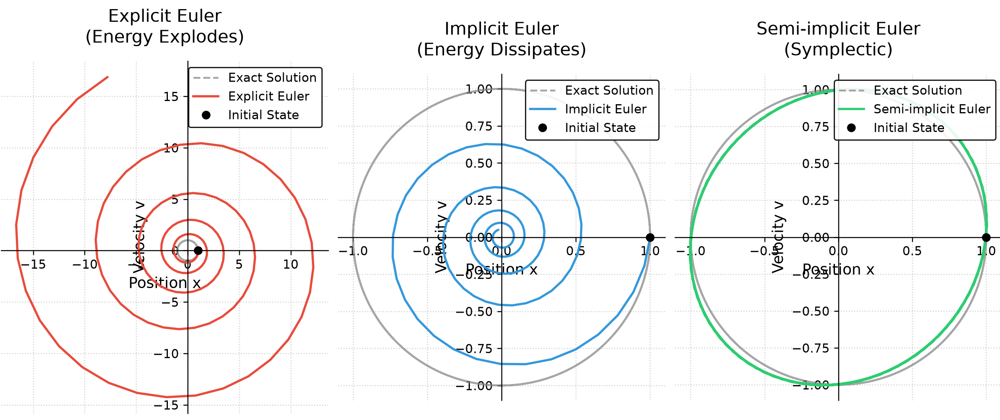
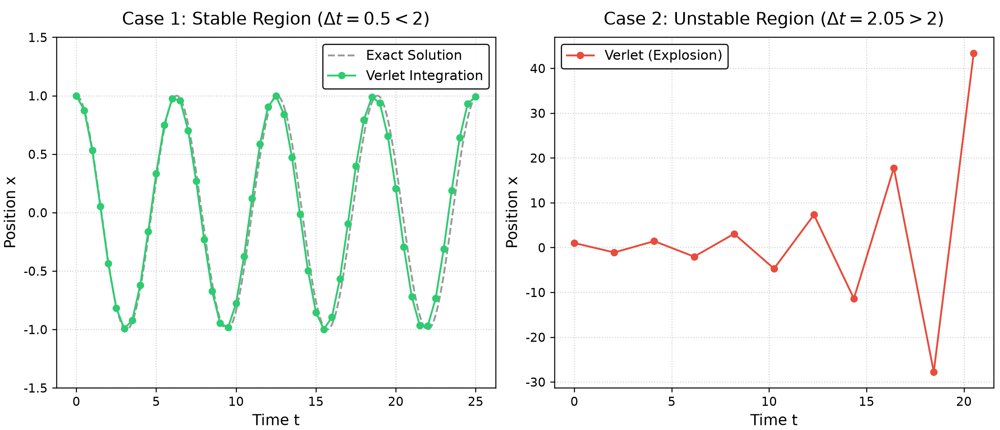

# 数值积分器
## 1、基本问题
&emsp;&emsp;数值积分器用于对描述系统动力学的常微分方程组进行离散求解：
$$
\dot{\mathbf{x}}=\mathbf{f}\left(\mathbf{x},t\right)
$$
给定当前状态后，积分器需要在有限时间步 $\Delta t$ 内同时更新位置、速度等状态量。不同方法对误差、能量变化与稳定性的处理方式不同，因此会直接影响实时物理仿真的表现。

## 2、欧拉积分
&emsp;&emsp;以质量与刚度均为 $1$ 的无阻尼简谐振子为例。设系统在 $t$ 时刻的位置为 $x_t$、速度为 $v_t$，机械能为：
$$
E_t=\frac{1}{2}v_t^2+\frac{1}{2}x_t^2
$$
振子受到指向平衡位置的恢复加速度：
$$
a_t=-x_t
$$
下面比较三种欧拉更新策略的能量演化。

### 2.1、显式欧拉
&emsp;&emsp;显式欧拉利用当前时刻的位置、速度与加速度直接外推下一时刻：
$$
\begin{aligned}
x_{t+\Delta t}&=x_t+v_t\Delta t\\
v_{t+\Delta t}&=v_t+a_t\Delta t
\end{aligned}
\tag{1}
$$
将 $a_t=-x_t$ 代入式 (1)，再展开下一时刻的机械能，可以得到：
$$
E_{t+\Delta t}
=E_t\left(1+\Delta t^2\right)
\tag{2}
$$
递推应用式 (2)，经过 $n$ 步后的系统总能量为：
$$
E_n=E_0\left(1+\Delta t^2\right)^n
$$
显式欧拉每一步都会按固定倍率放大能量，长时间模拟时会出现指数级发散。

### 2.2、隐式欧拉
&emsp;&emsp;隐式欧拉使用未来时刻的速度和加速度完成位置更新：
$$
\begin{aligned}
x_{t+\Delta t}&=x_t+v_{t+\Delta t}\Delta t\\
v_{t+\Delta t}&=v_t+a_{t+\Delta t}\Delta t
\end{aligned}
\tag{3}
$$
对于线性系统，可以直接求解未来状态；对于非线性系统，则需要通过数值迭代求根。对上述简谐振子求解式 (3)，单步更新后的能量变为：
$$
E_{t+\Delta t}
=\frac{E_t}{1+\Delta t^2}
\tag{4}
$$
递推应用式 (4)，经过 $n$ 步后的系统总能量为：
$$
E_n=\frac{E_0}{\left(1+\Delta t^2\right)^n}
$$
隐式欧拉每一步都会消耗一部分机械能，表现出明显的数值阻尼。该方法对大步长更稳定，但会改变系统原本的能量守恒特征。

### 2.3、半隐式欧拉
&emsp;&emsp;半隐式欧拉先用当前位置计算新的速度，再用新速度更新位置：
$$
\begin{aligned}
v_{t+\Delta t}&=v_t+a_t\Delta t\\
x_{t+\Delta t}&=x_t+v_{t+\Delta t}\Delta t
\end{aligned}
\tag{5}
$$
将新的速度与位置代回机械能定义，可以得到单步更新后的能量：
$$
E_{t+\Delta t}
=E_t-\frac{1}{2}x_t^2\Delta t^2
\left(1-\Delta t^2\right)
\tag{6}
$$
能量误差与当前位置有关，并在一个振荡周期内正负交替，不会像显式欧拉一样每步按固定倍率单调放大。其更新映射保持相空间面积不变，因此属于辛积分方法。

### 2.4、相空间轨迹对比
&emsp;&emsp;将状态映射到由位置 $x$ 与速度 $v$ 构成的相空间，可以直接观察三种方法的长期行为。显式欧拉的轨迹向外发散，隐式欧拉的轨迹向内收缩，半隐式欧拉则在解析轨迹附近形成近似闭合的环路。

  

## 3、Verlet 积分
### 3.1、公式推导
&emsp;&emsp;Verlet 积分是图形学中常用的时间积分方法。将连续位置函数 $x(t)$ 分别向未来时刻 $t+\Delta t$ 与过去时刻 $t-\Delta t$ 作泰勒展开：
$$
\begin{aligned}
x(t+\Delta t)
&=x(t)+v(t)\Delta t+\frac{1}{2}a(t)\Delta t^2
+\frac{1}{6}j(t)\Delta t^3+O\left(\Delta t^4\right)\\
x(t-\Delta t)
&=x(t)-v(t)\Delta t+\frac{1}{2}a(t)\Delta t^2
-\frac{1}{6}j(t)\Delta t^3+O\left(\Delta t^4\right)
\end{aligned}
$$
其中 $j(t)$ 为加加速度。将两式相加，速度项与加加速度项相互抵消：
$$
x(t+\Delta t)+x(t-\Delta t)
=2x(t)+a(t)\Delta t^2+O\left(\Delta t^4\right)
$$
移项并舍去高阶余项，记 $x_n=x(t_n)$，即可得到经典 Verlet 位置更新公式：
$$
x_{n+1}=2x_n-x_{n-1}+a_n\Delta t^2
\tag{7}
$$
Verlet 不需要单独存储速度，对恒定时间步的场景具有较低的状态管理开销。

### 3.2、稳定性分析
&emsp;&emsp;继续使用无阻尼简谐振子，将 $a_n=-x_n$ 代入式 (7)：
$$
x_{n+1}
=\left(2-\Delta t^2\right)x_n-x_{n-1}
\tag{8}
$$
将 $x_n=r^n$ 代入式 (8)，得到对应的特征方程：
$$
r^2-\left(2-\Delta t^2\right)r+1=0
\tag{9}
$$
两个特征根为：
$$
r_{1,2}
=1-\frac{\Delta t^2}{2}
\pm\frac{\Delta t}{2}\sqrt{\Delta t^2-4}
$$
当 $\Delta t<2$ 时，根号内为负，特征根为一对共轭复数，且谱半径满足：
$$
\rho=\left|r_{1,2}\right|=1
\tag{10}
$$
此时数值解表现为等幅振荡。当 $\Delta t>2$ 时，两个特征根均为实数，其中一个根满足 $\left|r\right|>1$，误差会随时间快速放大。

  

&emsp;&emsp;左图对应 $\Delta t=0.5<2$，积分轨迹保持等幅振荡，但相位相对解析解出现了轻微偏移。右图对应 $\Delta t=2.05>2$，时间步长刚刚越过临界值，数值解便迅速崩溃。因此，Verlet 对线性振荡系统属于条件稳定方法，时间步长必须小于稳定上限。

## 4、延伸阅读
- 作品：[Unity 实时柔性体与粒子流体系统](<../../../../作品/计算机图形学/物理/Unity 实时柔性体与粒子流体系统：基于 XPBD 与 PBF 的物理模拟.md>)
- 文章：[基于 XPBD 的网格布料仿真](../../../../文章/计算机图形学/物理/XPBD/基于%20XPBD%20的网格布料仿真.md)、[基于 XPBD 的柔性骨骼仿真](../../../../文章/计算机图形学/物理/XPBD/基于%20XPBD%20的柔性骨骼仿真.md)
- 笔记：[基于位置的扩展动力学（XPBD）](<../XPBD/基于位置的扩展动力学（XPBD）.md>)、[数值迭代法](数值迭代法.md)
