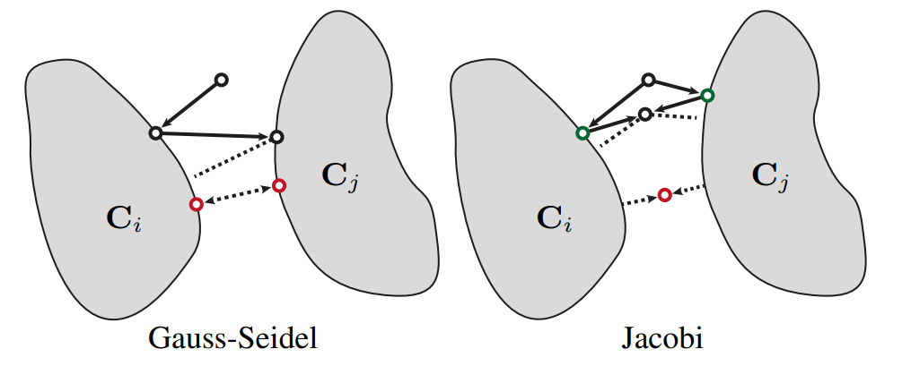

# 数值迭代法
## 1、矩阵分解
&emsp;&emsp;在物理仿真中，隐式积分与约束求解往往会转化为求解大型线性方程组：
$$
A\mathbf{x}=\mathbf{b}
$$
其中，$A$ 为 $n\times n$ 的非奇异系数矩阵，$\mathbf{x}$ 为未知向量，$\mathbf{b}$ 为已知向量。对于大规模稀疏系统，直接求逆或执行高密度矩阵分解的成本较高，因此通常采用迭代方式逐步逼近解。

&emsp;&emsp;为构造迭代格式，将系数矩阵拆分为对角、严格下三角与严格上三角三部分：
$$
A=D+L+U
\tag{1}
$$
其中，$D$ 只保留 $A$ 的对角元素，$L$ 为严格下三角矩阵，$U$ 为严格上三角矩阵。原方程可以等价写成：
$$
\left(D+L+U\right)\mathbf{x}=\mathbf{b}
$$
雅可比迭代与高斯-塞德尔迭代的主要区别，在于等号左右保留哪些矩阵，以及新旧未知量如何参与计算。

## 2、雅可比迭代
### 2.1、矩阵形式
&emsp;&emsp;利用式 (1) 的矩阵拆分，雅可比迭代将对角矩阵保留在等号左侧，其余部分移到右侧：
$$
D\mathbf{x}=\mathbf{b}-\left(L+U\right)\mathbf{x}
$$
在第 $k$ 次迭代中，右侧统一使用上一轮的旧解 $\mathbf{x}^{(k)}$，左侧求解新一轮解 $\mathbf{x}^{(k+1)}$：
$$
D\mathbf{x}^{(k+1)}
=\mathbf{b}-\left(L+U\right)\mathbf{x}^{(k)}
$$
由于 $D$ 为对角矩阵，其逆矩阵只需要对主对角元素分别取倒数。等式两边左乘 $D^{-1}$ 后得到：
$$
\mathbf{x}^{(k+1)}
=D^{-1}\left(\mathbf{b}-\left(L+U\right)\mathbf{x}^{(k)}\right)
\tag{2}
$$

### 2.2、分量形式
&emsp;&emsp;将式 (2) 展开至第 $i$ 个未知数，得到：
$$
x_i^{(k+1)}
=\frac{1}{a_{ii}}
\left(
b_i-\sum_{\substack{j=1\\j\neq i}}^n a_{ij}x_j^{(k)}
\right)
\tag{3}
$$
计算第 $k+1$ 轮的任意分量时，雅可比迭代只读取第 $k$ 轮的数据。因此，各分量的更新相互独立，便于并行计算。

## 3、高斯-塞德尔迭代
### 3.1、矩阵形式
&emsp;&emsp;利用式 (1) 的矩阵拆分，高斯-塞德尔迭代将对角矩阵 $D$ 与下三角矩阵 $L$ 一并保留在等号左侧，只把上三角矩阵 $U$ 移到右侧：
$$
\left(D+L\right)\mathbf{x}^{(k+1)}
=\mathbf{b}-U\mathbf{x}^{(k)}
$$
两边左乘 $\left(D+L\right)^{-1}$，得到：
$$
\mathbf{x}^{(k+1)}
=\left(D+L\right)^{-1}
\left(\mathbf{b}-U\mathbf{x}^{(k)}\right)
\tag{4}
$$

### 3.2、分量形式
&emsp;&emsp;将式 (4) 展开至第 $i$ 个未知数，得到：
$$
x_i^{(k+1)}
=\frac{1}{a_{ii}}
\left(
b_i-\sum_{j=1}^{i-1}a_{ij}x_j^{(k+1)}
-\sum_{j=i+1}^{n}a_{ij}x_j^{(k)}
\right)
\tag{5}
$$
计算第 $i$ 个未知数时，索引小于 $i$ 的分量已经使用本轮新值，索引大于 $i$ 的分量仍然使用上一轮旧值。最新计算结果会立即参与后续分量更新，因此高斯-塞德尔通常比雅可比收敛更快，但各分量之间存在严格的串行依赖。

## 4、在 PBD 约束投影中的应用
&emsp;&emsp;在基于位置的动力学（Position-Based Dynamics，PBD）中，线性系统的迭代思想被转化为顶点位置的几何投影。设 $V$ 为顶点集合，$E$ 为距离约束集合，$\mathbf{x}_i$、$\mathbf{x}_j\in\mathbb{R}^3$ 为约束边 $e=\{i,j\}$ 两端质点的位置，$L_e$ 为该约束的原长。

&emsp;&emsp;若当前边长与目标长度存在差值，可将两端位置沿连线方向相向投影。带符号的修正向量定义为：
$$
\Delta\mathbf{x}
=\frac{1}{2}
\left(
\left\|\mathbf{x}_i-\mathbf{x}_j\right\|-L_e
\right)
\frac{\mathbf{x}_i-\mathbf{x}_j}
{\left\|\mathbf{x}_i-\mathbf{x}_j\right\|}
\tag{6}
$$
其中，$K$ 为最大迭代次数，$k$ 为当前迭代轮次，$n_i$ 为与顶点 $i$ 关联的约束数量，$\alpha$ 为用于控制欠松弛的系数。

&emsp;&emsp;雅可比形式累计全部约束后，需要对候选位置执行欠松弛平均：
$$
\mathbf{x}_i
=\frac{\mathbf{x}_i^{\mathrm{new}}+\alpha\mathbf{x}_i}
{n_i+\alpha}
\tag{7}
$$

### 4.1、约束投影的雅可比形式
&emsp;&emsp;雅可比形式采用“先独立累加，再统一平均”的更新策略。每条约束只读取本轮开始时的位置，并把各自的候选修正累加到临时位置中：

&emsp;&emsp;(1) For $k=0,\dots,K-1$  
&emsp;&emsp;(2) &emsp;&emsp;For every vertex $i\in V$  
&emsp;&emsp;(3) &emsp;&emsp;&emsp;&emsp;$\mathbf{x}_i^{\mathrm{new}}\leftarrow\mathbf{0},\quad n_i\leftarrow0$ // 清空候选位置与约束计数  
&emsp;&emsp;(4) &emsp;&emsp;For every edge $e=\{i,j\}\in E$  
&emsp;&emsp;(5) &emsp;&emsp;&emsp;&emsp;compute $\Delta\mathbf{x}$ // 计算当前距离约束的修正向量  
&emsp;&emsp;(6) &emsp;&emsp;&emsp;&emsp;$\mathbf{x}_i^{\mathrm{new}}\leftarrow\mathbf{x}_i^{\mathrm{new}}+\mathbf{x}_i-\Delta\mathbf{x}$  
&emsp;&emsp;(7) &emsp;&emsp;&emsp;&emsp;$\mathbf{x}_j^{\mathrm{new}}\leftarrow\mathbf{x}_j^{\mathrm{new}}+\mathbf{x}_j+\Delta\mathbf{x}$  
&emsp;&emsp;(8) &emsp;&emsp;&emsp;&emsp;$n_i\leftarrow n_i+1,\quad n_j\leftarrow n_j+1$  
&emsp;&emsp;(9) &emsp;&emsp;For every vertex $i\in V$  
&emsp;&emsp;(10)&emsp;&emsp;&emsp;&emsp;$\mathbf{x}_i\leftarrow\dfrac{\mathbf{x}_i^{\mathrm{new}}+\alpha\mathbf{x}_i}{n_i+\alpha}$ // 对候选位置执行欠松弛平均  

各约束之间没有即时数据依赖，因此该形式适合映射到 GPU 并行计算。由于顶点位置最终由多条约束的修正结果共同平均，单轮收敛速度通常慢于高斯-塞德尔形式。

### 4.2、约束投影的高斯-塞德尔形式
&emsp;&emsp;高斯-塞德尔形式在每条约束处理完成后立即写回端点位置，后续约束直接读取最新的顶点状态：

&emsp;&emsp;(1) For $k=0,\dots,K-1$  
&emsp;&emsp;(2) &emsp;&emsp;For every edge $e=\{i,j\}\in E$  
&emsp;&emsp;(3) &emsp;&emsp;&emsp;&emsp;compute $\Delta\mathbf{x}$ // 计算当前距离约束的修正向量  
&emsp;&emsp;(4) &emsp;&emsp;&emsp;&emsp;$\mathbf{x}_i\leftarrow\mathbf{x}_i-\Delta\mathbf{x}$ // 立即写回顶点 $i$  
&emsp;&emsp;(5) &emsp;&emsp;&emsp;&emsp;$\mathbf{x}_j\leftarrow\mathbf{x}_j+\Delta\mathbf{x}$ // 立即写回顶点 $j$  

该方法能快速把最新修正传播到相邻约束，通常只需较少迭代即可逼近约束流形。不过，约束处理顺序会影响最终结果，且相邻约束之间的数据依赖使该方法难以直接并行。

### 4.3、约束不存在可行解
&emsp;&emsp;当多个刚性约束相互矛盾时，约束集合可能不存在同时满足全部条件的可行解。不同迭代策略在无效解附近会表现出明显差异。

  

&emsp;&emsp;高斯-塞德尔采用就地更新，估计值会在不同约束流形之间反复跳转，并可能持续振荡。雅可比形式先并行计算各个约束的候选投影，再通过加权平均或质量分摊执行欠松弛更新，因此更容易收敛到稳定的折中位置。

## 5、延伸阅读
- 作品：[Unity 实时柔性体与粒子流体系统](<../../../../作品/计算机图形学/物理/Unity 实时柔性体与粒子流体系统：基于 XPBD 与 PBF 的物理模拟.md>)
- 文章：[基于 XPBD 的网格布料仿真](../../../../文章/计算机图形学/物理/XPBD/基于%20XPBD%20的网格布料仿真.md)、[基于 XPBD 的柔性骨骼仿真](../../../../文章/计算机图形学/物理/XPBD/基于%20XPBD%20的柔性骨骼仿真.md)
- 笔记：[基于位置的扩展动力学（XPBD）](<../XPBD/基于位置的扩展动力学（XPBD）.md>)、[数值积分器](数值积分器.md)
