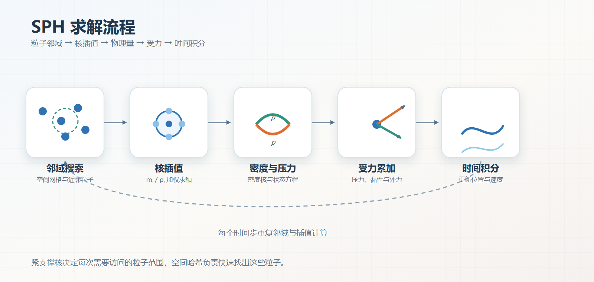

# Müller SPH 流体模型（2003）
## 1、参考文献
1. Müller, M., Charypar, D., & Gross, M. Particle-Based Fluid Simulation for Interactive Applications. *Proceedings of the 2003 ACM SIGGRAPH/Eurographics Symposium on Computer Animation*, 2003: 154–159. [DOI](https://doi.org/10.2312/SCA03/154-159)
2. Desbrun, M., & Cani, M.-P. Smoothed Particles: A New Paradigm for Animating Highly Deformable Bodies. *Computer Animation and Simulation '96*, Springer, 1996: 61–76.
3. Monaghan, J. J. Smoothed Particle Hydrodynamics. *Annual Review of Astronomy and Astrophysics*, 1992, 30: 543–574.

## 2、概念
&emsp;&emsp;Müller、Charypar 与 Gross 在 2003 年把 SPH 系统性地用于带自由表面的交互式流体动画 [1]。论文直接从 Navier-Stokes 方程出发，把压力、黏性和外力离散为作用在粒子上的力密度，并补充表面张力、碰撞和自由表面渲染。

&emsp;&emsp;SPH 是底层的粒子插值框架，而这个模型是 SPH 在图形学流体中的一套完整实现。质量固定在粒子上，因此粒子方法天然保持质量。粒子随流体运动，也不需要欧拉网格中的对流项。

  

## 3、模型假设
&emsp;&emsp;论文采用等温、不可压缩或弱可压缩的牛顿流体模型。每个粒子具有恒定质量 $m_i$、位置 $\mathbf{x}_i$、速度 $\mathbf{v}_i$ 和随邻域变化的密度 $\rho_i$。所有粒子质量相同，粒子数在整个模拟过程中保持固定。

&emsp;&emsp;SPH 场量通过有限支撑的平滑核近似。核函数满足归一化和对称性条件，在支撑半径 $h$ 外取零。核函数及其导数直接决定密度估计、压力梯度和黏性力的精度。

## 4、密度估计
&emsp;&emsp;标量场 $A$ 在粒子 $i$ 处的 SPH 插值为：
$$
A_i
=\sum_j
\frac{m_j}{\rho_j}
A_jW_{ij}
\tag{1}
$$
令 $A=\rho$，并利用 $m_j=\rho_jV_j$，密度可以写成：
$$
\rho_i
=\sum_jm_jW_{ij}
\tag{2}
$$
其中，$W_{ij}=W(\left\|\mathbf{x}_i-\mathbf{x}_j\right\|,h)$。论文使用 Poly6 核计算密度，因为它的表达式只依赖距离平方，计算成本较低。

## 5、压力
&emsp;&emsp;粒子本身不存储压力，需要先由密度状态方程求出压力。论文采用修正的理想气体状态方程，使密度超过静止密度 $\rho_0$ 时产生正压力：
$$
p_i
=k\left[
\left(\frac{\rho_i}{\rho_0}\right)^7
-1
\right]
\tag{3}
$$
其中，$k$ 控制压力对密度误差的响应强度。减小状态方程偏移不会改变压力梯度的数学方向，但会影响数值稳定性和光滑后的压力场。

&emsp;&emsp;直接离散压力梯度会让两个粒子的压力力不对称。论文采用对称形式：
$$
\mathbf{a}_i^{pressure}
=-\sum_j
m_j
\left(
\frac{p_i}{\rho_i^2}
+\frac{p_j}{\rho_j^2}
\right)
\nabla_iW_{ij}
\tag{4}
$$
同一粒子对 $i,j$ 上的压力大小相等、方向相反，因此有助于保持线动量。

## 6、黏性
&emsp;&emsp;黏性项来自 Navier-Stokes 方程中的速度拉普拉斯量。直接对绝对速度做核估计会产生不对称力，因此论文把黏性改写为依赖速度差的形式：
$$
\mathbf{f}_i^{viscosity}
=\mu\sum_j
m_j
\frac{\mathbf{v}_j-\mathbf{v}_i}
{\rho_j}
\nabla^2W_{ij}
\tag{5}
$$
黏性使邻域粒子的速度趋于一致，并耗散流体内部的相对运动。

&emsp;&emsp;速度差越小，黏性力越弱，速度差越大，黏性作用越强。该性质使黏性能够平滑流场，同时保持均匀平移的整体速度不变。

## 7、光滑核
&emsp;&emsp;论文并不只使用一个核函数，而是为不同物理量选择不同核：

- Poly6 核用于密度等需要稳定标量插值的场，计算不需要开平方
- Spiky 核用于压力梯度，避免 Poly6 梯度在粒子接近重合时趋近于零
- 粘度核具有非负拉普拉斯算子，避免近距离时错误地增大速度差

&emsp;&emsp;Poly6 由论文设计并广泛用于密度估计，Spiky 则明确沿用 Desbrun 的尖峰核思想 [2]，用于解决压力计算中的粒子聚集。三种核的统一数学形式和梯度推导见：[核函数](../../../../../笔记/物理/流体力学/水动力学/核函数.md)。

## 8、表面张力
&emsp;&emsp;原 Navier-Stokes 方程中没有显式表面张力。论文引入颜色场 $c_S$ 标记流体占据的空间，并在表面附近计算颜色场梯度：
$$
\mathbf{n}
=\nabla c_S
$$
其中，$\mathbf{n}$ 指向流体内部。对归一化法线求散度可以估计曲率，表面牵引力与曲率和表面张力系数有关。

&emsp;&emsp;表面张力只在颜色场梯度不为零的自由表面附近生效。这个模型让表面趋向于减小曲率，从而形成水滴、液面和飞溅的收缩趋势。

## 9、延伸阅读
- 作品：[Unity 实时柔性体与粒子流体系统](<../../../../../作品/计算机图形学/物理/Unity 实时柔性体与粒子流体系统：基于 XPBD 与 PBF 的物理模拟.md>)
- 文章：[PBF 粒子流体模拟](../../../../../文章/计算机图形学/物理/水动力学仿真/PBF%20粒子流体模拟.md)、[基于二维波动方程的浅水波场](../../../../../文章/计算机图形学/物理/水动力学仿真/基于二维波动方程的浅水波场.md)
- 笔记：[光滑粒子流体动力学（SPH）](光滑粒子流体动力学（SPH）.md)、[核函数](../../../../../笔记/物理/流体力学/水动力学/核函数.md)、[基于位置的流体（PBF）](基于位置的流体（PBF）.md)
