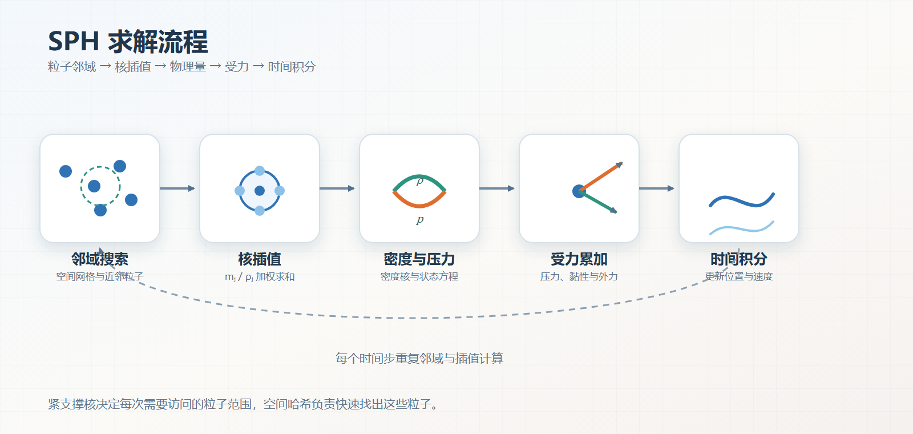
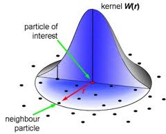
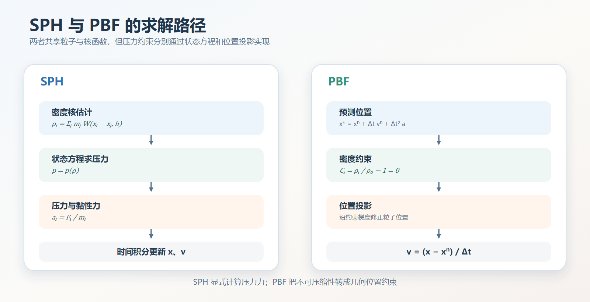

# 光滑粒子流体动力学（SPH）
## 1、参考文献
1. Lucy, L. B. A numerical approach to the testing of the fission hypothesis. *The Astronomical Journal*, 1977, 82: 1013–1024. [DOI](https://doi.org/10.1086/112164)
2. Gingold, R. A., & Monaghan, J. J. Smoothed particle hydrodynamics: theory and application to non-spherical stars. *Monthly Notices of the Royal Astronomical Society*, 1977, 181(3): 375–389. [DOI](https://doi.org/10.1093/mnras/181.3.375)
3. Müller, M., Charypar, D., & Gross, M. Particle-Based Fluid Simulation for Interactive Applications. *Proceedings of the 2003 ACM SIGGRAPH/Eurographics Symposium on Computer Animation*, 2003: 154–159. [DOI](https://doi.org/10.2312/SCA03/154-159)
4. Wang, H. GAMES103: Introduction to Physics-Based Animation, Lecture 12: Smoothed Particle Hydrodynamics. 2022. [Slides](https://slides.games-cn.org/course/GAMES103-12-SPH.pptx)

## 2、概念
&emsp;&emsp;光滑粒子流体动力学（Smoothed Particle Hydrodynamics，SPH）是一种无网格粒子方法 [1][2]。它把连续流体离散为一组携带质量、速度、压力和温度等属性的粒子，再使用核函数把离散粒子信息插值为连续场。

&emsp;&emsp;SPH 本身是一种空间插值框架，并不规定流体必须采用哪一种压力模型。图形学中的弱可压缩 SPH 通常先由粒子密度和状态方程计算压力，再把压力和黏性力作为加速度作用到粒子上 [3]；PBF 则沿用粒子与核函数，但把不可压缩性改写成密度约束并进行位置投影。

&emsp;&emsp;SPH 的主要计算步骤包括：

1. 使用空间网格或哈希结构查找每个粒子的邻域
2. 通过核插值估计密度和其他场量
3. 由状态方程或压力模型计算压力
4. 累加压力、黏性、外力和表面力
5. 使用时间积分更新粒子位置与速度
6. 在新位置重新构建邻域并进入下一时间步

  

## 3、核插值
&emsp;&emsp;GAMES103 从局部邻域平均出发解释 SPH 的构造。若粒子 $i$ 周围有 $n_i$ 个邻居，最直接的平均模型是：
$$
A_i^{simple}
=\frac{1}{n_i}\sum_jA_j
$$
这个模型实现简单，但所有邻居权重相同，支撑域边界上的粒子加入或离开时还会导致结果跳变。

&emsp;&emsp;若引入粒子体积 $V_j$，可以改为体积加权：
$$
A_i^{weighted}
=\frac{1}{n_i}\sum_jV_jA_j
$$
此时贡献与粒子代表的流体体积有关，但邻域边界处仍不连续。课程随后用平滑核 $W_{ij}$ 替代硬截断窗口，得到最终的核加权插值 [4]。

&emsp;&emsp;设粒子 $j$ 的质量为 $m_j$、密度为 $\rho_j$、位置为 $\mathbf{x}_j$，则任意场量 $A$ 在粒子 $i$ 处的 SPH 估计为：
$$
\left\langle A_i\right\rangle
=\sum_j
\frac{m_j}{\rho_j}
A_j
W\left(\left\|\mathbf{x}_i-\mathbf{x}_j\right\|,h\right)
\tag{1}
$$
其中，$W$ 为平滑核，$h$ 为平滑长度，$m_j/\rho_j$ 可看作粒子 $j$ 占据的体积。离粒子 $i$ 越近的邻居通常拥有更大的核权重。

&emsp;&emsp;粒子体积也可以通过密度估计反求。由 $\rho_i=m_i/V_i$ 和密度核估计可得：
$$
V_i
=\frac{m_i}{\sum_jm_jW_{ij}}
$$

这说明核函数不仅决定谁更重要，也参与从粒子质量恢复局部空间体积。

  

图源：GAMES103 Lecture 12 “Smoothed Particle Hydrodynamics”，Huamin Wang，第 13 页。

&emsp;&emsp;现场量变化较平缓时，空间导数可以近似为对核函数求导：
$$
\nabla_i\left\langle A_i\right\rangle
=\sum_j
\frac{m_j}{\rho_j}
A_j
\nabla_iW\left(\mathbf{x}_i-\mathbf{x}_j,h\right)
\tag{2}
$$
这样就不需要为粒子系统建立空间网格。核函数具体形式、归一化条件和 Spiky/Poly6 梯度见：[核函数](../../../../物理/流体力学/水动力学/核函数.md)。

## 4、密度估计
&emsp;&emsp;把一般核插值公式中的场量 $A$ 替换成密度，得到：
$$
\rho_i
=\sum_jV_j\rho_jW_{ij}
$$
其中，$V_j\rho_j$ 就是粒子 $j$ 的质量 $m_j$。代入粒子体积 $V_j=m_j/\rho_j$：
$$
\rho_i
=\sum_j
\frac{m_j}{\rho_j}
\rho_jW_{ij}
=\sum_jm_jW_{ij}
$$
因此密度核估计可以写成常用的质量加权求和形式：
$$
\left\langle\rho_i\right\rangle
=\sum_j
m_j
W\left(\left\|\mathbf{x}_i-\mathbf{x}_j\right\|,h\right)
\tag{3}
$$

&emsp;&emsp;密度求和形式简单、守恒性好，常用于图形学流体。另一种连续性密度形式直接积分密度变化：
$$
\frac{D\rho_i}{Dt}
=\sum_jm_j
\left(\mathbf{v}_i-\mathbf{v}_j\right)\cdot
\nabla_iW_{ij}
$$
它适合某些可压缩或高速流动，但对时间积分更敏感。

## 5、状态方程
&emsp;&emsp;弱可压缩 SPH 使用状态方程把密度误差转换为压力。图形学中常用 Tait 状态方程：
$$
p_i
=B\left[
\left(\frac{\rho_i}{\rho_0}\right)^\gamma
-1
\right],
\qquad
B=\frac{\rho_0c_s^2}{\gamma}
\tag{4}
$$
其中，$\rho_0$ 为静止密度，$c_s$ 为数值声速，$\gamma$ 通常取 $7$。当 $\rho_i=\rho_0$ 时压力为零，密度高于静止密度时产生正压力。

&emsp;&emsp;数值声速决定流体的软硬程度。声速越大，密度误差被压制得越强，但稳定时间步也越小。为了允许较大的实时时间步，图形学模拟通常选择远低于真实水中声速的数值声速，允许少量可压缩性。

&emsp;&emsp;自由表面附近还需要处理负压。若不希望流体产生人工内聚力，可以把压力截断为非负值：
$$
p_i\leftarrow\max\left(0,p_i\right)
$$

## 6、压力力
&emsp;&emsp;GAMES103 用相邻粒子的压力差解释压力力：如果邻域压力处处相同，各方向作用相互抵消，粒子不会获得净加速度。只有压力在空间中出现差异时，粒子才会被从高压区推向低压区。因此真正驱动运动的是压力梯度 $\nabla p$，绝对压力值本身不会直接产生平移。

&emsp;&emsp;由压力梯度产生的粒子加速度可采用对称形式：
$$
\mathbf{a}_i^{pressure}
=-\sum_j
m_j
\left(
\frac{p_i}{\rho_i^2}
+\frac{p_j}{\rho_j^2}
\right)
\nabla_iW_{ij}
\tag{5}
$$
该形式对粒子对 $i,j$ 具有对称性，有利于保持线动量。若直接把连续 N-S 方程中的压力梯度离散成非对称形式，粒子之间的压力作用可能不平衡。

&emsp;&emsp;完整动量方程还需要加入黏性、外力和表面力：
$$
\mathbf{a}_i
=\mathbf{a}_i^{pressure}
+\mathbf{a}_i^{viscosity}
+\mathbf{g}
+\mathbf{a}_i^{surface}
$$
黏性项用于平滑粒子之间的相对速度。常用实现包括基于速度拉普拉斯的物理黏性、Monaghan 人工黏性和 XSPH 速度平滑。

&emsp;&emsp;课程把黏性解释为让邻域粒子尽量以相同速度运动：速度较快的粒子会被拖慢，速度较慢的粒子会被带动，相邻粒子的速度差因此缩小。离散实现可以看作对速度场施加平滑拉普拉斯，但速度差过大的瞬间仍需限制作用强度，避免显式积分失稳。

&emsp;&emsp;表面张力可以通过颜色场、表面法线和曲率估计，也可以在屏幕空间渲染阶段模拟。表面张力不是 SPH 插值本身固有的部分，需要根据应用单独加入。

## 7、时间积分
&emsp;&emsp;得到每个粒子的总加速度后，需要更新速度和位置。蛙跳积分先推进半个时间步的速度，再用新速度更新位置：
$$
\mathbf{v}_i^{n+1/2}
=\mathbf{v}_i^{n-1/2}
+\Delta t\mathbf{a}_i^n
\tag{6}
$$
$$
\mathbf{x}_i^{n+1}
=\mathbf{x}_i^n
+\Delta t\mathbf{v}_i^{n+1/2}
$$
积分完成后重新构建邻域、计算密度和压力，形成下一轮循环。蛙跳或辛欧拉积分比显式欧拉更适合长时间流体模拟，因为它们的能量误差更稳定。

&emsp;&emsp;显式 SPH 的时间步受声速、粒子速度和力的大小限制，常使用类似 CFL 的条件：
$$
\Delta t
\le C_{CFL}
\frac{h}{c_s+v_{\max}}
\tag{7}
$$
其中，$C_{CFL}$ 为小于 $1$ 的安全系数，$v_{\max}$ 为当前最大粒子速度。密度变化过快或局部力过大时，还应进一步缩小时间步。

## 8、SPH 与 PBF 的关系
&emsp;&emsp;SPH 和 PBF 都使用粒子、核函数和邻域查询，但求解压力的方式不同。弱可压缩 SPH 通过状态方程把密度映射为压力，再把压力转成力并进入显式时间积分，PBF 则先预测位置，再把密度误差写成约束，通过多轮位置投影修正粒子。

  

&emsp;&emsp;SPH 的优点是物理模型直接、压力场和速度场连续，适合弱可压缩气体和液体，缺点是显式压力力对时间步和材料参数敏感。PBF 更容易使用较大时间步，也更方便与 XPBD 位置约束框架结合，但需要多轮邻域更新或约束迭代，并且粒子速度要在位置修正后重新计算。

## 9、延伸阅读
- 作品：[Unity 实时柔性体与粒子流体系统](<../../../../../作品/计算机图形学/物理/Unity 实时柔性体与粒子流体系统：基于 XPBD 与 PBF 的物理模拟.md>)
- 文章：[PBF 粒子流体模拟](../../../../../文章/计算机图形学/物理/水动力学仿真/PBF%20粒子流体模拟.md)、[基于二维波动方程的浅水波场](../../../../../文章/计算机图形学/物理/水动力学仿真/基于二维波动方程的浅水波场.md)、[基于顶点高度位移贴图的浅水水面几何重建](../../../../../文章/计算机图形学/渲染/水体渲染/基于顶点高度位移贴图的浅水水面几何重建.md)、[基础水体着色](../../../../../文章/计算机图形学/渲染/水体渲染/基础水体着色.md)、[焦散](../../../../../文章/计算机图形学/渲染/水体渲染/焦散.md)
- 笔记：[核函数](../../../../../笔记/物理/流体力学/水动力学/核函数.md)、[纳维-斯托克斯方程](../../../../../笔记/物理/流体力学/纳维-斯托克斯方程.md)、[数值积分器](../../数值计算基础/数值积分器.md)、[基于位置的扩展动力学（XPBD）](../../XPBD/基于位置的扩展动力学（XPBD）.md)
