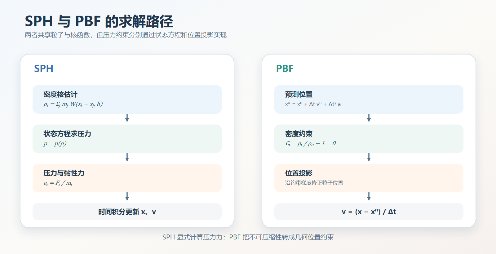

# 基于位置的流体（PBF）
## 1、参考文献
1. Macklin, M., & Müller, M. Position Based Fluids. *ACM Transactions on Graphics*, 2013, 32(4), Article 104. [DOI](https://doi.org/10.1145/2461912.2461984)
2. Müller, M., Heidelberger, B., Hennix, M., & Ratcliff, J. Position Based Dynamics. *Journal of Visual Communication and Image Representation*, 2007, 18(2): 109–118. [DOI](https://doi.org/10.1016/j.jvcir.2007.01.005)
3. Macklin, M., Müller, M., Chentanez, N., & Kim, T.-Y. Unified Particle Physics for Real-Time Applications. *ACM Transactions on Graphics*, 2014, 33(4), Article 153. [DOI](https://doi.org/10.1145/2601097.2601216)

## 2、概念
&emsp;&emsp;基于位置的流体（Position-Based Fluids，PBF）把不可压缩性写成粒子密度约束，并通过位置投影满足该约束 [1]。它沿用 SPH 的粒子表示、Poly6 密度核和 Spiky 梯度，但不再用状态方程把密度转换为压力，也不显式计算压力力。

&emsp;&emsp;PBF 建立在 PBD 的预测—投影框架上 [2]。粒子先按速度和加速度预测新位置，再通过多轮约束迭代修正位置，最后由位置变化反推速度。这样可以使用比显式弱可压缩 SPH 更大的时间步。

  

## 3、速度预测
&emsp;&emsp;每个时间步先施加重力和外力，预测粒子的新速度与位置：
$$
\mathbf{v}_i^{*}
=\mathbf{v}_i^{n}
+\Delta t\mathbf{a}_i^{ext}
$$
$$
\mathbf{x}_i^{*}
=\mathbf{x}_i^{n}
+\Delta t\mathbf{v}_i^{*}
$$
预测位置 $\mathbf{x}_i^{*}$ 通常不会精确满足不可压缩性，因此后续约束求解只修改位置，不直接修改速度。

## 4、密度约束
&emsp;&emsp;粒子 $i$ 的密度仍由 SPH 核估计：
$$
\rho_i
=\sum_jm_jW\left(\mathbf{x}_i-\mathbf{x}_j,h\right)
$$
PBF 将静止密度 $\rho_0$ 写成密度约束：
$$
C_i
=\frac{\rho_i}{\rho_0}-1
\tag{1}
$$
当 $C_i>0$ 时，局部密度过高，约束投影会将当前粒子与邻居推开。当 $C_i<0$ 时，通用 PBF 允许产生吸引修正。池水若只希望抵抗压缩，可以把乘子截断为非正数。

## 5、约束乘子
&emsp;&emsp;PBD 对密度约束进行一阶线性化，并沿约束梯度计算位置修正。对于粒子 $i$，标量乘子为：
$$
\lambda_i
=-\frac{C_i}
{\sum_k
\left\|\nabla_{\mathbf{x}_k}C_i\right\|^2
+\tilde{\epsilon}}
\tag{2}
$$
其中，$\tilde{\epsilon}$ 为约束力混合项，用于在相邻粒子过少或约束梯度接近零时稳定分母。论文把所有粒子视为等质量粒子，因此在离散公式中省略了质量项。

## 6、位置修正
&emsp;&emsp;粒子 $i$ 的位置修正同时使用自身与邻居粒子的乘子：
$$
\Delta\mathbf{x}_i
=\frac{1}{\rho_0}
\sum_j
\left(
\lambda_i+\lambda_j+s_{corr}
\right)
\nabla_{\mathbf{x}_i}W_{ij}
\tag{3}
$$
在固定迭代次数内重复计算密度、乘子和位置修正。PBF 论文采用类似雅可比的约束更新方式，把所有粒子放在同一轮中独立求乘子，再统一应用修正。

&emsp;&emsp;位置投影完成后，粒子速度由整个时间步的位置变化反推：
$$
\mathbf{v}_i^{n+1}
=\frac{
\mathbf{x}_i^{n+1}
-\mathbf{x}_i^{n}
}{\Delta t}
$$
因此，碰撞和密度约束造成的位置修正都会自然反映到速度中。

## 7、人工压力
&emsp;&emsp;自由表面附近邻居不足时，SPH 密度估计可能偏低，产生粒子聚集。PBF 引入人工压力项：
$$
s_{corr}
=-k
\left(
\frac{W\left(\mathbf{x}_{ij},h\right)}
{W\left(\Delta\mathbf{q},h\right)}
\right)^n
\tag{4}
$$
其中，$\mathbf{x}_{ij}=\mathbf{x}_i-\mathbf{x}_j$，$\Delta\mathbf{q}$ 是支撑域内的固定参考距离。论文建议 $|\Delta\mathbf{q}|=0.1h\sim0.3h$、$k=0.1$、$n=4$。

&emsp;&emsp;人工压力是纯排斥项，会把局部密度压到略低于静止密度，周围粒子随后向内修正。这改善了粒子分布，也会产生类似表面张力的收紧效果。该参数同时依赖空间分辨率和时间步，因此并不是一个完全独立的表面张力模型。

## 8、涡量约束
&emsp;&emsp;基于位置的求解会引入额外数值阻尼，使小尺度涡旋衰减过快。PBF 在速度更新阶段可选地计算涡量：
$$
\boldsymbol{\omega}_i
=\sum_j
\left(\mathbf{v}_j-\mathbf{v}_i\right)
\times
\nabla_{\mathbf{x}_i}W_{ij}
\tag{5}
$$
定义涡量模长的梯度方向和单位向量：
$$
\boldsymbol{\eta}
=\nabla\left\|\boldsymbol{\omega}_i\right\|
\qquad
\hat{\mathbf{N}}
=\frac{\boldsymbol{\eta}}
{\left\|\boldsymbol{\eta}\right\|}
$$
涡量约束力为：
$$
\mathbf{f}_i^{vorticity}
=\epsilon_{vort}
\left(
\hat{\mathbf{N}}\times\boldsymbol{\omega}_i
\right)
\tag{6}
$$
该力只在原本存在涡量的位置增强旋转，不会凭空制造新的涡结构。

## 9、XSPH 粘度
&emsp;&emsp;密度约束只负责不可压缩性，不会自动保证速度场连续。PBF 使用 XSPH 平滑邻居之间的相对速度：
$$
\mathbf{v}_i
\leftarrow
\mathbf{v}_i
+c_{xsph}
\sum_j
\frac{m_j}{\rho_j}
\left(
\mathbf{v}_j-\mathbf{v}_i
\right)
W_{ij}
\tag{7}
$$
较小的 $c_{xsph}$ 保留高速流动与细小液面变化，较大的值会增加速度连续性，但也会抹平细小涡旋。

## 10、求解流程
&emsp;&emsp;PBF 论文给出的单步主循环伪代码如下（设 $k$ 为约束迭代计数器）：

&emsp;&emsp;(1) For every particle $i$  
&emsp;&emsp;(2) &emsp;&emsp;$\mathbf{v}_i \leftarrow \mathbf{v}_i + \Delta t\,\mathbf{a}_{ext}(\mathbf{x}_i)$ // 施加重力和其他外力  
&emsp;&emsp;(3) &emsp;&emsp;$\mathbf{x}_i^{*} \leftarrow \mathbf{x}_i + \Delta t\,\mathbf{v}_i$ // 预测新位置  
&emsp;&emsp;(4) End for  
&emsp;&emsp;(5) For every particle $i$  
&emsp;&emsp;(6) &emsp;&emsp;$\mathcal{N}_i \leftarrow$ FindNeighbors $(\mathbf{x}_i^{*})$ // 在预测位置构建邻域  
&emsp;&emsp;(7) End for  
&emsp;&emsp;(8) While $k < solverIterations$  
&emsp;&emsp;(9) &emsp;&emsp;For every particle $i$  
&emsp;&emsp;(10)&emsp;&emsp;&emsp;&emsp;compute $\lambda_i$ // 计算密度约束乘子  
&emsp;&emsp;(11)&emsp;&emsp;End for  
&emsp;&emsp;(12)&emsp;&emsp;For every particle $i$  
&emsp;&emsp;(13)&emsp;&emsp;&emsp;&emsp;compute $\Delta\mathbf{x}_i$ // 计算密度约束位置修正  
&emsp;&emsp;(14)&emsp;&emsp;&emsp;&emsp;resolveCollisions $(\Delta\mathbf{x}_i)$ // 在迭代中修正碰撞导致的位置增量  
&emsp;&emsp;(15)&emsp;&emsp;End for  
&emsp;&emsp;(16)&emsp;&emsp;For every particle $i$  
&emsp;&emsp;(17)&emsp;&emsp;&emsp;&emsp;$\mathbf{x}_i^{*} \leftarrow \mathbf{x}_i^{*} + \Delta\mathbf{x}_i$ // 更新预测位置  
&emsp;&emsp;(18)&emsp;&emsp;End for  
&emsp;&emsp;(19) End while  
&emsp;&emsp;(20) For every particle $i$  
&emsp;&emsp;(21)&emsp;&emsp;$\mathbf{v}_i \leftarrow \left(\mathbf{x}_i^{*} - \mathbf{x}_i\right) / \Delta t$ // 由位置变化反推速度  
&emsp;&emsp;(22)&emsp;&emsp;applyVorticityAndXSPH $(\mathbf{v}_i)$ // 可选的涡量与速度平滑后处理  
&emsp;&emsp;(23)&emsp;&emsp;$\mathbf{x}_i \leftarrow \mathbf{x}_i^{*}$ // 写回最终位置  
&emsp;&emsp;(24) End for  

&emsp;&emsp;密度约束使用雅可比式更新，便于 GPU 并行。同一轮中所有粒子先独立求乘子，下一轮再读取全部最新位置。提高迭代次数可以改善收敛，但每轮都需要重新计算密度和约束梯度。

## 11、与弱可压缩 SPH 的区别
&emsp;&emsp;弱可压缩 SPH 与 PBF 使用相同的粒子密度核，但压力求解路径不同：

- 弱可压缩 SPH：密度 → 状态方程 → 压力 → 压力力 → 显式时间积分
- PBF：预测位置 → 密度误差 → 约束乘子 → 位置投影 → 由位置反推速度

PBF 不显式计算压力，但在约束迭代完成后，位置修正对应的拉格朗日乘子可以被解释为压力冲量。它也不是严格的无散度投影，实际不可压缩程度取决于约束迭代次数和允许误差。

## 12、局限与后续发展
&emsp;&emsp;PBF 论文指出，固体边界附近的粒子缺少足够流体邻居，密度估计仍可能不准确，导致粒子沿边界堆叠。雅可比迭代每轮只向直接邻居传播信息，粒子数增加时收敛速度会下降。人工压力参数同时影响粒子分布与表面张力，很难完全独立控制。

&emsp;&emsp;Unified Particle Physics 进一步把流体、刚体和布料统一到同一套位置约束框架 [3]，使用更一般的约束求解、碰撞和耦合机制。这为 XPBD 风格的统一物理模拟奠定了基础。

## 13、延伸阅读
- 作品：[Unity 实时柔性体与粒子流体系统](<../../../../../作品/计算机图形学/物理/Unity 实时柔性体与粒子流体系统：基于 XPBD 与 PBF 的物理模拟.md>)
- 文章：[PBF 粒子流体模拟](../../../../../文章/计算机图形学/物理/水动力学仿真/PBF%20粒子流体模拟.md)、[基于二维波动方程的浅水波场](../../../../../文章/计算机图形学/物理/水动力学仿真/基于二维波动方程的浅水波场.md)、[基于顶点高度位移贴图的浅水水面几何重建](../../../../../文章/计算机图形学/渲染/水体渲染/基于顶点高度位移贴图的浅水水面几何重建.md)、[基础水体着色](../../../../../文章/计算机图形学/渲染/水体渲染/基础水体着色.md)、[焦散](../../../../../文章/计算机图形学/渲染/水体渲染/焦散.md)
- 笔记：[光滑粒子流体动力学（SPH）](光滑粒子流体动力学（SPH）.md)、[Müller SPH 流体模型（2003）](<Müller SPH 流体模型（2003）.md>)、[核函数](../../../../../笔记/物理/流体力学/水动力学/核函数.md)、[基于位置的扩展动力学（XPBD）](../../XPBD/基于位置的扩展动力学（XPBD）.md)
