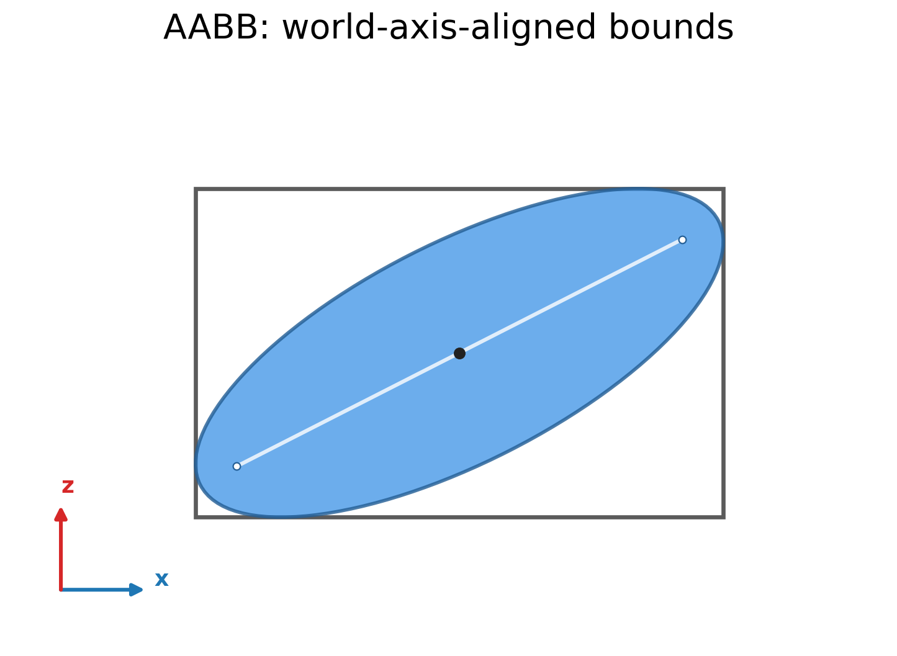
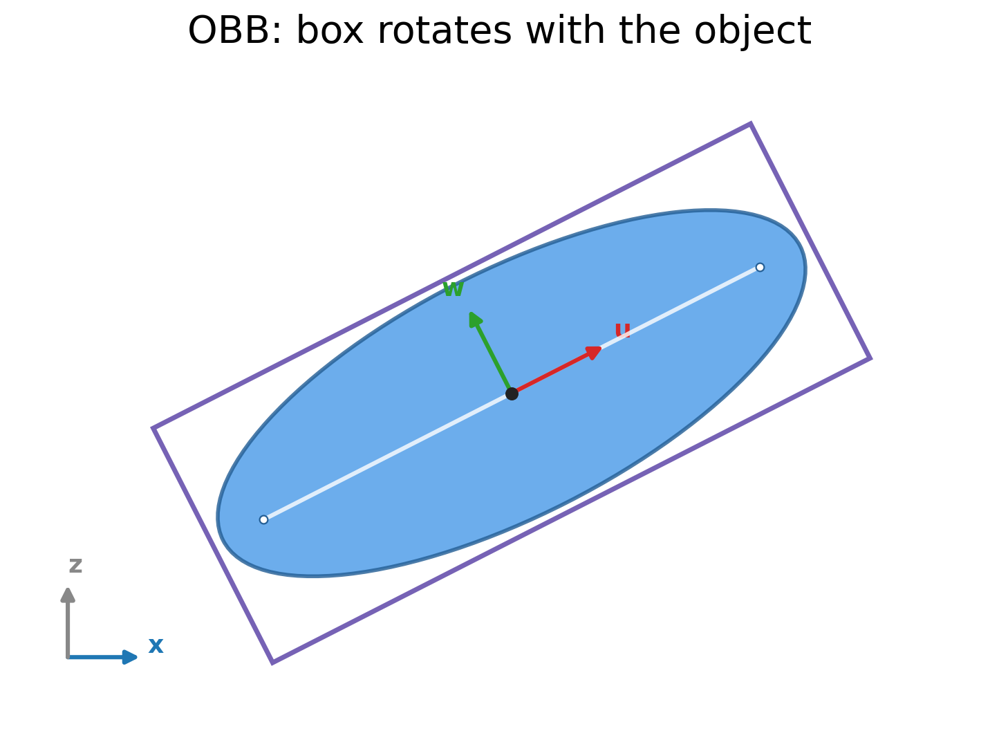
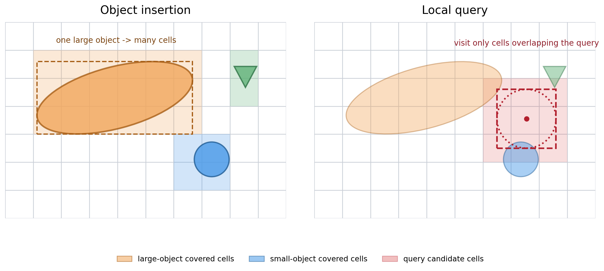
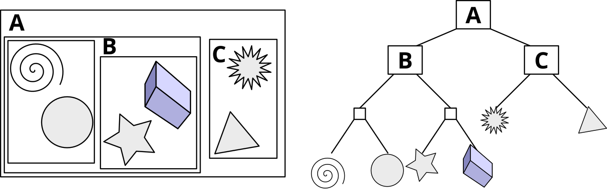
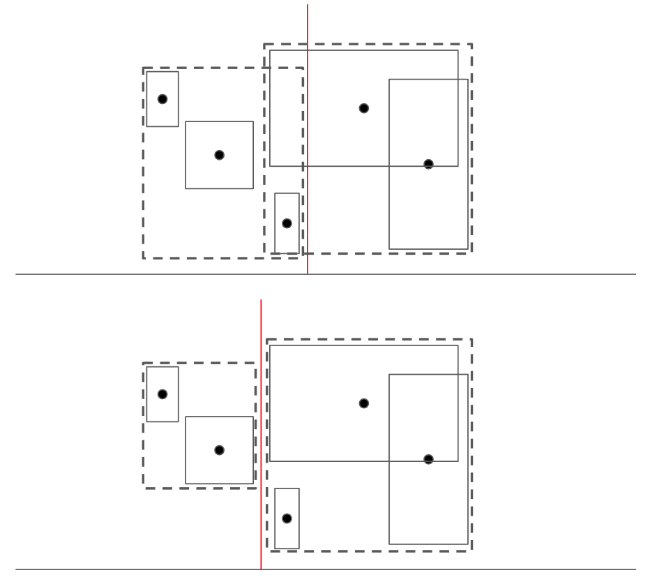
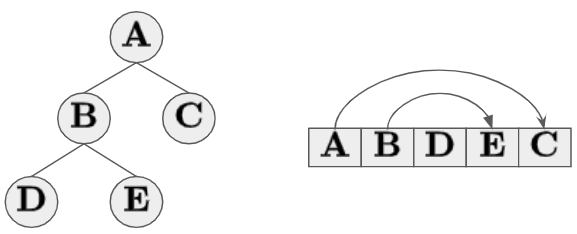
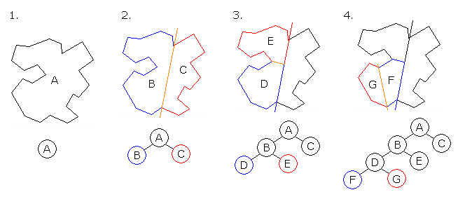
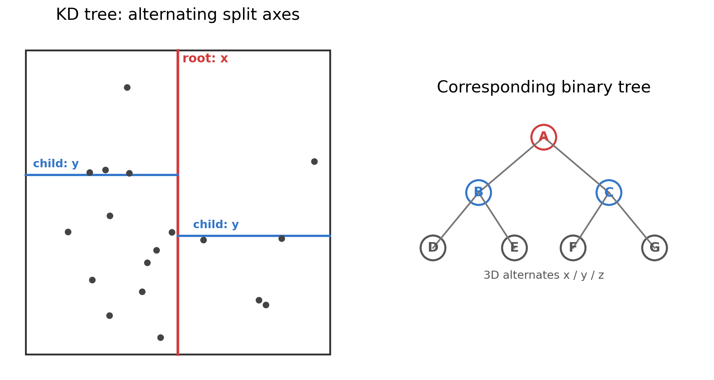
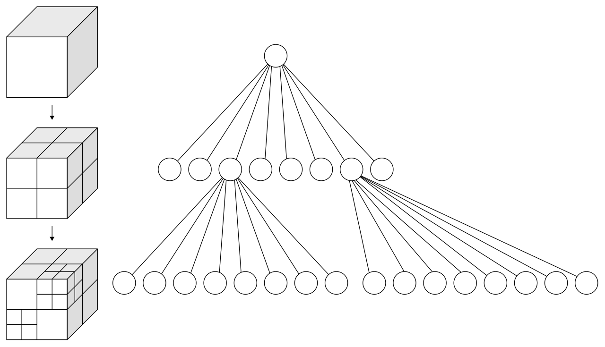

# 空间数据结构
## 1、参考文献
1. Yan, L. GAMES101: Introduction to Computer Graphics, Lecture 14: Ray Tracing 2 (Acceleration & Radiometry). University of California, Santa Barbara, 2020. [Slides](https://sites.cs.ucsb.edu/~lingqi/teaching/resources/GAMES101_Lecture_14.pdf)
2. 《Real-Time Rendering 3rd》提炼总结：游戏开发中的渲染加速算法总结. 知乎. [Article](https://zhuanlan.zhihu.com/p/32300891)
3. 《基于 XPBD 的实时物理模拟》，附录“空间哈希”。
4. Ericson, C. *Real-Time Collision Detection*. CRC Press, 2005.

## 2、概念
&emsp;&emsp;空间数据结构用于组织多维空间中的几何体、粒子或其他离散对象，使相交测试、邻域查询、碰撞检测、视锥裁剪和光线追踪只处理局部候选，而不必遍历整个场景 [1][2]。

&emsp;&emsp;暴力查询通常需要枚举全部对象对，时间复杂度为 $O(N^2)$。空间数据结构通过空间划分或对象分组建立索引，把查询限制在一个或少量子区域内。对实时物理和渲染而言，这类结构的主要收益是减少无效的距离测试和相交测试。

## 3、包围体
### 3.1、轴对齐包围盒
&emsp;&emsp;轴对齐包围盒（Axis-Aligned Bounding Box，AABB）的每条边都平行于世界坐标轴。三维 AABB 只记录最小点和最大点：
$$
\mathbf{b}_{\min}
=\left(x_{\min},y_{\min},z_{\min}\right),
\qquad
\mathbf{b}_{\max}
=\left(x_{\max},y_{\max},z_{\max}\right)
$$
点 $\mathbf{x}$ 位于 AABB 内，当且仅当三个坐标轴上的分量都落在对应区间内。AABB 存储紧凑，相交测试简单，是 BVH、均匀网格和其他层次结构中最常见的包围体。

&emsp;&emsp;另一种等价表示使用中心点和半尺寸：
$$
\mathbf{c}
=\frac{\mathbf{b}_{\min}+\mathbf{b}_{\max}}{2},
\qquad
\mathbf{e}
=\frac{\mathbf{b}_{\max}-\mathbf{b}_{\min}}{2}
$$

  

### 3.2、定向包围盒
&emsp;&emsp;定向包围盒（Oriented Bounding Box，OBB）使用中心点、三条正交局部轴和三个半尺寸描述一个可随物体旋转的盒体：
$$
\mathbf{c},\qquad
\mathbf{u},\mathbf{v},\mathbf{w},\qquad
\mathbf{e}=\left(e_u,e_v,e_w\right)
$$
其中 $\mathbf{u}$、$\mathbf{v}$、$\mathbf{w}$ 是 OBB 的局部坐标轴，$\mathbf{e}$ 是沿三条轴的半尺寸。把点 $\mathbf{x}$ 变换到 OBB 局部空间：
$$
\mathbf{q}
=\left(
\left(\mathbf{x}-\mathbf{c}\right)\cdot\mathbf{u},\,
\left(\mathbf{x}-\mathbf{c}\right)\cdot\mathbf{v},\,
\left(\mathbf{x}-\mathbf{c}\right)\cdot\mathbf{w}
\right)
$$
点位于 OBB 内，当且仅当三个局部坐标同时满足：
$$
\left|q_u\right|\le e_u,\qquad
\left|q_v\right|\le e_v,\qquad
\left|q_w\right|\le e_w
$$

  

&emsp;&emsp;当 $\mathbf{u}$、$\mathbf{v}$、$\mathbf{w}$ 分别取世界坐标轴时，OBB 退化为 AABB。OBB 能随旋转物体保持较紧的包围范围，减少宽相和近邻查询中的假阳性，代价是必须保存朝向并执行坐标变换。三维中两个 OBB 的重叠测试通常使用分离轴定理，需要检查双方各三条面法轴以及九条边方向叉积轴，共 15 条候选分离轴 [4]。

## 4、空间划分与物体划分
&emsp;&emsp;GAMES101 将加速结构分成两类：

- 空间划分：把整个空间切分成互不重叠的区域，例如均匀网格、BSP 树、KD 树和八叉树。同一个大物体会同时出现在多个区域中。
- 物体划分：把对象集合划分成互不重叠的子集，例如 BVH。不同子集的包围盒允许在空间中重叠，但每个对象只属于一个叶子节点。

对粒子邻域查询而言，粒子通常具有相近尺寸，并且在中等密度区域分布较均匀，因此均匀网格和空间哈希通常比树结构更直接。对大小差异明显、空间分布极不均匀的几何场景，BVH 或自适应空间树通常更合适。

## 5、均匀空间网格
&emsp;&emsp;均匀网格先求场景 AABB，再按固定边长把空间切成规则单元。对每个对象计算其包围盒覆盖的格子，并把对象引用写入这些格子。查询时只访问对象所在格及其邻格。

  

左：对象写入其包围盒覆盖的全部格子；右：查询只访问与查询范围重叠的候选格。

&emsp;&emsp;均匀网格适合大小相近、空间分布较均匀的大量对象。GAMES101 指出，网格过粗时每个格子包含的对象过多，无法有效加速。网格过细又会产生大量空格的遍历开销。当场景同时包含极大和极小对象时，还会出现少数大对象覆盖大量格子，而大量小对象挤在很小区域的问题。

&emsp;&emsp;对密集的三维数组实现，内存量与完整网格分辨率的三轴乘积成正比。对于开放场景或只占少量空间的大量粒子，这种存储方式很浪费，因此通常使用空间哈希压缩非空网格。

## 6、空间哈希

&emsp;&emsp;邻域查询如果直接对全部点两两比较，时间复杂度为 $O(N^2)$。空间哈希先在规则网格上缩小候选范围，再用哈希表压缩稀疏网格的存储开销，从而把查询限制在当前格及其相邻格中 [3]。

### 6.1、网格划分
&emsp;&emsp;设邻域支持半径为 $h$，把空间划分为边长为 $h$ 的均匀立方体网格。点 $(x,y,z)$ 所在的三维格坐标为：
$$
\operatorname{cell}\left(x,y,z\right)
=\left(
\left\lfloor\frac{x}{h}\right\rfloor,
\left\lfloor\frac{y}{h}\right\rfloor,
\left\lfloor\frac{z}{h}\right\rfloor
\right)
\tag{1}
$$
由于距离超过 $h$ 的对象不再属于有效邻域，某个点的影响范围只可能覆盖以自身格为中心的 $3\times3\times3$ 个格子。因此邻域查询只需检查这 27 个候选格，而不必扫描整个空间。

### 6.2、哈希映射
&emsp;&emsp;若直接为完整三维网格分配数组，大量空格会浪费内存。空间哈希把整数格坐标 $(x,y,z)$ 映射到长度为 $N_{\mathrm{table}}$ 的一维哈希表：
$$
H\left(x,y,z\right)
=
\left|
xp_1\oplus yp_2\oplus zp_3
\right|
\bmod N_{\mathrm{table}}
\tag{2}
$$
其中，$\oplus$ 为按位异或，$p_1$、$p_2$、$p_3$ 取三个大素数，用于打散相邻格坐标，$N_{\mathrm{table}}$ 为哈希表长度。常用取值为 $73856093$、$19349663$、$83492791$，并取：
$$
N_{\mathrm{table}}=\max\left(1024,2N\right)
$$
其中 $N$ 为对象数量 [3]。

### 6.3、邻居查询
&emsp;&emsp;对当前对象，枚举其所在格周围的 $3\times3\times3$ 个候选格，并分别计算哈希桶。哈希冲突会让不同格坐标共享同一个桶，因此从桶中取出的候选对象还需要先比较原始格坐标，再计算距离：
$$
\left\|\mathbf{x}_j-\mathbf{x}_i\right\|<h
$$
只有格坐标校验通过且距离小于 $h$ 的对象才属于最终邻域。格坐标比较用于排除哈希冲突产生的无关候选，距离判断用于排除同一候选格中但仍处于支持域外的对象。

## 7、层次包围盒
### 7.1、结构
&emsp;&emsp;BVH 按对象集合递归划分。根节点包围整个对象集合，内部节点保存两个子节点，叶子节点保存少量对象及其包围盒。不同分支的包围盒可以重叠，但一个对象通常只存在于一个叶子节点中。

  

图源：<a href="https://commons.wikimedia.org/wiki/File:Example_of_bounding_volume_hierarchy.svg">Wikimedia Commons</a>，Schreiberx，CC BY-SA 3.0。

### 7.2、构造与 SAH
&emsp;&emsp;BVH 常用的自顶向下构造流程是：

1. 计算当前对象集合的包围盒
2. 选择分割轴和分割位置
3. 把对象划分到左右子集
4. 递归构建子树
5. 对象数量足够少时停止

  

图源：<a href="https://commons.wikimedia.org/wiki/File:BVH_Splitting_Plane.png">Wikimedia Commons</a>，Tamthuc199x，CC0。

简单策略可以选择最长轴或按对象中心的中位数划分。质量更高的构造通常使用表面积启发式：
$$
C\left(S\right)
=C_{\mathrm{trav}}
+\frac{A\left(L\right)}{A\left(N\right)}N_LC_{\mathrm{isect}}
+\frac{A\left(R\right)}{A\left(N\right)}N_RC_{\mathrm{isect}}
\tag{3}
$$
其中，$A(N)$、$A(L)$、$A(R)$ 分别为当前节点、左子节点和右子节点包围盒的表面积，$N_L$、$N_R$ 为左右对象数，$C_{\mathrm{trav}}$ 和 $C_{\mathrm{isect}}$ 分别为遍历与相交测试成本。

### 7.3、遍历
&emsp;&emsp;射线首先测试根节点包围盒，未命中时直接结束，命中内部节点时递归测试子节点，命中叶子节点时再与叶子中的具体图元求交。BVH 适合对象大小差异明显、空间分布不均匀的动态场景，也常用于视锥裁剪、可见性判断和光线追踪。

  

图源：<a href="https://commons.wikimedia.org/wiki/File:BVHtree_travelsal.png">Wikimedia Commons</a>，Tamthuc199x，CC0。

## 8、BSP、KD 树与八叉树
### 8.1、BSP 树
&emsp;&emsp;BSP 树使用超平面递归切分空间，每个节点记录分割平面及前后两个子空间。它可以将场景表达为与视点相关的从前到后顺序，适合静态场景和可见性排序，但动态对象频繁移动时重建成本较高。

  

图源：<a href="https://commons.wikimedia.org/wiki/File:Binary_space_partition.png">Wikimedia Commons</a>，Public Domain。

### 8.2、KD 树
&emsp;&emsp;KD 树沿坐标轴轮流选择分割维度和分割位置，把空间递归划分为互不重叠的区域。内部节点通常只保存分割轴、分割位置和子节点，对象存放在叶子节点中。跨越分割平面的对象可能同时进入多个区域。

  

二维示意；三维 KD 树按 x、y、z 轴轮换选择分割维度。

### 8.3、八叉树
&emsp;&emsp;八叉树把一个立方体空间递归划分为八个子立方体，是四叉树在三维空间中的推广。它适合空间分布不均匀的场景，但每次均匀八分可能产生大量空节点，因此实际实现常采用自适应终止条件。

  

图源：<a href="https://commons.wikimedia.org/wiki/File:Octree2.svg">Wikimedia Commons</a>，WhiteTimberwolf、Nü，CC BY-SA 3.0。

## 9、结构选择
| 结构 | 划分对象 | 优点 | 主要限制 | 典型用途 |
| --- | --- | --- | --- | --- |
| 均匀网格 | 空间 | 构建简单、邻格查询直观 | 稀疏场景浪费内存，大小差异敏感 | 均匀场景、粒子邻域 |
| 空间哈希 | 空间 | 内存与粒子数和桶数相关 | 需要处理冲突，最坏情况退化 | SPH/PBF 邻域 |
| BVH | 物体 | 适应非均匀分布和静态大场景 | 动态场景需要更新或重建 | 光线追踪、视锥裁剪 |
| KD 树 | 空间 | 搜索效率高，空间划分灵活 | 构建和更新成本较高 | 静态空间查询 |
| 八叉树 | 空间 | 适合三维非均匀分布 | 空节点和层级管理成本 | 三维场景管理 |
| BSP 树 | 空间 | 可生成空间前后顺序 | 动态对象处理不便 | 静态可见性排序 |

## 10、延伸阅读
- 作品：[Unity 实时柔性体与粒子流体系统](<../../../作品/计算机图形学/物理/Unity 实时柔性体与粒子流体系统：基于 XPBD 与 PBF 的物理模拟.md>)
- 文章：[PBF 粒子流体模拟](../../../文章/计算机图形学/物理/水动力学仿真/PBF%20粒子流体模拟.md)
- 笔记：[光滑粒子流体动力学（SPH）](../../计算机图形学/物理/水动力学仿真/拉格朗日方法/光滑粒子流体动力学（SPH）.md)、[基于位置的流体（PBF）](../../计算机图形学/物理/水动力学仿真/拉格朗日方法/基于位置的流体（PBF）.md)、[数值迭代法](../../计算机图形学/物理/数值计算基础/数值迭代法.md)
